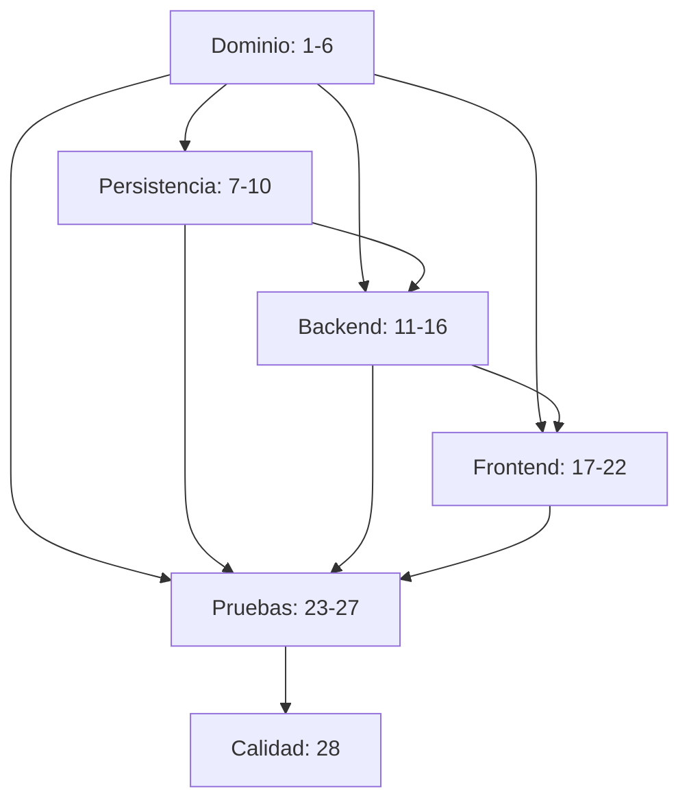

# Implementation Plan: Zonas restringidas (001-restricted-zones)

**Fase MADA:** CONSTRUIR
**HU cubiertas:** HU-02 del backlog del prototipo; el plano («HU-01» en esta spec) es soporte de
HU-02/HU-03 **[RC-01]**
**Estado:** Tareas 1–27 implementadas (28 parcial); spec aprobada en lo implementado (2026-11-23);
refuerzo RC-01 (incluidas la rev2 a la rev6) pendiente de aprobación humana **[RC-01 rev2]** **[RC-01 rev3]** **[RC-01 rev4]** **[RC-01 rev5]** **[RC-01 rev6]**
(requiere `requirements.md` y `design.md` aprobados, incluido RC-01)

## Overview

Plan de implementación de las HU-01 y HU-02. Las tareas van de dominio → persistencia →
backend → frontend → pruebas, con TDD en la geometría. Cada tarea referencia su criterio de
aceptación o requisito del `requirements.md`.

## Tasks

- [x] 1. Definir tipos del dominio `Zone`, `ZoneInput`, `Point`, `Segment`, `AABB` en `@home-guardian/domain`
  - _Requisitos: RF-02, DD-004_
- [x] 2. Definir constantes `FLOOR_WIDTH=1000`, `FLOOR_HEIGHT=800` y leer `ROBOT_RADIUS` y `SAFETY_MARGIN` de variables de entorno con default `0`; derivar `COLLISION_PAD = r + m`
  - _Requisitos: Modelo geométrico, DD-008_
- [x] 3. (TDD, prueba roja primero) Implementar `expandZone` y `pointInAABB` con borde inclusivo
  - _Requisitos: DD-001, DD-003_
- [x] 4. (TDD) Implementar `segmentIntersectsAABB` (Liang-Barsky) con manejo de segmento degenerado (origen==destino)
  - _Requisitos: DD-002, B4, B9_
- [x] 5. Implementar `isCollision(zone, segment, pad?)` que devuelve `{ collides, type }` con `type ∈ {ORIGIN_IN_RESTRICTED_ZONE, RESTRICTED_ZONE_VIOLATION, TRAJECTORY_CROSSES_ZONE} | null`; `pad` opcional (default `COLLISION_PAD`) para fijar `r+m` sin depender del entorno
  - _Requisitos: Modelo geométrico (4 reglas), DD-009_
- [x] 6. Definir esquemas Zod `createZoneSchema`, `updateZoneSchema`, `listZoneQuerySchema` y exportar todo desde `index.ts`
  - _Requisitos: RNF-01, DD-007_
- [x] 7. Crear `db/connection.ts` (instancia única `better-sqlite3`)
  - _Requisitos: RF-04.1, DD-005_
- [x] 8. Crear `migrations/001_create_zones.sql` (tabla `zones` con `name UNIQUE`)
  - _Requisitos: RF-04.2, DD-006_
- [x] 9. Crear `db/migrate.ts`: tabla `schema_migrations`, aplica pendientes en transacción, orden lexicográfico
  - _Requisitos: RF-04.2_
- [x] 10. Implementar `zoneRepository` (`create`, `findById`, `findAll(filter)`, `update`, `delete`, `existsByName`) con mapeo `0|1`↔`boolean`
  - _Requisitos: RF-02.5, RF-04.1_
- [x] 11. Crear `AppError` y fábricas (`ZONE_NOT_FOUND`, `ZONE_NAME_DUPLICATE`, `INVALID_ZONE_DIMENSIONS`, `ZONE_OUT_OF_BOUNDS`)
  - _Requisitos: Catálogo de errores_
- [x] 12. Crear `middlewares/validate.ts` (Zod → 422) y `middlewares/errorHandler.ts` (AppError → `{code,message}`, 500 sin stack trace)
  - _Requisitos: RNF-04, RNF-05_
- [x] 13. Implementar `zoneService` con inyección del repositorio: `assertDimensions`, `assertWithinFloor`, unicidad de nombre y CRUD
  - _Requisitos: RF-03, CA-02.2, CA-02.3, CA-02.4, DD-007_
- [x] 14. Implementar `zoneController` (solo recibe/responde, delega al servicio)
  - _Requisitos: SOLID-S_
- [x] 15. Crear `routes/zoneRoutes.ts` (`POST/GET/GET:id/PUT/DELETE /api/zones`) y montar en `app.ts`
  - _Requisitos: Contrato de API_
- [x] 16. Cablear filtro `active` (por defecto activas, `all`, `false`)
  - _Requisitos: RF-02.5, CA-02.8_
- [x] 17. Crear `api/client.ts` + `zonesApi` (list/get/create/update/remove)
  - _Requisitos: Convención frontend_
- [x] 18. Crear `hooks/useZones.ts` con estados de carga/error por operación
  - _Requisitos: RNF frontend_
- [x] 19. Crear `components/FloorPlan.tsx`: plano a escala `1000×800`, cuadrícula, origen arriba-izquierda, solo zonas activas destacadas
  - _Requisitos: CA-01.1, CA-01.2, RF-01_
- [x] 20. Crear `components/ZoneForm.tsx` (alta/edición con validación visual)
  - _Requisitos: RF-02.1, RF-02.2_
- [x] 21. Crear `components/ZoneList.tsx` (listar, activar/desactivar, eliminar)
  - _Requisitos: RF-02.3, RF-02.4, CA-02.6, CA-02.7_
- [x] 22. Integrar `pages/RoomsPage.tsx` (plano + formulario + lista) y refrescar el plano tras cada mutación
  - _Requisitos: RF-01.4_
- [x] 23. Pruebas unit de geometría: B1–B9 sobre Z1=(100,100,200,150) **fijando `pad=30` (r=20, m=10) explícitamente**, verificando `collides` y el `type` correcto; más `expandZone`/`pointInAABB`
  - _Requisitos: Escenarios de borde, DD-008, DD-009_
- [x] 24. Pruebas unit del servicio: 422 dimensiones, 422 fuera de plano, 409 duplicado, filtro active
  - _Requisitos: CA-02.2, CA-02.3, CA-02.4, CA-02.8_
- [x] 25. Pruebas de integración (Supertest): POST 201/409/422, GET lista+filtro, GET:id 200/404, PUT 200/404/409/422, DELETE 204/404
  - _Requisitos: Contrato de API_
- [x] 26. Pruebas de componentes (RTL): ZoneForm validación, ZoneList activar/eliminar
  - _Requisitos: CA-02.5, CA-02.6, CA-02.7_
- [x] 27. Prueba E2E (Playwright): plano con cuadrícula + crear zona + verla destacada
  - _Requisitos: HU-01, HU-02_
- [ ] 28. Calidad: ESLint + Prettier sin errores, cero `any`, sin secretos (`git grep -i password`), `.env` en `.gitignore`, pipeline CI verde
  - _Requisitos: RNF-02, Compuerta de oro_
  - _Avance: verificado en local (lint, formato, sin `any`, sin secretos, `.env` ignorado, `npm audit` sin vulnerabilidades). Falta: ejecución verde de `.github/workflows/ci.yml` en GitHub._

## Task Dependency Graph



```json
{
  "waves": [
    { "id": 0, "tasks": ["1", "2", "3", "4", "5", "6"] },
    { "id": 1, "tasks": ["7", "8", "9", "10"] },
    { "id": 2, "tasks": ["11", "12", "13", "14", "15", "16"] },
    { "id": 3, "tasks": ["17", "18", "19", "20", "21", "22"] },
    { "id": 4, "tasks": ["23", "24", "25", "26", "27"] },
    { "id": 5, "tasks": ["28"] }
  ]
}
```

## Notes

- TDD obligatorio en la geometría (tareas 3 y 4): prueba roja antes de implementar.
- Consultas SQL siempre parametrizadas; base `:memory:` en pruebas.
- No implementar HU-06 a HU-10; esta spec es línea base.
- Referencia visual: `prototipo/Guardian_Hogar_Artifact_V2.html`. La base nueva se siembra con
  sus 5 habitaciones (`db/seed.ts`). Zona activa = habitación restringida (borde rojo
  discontinuo); zona inactiva = área permitida (verde claro). Tareas afectadas: 19–22, 26, 27.
  Pendiente de decisión humana: el prototipo usa un plano de 595×430 sin cuadrícula; se mantiene
  1000×800 con cuadrícula según CA-01.1 y RF-03.3.
- Compuerta Fase 3 (CONSTRUIR): todas las tareas completas, cada CA con al menos una prueba,
  y revisión del humano antes de pasar a VERIFICAR.

### Trazabilidad CA → tarea
| CA | Tareas |
|----|--------|
| CA-01.1 / CA-01.2 | 19, 27 |
| CA-02.1 | 10, 13, 15, 25 |
| CA-02.2 | 13, 24, 25 |
| CA-02.3 | 13, 24 |
| CA-02.4 | 13, 24 |
| CA-02.5 | 13, 20, 26 |
| CA-02.6 | 16, 21, 26 |
| CA-02.7 | 14, 21, 25, 26 |
| CA-02.8 | 16, 24 |
| B1-B9 | 3, 4, 5, 23 |

---

## Refuerzo RC-01 — tareas de convergencia

> Propuesto el 2026-11-22. **No se implementa hasta que el humano apruebe RC-01** (art. XII).
> Las tareas 1–28 anteriores no cambian. TDD: cada bloque empieza por su prueba roja, que debe
> verse fallar antes de implementar (art. V); la evidencia (salida real de la prueba) se adjunta.
> Contrato común con las specs 002 y 003: decisiones D4 (uso de `rule` en incidentes) y D6.
>
> **[RC-01 rev2] Unidades de integración.** Cada tarea lleva `[U1]` o `[U2]` (plan único del
> contrato rev2). Nada intermedio se integra en `integration`/`develop`; dentro de la rama de
> trabajo cada tarea termina en verde.
> - **U1, paso 1 (dominio aditivo):** RC-1 y RC-2 (`RULES` + `ruleForDecision`, única definición).
>   Debe estar antes de que la 002 rellene `incidents.rule` (U1, paso 3).
> - **U2:** registro de cambios de zona (`013_create_zone_change_log.sql`), tarjeta de reglas,
>   E2E y calidad (RC-3 a RC-16).

- [x] RC-1. `[U1 · paso 1]` **[RC-01 rev5] [par con RC-2]** (Prueba roja primero) Pruebas del catálogo de reglas: `RULES` contiene exactamente `R-ZONA-01`, `R-SIGNAL-01` y `R-DATA-01`; cada código de denegación de `DecisionCode` aparece en exactamente una regla; `ruleForDecision` devuelve la regla correcta y `null` para `AUTHORIZED`, `SAFE_STOP_ACTIVE` y `BUSY`; **[RC-01 rev2]** `ruleForDecision('POSITION_QUALITY_LOST')` devuelve `R-SIGNAL-01` (Q-B)
  - _Requisitos: RF-06.1, RF-06.2, CA-02.13, Property 8_
- [x] RC-2. `[U1 · paso 1]` **[RC-01 rev5] [par con RC-1]** Implementar `domain/src/rules/catalog.ts` (`RuleId`, `Rule`, `RULES`, `ruleForDecision`) y exportarlo desde `index.ts`
  - _Requisitos: RF-06.1, RF-06.2, DD-014_
  - **Dependencia entre specs:** debe estar integrada **antes** de la tarea de la spec 002 que añade `rule` a `incidents` (RC-01, D4).
  - **[RC-01 rev2] (I-5)** Única definición del sistema; la spec 002 la importa y no implementa otra.
- [ ] RC-3. `[U2]` (Prueba roja primero) Pruebas de `classifyZoneUpdate`: solo `active` false→true = `ACTIVATE`; true→false = `DEACTIVATE`; otro campo (con o sin `active`) = `UPDATE`; sin cambios = `null`
  - _Requisitos: RF-05.3, DD-013_
- [ ] RC-4. `[U2]` Implementar `domain/src/models/zoneChange.ts` (`ZoneChangeAction`, `ZoneChange`, `classifyZoneUpdate`) y exportarlo
  - _Requisitos: RF-05.1, RF-05.3_
- [ ] RC-5. `[U2]` (Prueba roja primero) Prueba de migración: la tabla `zone_change_log` existe con sus `CHECK` (acción válida, `before` nulo en `CREATE`, `after` nulo en `DELETE`) y los triggers rechazan `UPDATE` y `DELETE`; actualizar la lista de migraciones esperadas en `migrate.test.ts`
  - _Requisitos: RF-05.5, CA-02.11, RNF-06_
- [ ] RC-6. `[U2]` Crear `migrations/013_create_zone_change_log.sql` (numeración fijada en la unificación RC-01: 007 y 012 son de la spec 003; 008–011, de la 002; **[RC-01 rev2]** 013 se entrega en U2, después de 007–012); sin filas retroactivas para las zonas existentes ni para la siembra
  - _Requisitos: RF-05.4, RF-05.5, DD-010, DD-012_
- [ ] RC-7. `[U2]` (Prueba roja primero) Implementar `repositories/zoneChangeLogRepository.ts` (`append`, `listAll` ordenado por `id DESC`) con SQL parametrizado y mapeo JSON ↔ `Zone`
  - _Requisitos: RF-05.1, RF-05.6_
- [ ] RC-8. `[U2]` (Prueba roja primero) Pruebas del servicio: una fila por `create`/`update`/`activate`/`deactivate`/`remove` con `before`/`after` correctos; sin fila en 404, 409, 422 y en un `PUT` sin cambios; atomicidad (si `append` falla, la zona no cambia)
  - _Requisitos: RF-05.1–RF-05.4, CA-02.9, CA-02.10, Property 7_
- [ ] RC-9. `[U2]` Refactorizar `createZoneService` para recibir `{ zones, changes, runInTransaction }` (transacción `IMMEDIATE`) y registrar cada cambio; actualizar su construcción en `app.ts`, `seed.ts` (la siembra sigue usando el repositorio directamente y no genera filas) y en las pruebas existentes (`zoneService.test.ts`, `zones.api.test.ts`) sin cambiar su comportamiento
  - _Requisitos: RF-05.2, DD-011_
- [ ] RC-10. `[U2]` (Prueba roja primero) Prueba de integración (Supertest): la secuencia de CA-02.9 devuelve las 5 filas en orden; `GET /api/zones/changes` no se interpreta como `/:id`; un 409/422 no añade filas
  - _Requisitos: RF-05.6, CA-02.9, CA-02.10_
- [ ] RC-11. `[U2]` Añadir `listChanges` al servicio y al `zoneController`, y la ruta `GET /api/zones/changes` registrada antes de `/:id`
  - _Requisitos: RF-05.6, Contrato de API_
- [ ] RC-12. `[U2]` (Prueba roja primero) Prueba RTL de `RulesCatalog`: muestra las tres reglas con id, título, descripción y HU, y la tarjeta «Fuera del MVP»; no hace llamadas HTTP
  - _Requisitos: RF-06.3, CA-02.12_
- [ ] RC-13. `[U2]` Crear `components/RulesCatalog.tsx` con el estilo del prototipo (`.rulecard`, `.rule-id`) e integrarlo en la columna lateral de `RoomsPage`
  - _Requisitos: RF-06.3, CA-02.12_
- [ ] RC-14. `[U2]` E2E (Playwright): en «Zonas y reglas» se ve la tarjeta «Catálogo de reglas» con `R-ZONA-01`; tras restringir y permitir «Pasillo», `GET /api/zones/changes` contiene `DEACTIVATE`/`ACTIVATE` de esa zona (el E2E deja el estado como lo encontró)
  - _Requisitos: CA-02.9, CA-02.12_
  - **[RC-01 rev7]** (alineación 001↔003) El E2E abre la vista de zonas con `page.goto('/#/zonas')`, no con `goto('/')`: la ruta por defecto es `#/supervision` y la dueña de la navegación es la spec 003 (R10, CA-03.37, RC-19). Va en `rooms.spec.ts`, que la 003 RC-19 ya adaptó a esa ruta.
- [ ] RC-15. `[U2]` Calidad: lint, typecheck y Prettier del repo sin errores, cero `any`; documentar en Notes las decisiones Q-A/Q-C que tome el humano
  - _Requisitos: RNF-02, RNF-06_
- [ ] RC-16. `[U2]` **[RC-01 rev2]** (Prueba roja primero) En `migrate.test.ts`: con 001–012 aplicadas, `migrate` aplica `013_create_zone_change_log.sql` después de 007–012; y si una base ya tiene aplicada `013` y aparece pendiente una migración con número menor, el arranque falla con error claro (endurecimiento Q-G de `migrate.ts`, implementado en la spec 002)
  - _Requisitos: RF-05.5, RA-02, Q-G_
  - **Dependencia entre specs:** requiere el endurecimiento de `migrate.ts` de la spec 002 (U1); si aún no está, la segunda aserción queda en rojo hasta entonces dentro de la rama de U2.

### Grafo de dependencias RC-01

```mermaid
graph TD
  R0[Pruebas rojas de dominio: RC-1, RC-3] --> R1[Dominio: RC-2, RC-4]
  R1 --> R2[Persistencia: RC-5, RC-6, RC-7]
  R2 --> R3[Servicio: RC-8, RC-9]
  R3 --> R4[API y UI: RC-10, RC-11, RC-12, RC-13]
  R4 --> R5[E2E y calidad: RC-14, RC-15, RC-16]
  R1 -. RULES antes de incidents.rule .-> S002[Spec 002: tarea RC-01 de incidentes]
```

> **[RC-01 rev3] (N-5)** El orden real de ejecución de U1 entre las tres specs lo fija la tabla
> única **«Orden intercalado de U1»** publicada en `002-safety-guardian/tasks.md`; este grafo es
> local a la 001 y se subordina a ella. RC-1/RC-2 van en U1 paso 1, junto a la tarea de la 002
> que define `IncidentCode` (N-8). RC-3..RC-16 van en U2.

```json
{
  "rc01_waves": [
    { "id": "RC-W0", "tasks": ["RC-1", "RC-3"] },
    { "id": "RC-W1", "tasks": ["RC-2", "RC-4"] },
    { "id": "RC-W2", "tasks": ["RC-5", "RC-6", "RC-7"] },
    { "id": "RC-W3", "tasks": ["RC-8", "RC-9"] },
    { "id": "RC-W4", "tasks": ["RC-10", "RC-11", "RC-12", "RC-13"] },
    { "id": "RC-W5", "tasks": ["RC-14", "RC-15", "RC-16"] }
  ]
}
```

### Trazabilidad RC-01 → tarea
| Requisito / CA | Tareas |
|----------------|--------|
| RF-05.1–RF-05.4 | RC-3, RC-4, RC-6, RC-7, RC-8, RC-9 |
| RF-05.5 / CA-02.11 | RC-5, RC-6 |
| RF-05.6 | RC-7, RC-10, RC-11 |
| CA-02.9 / CA-02.10 / Property 7 | RC-8, RC-10, RC-14 |
| RF-06.1 / RF-06.2 / CA-02.13 / Property 8 | RC-1, RC-2 |
| RF-06.3 / CA-02.12 | RC-12, RC-13, RC-14 |
| RNF-06 | RC-5, RC-9, RC-15 |
| RA-02 / Q-G (orden de migraciones) | RC-16 |

### Notas RC-01
- La siembra (`db/seed.ts`) escribe con el repositorio, no con el servicio: no genera filas de
  historial. Es coherente con «sin registros retroactivos» (art. XV).
- Las preguntas Q-A (autenticación) y Q-C (aprobación formal) están en `requirements.md` §11; si el
  humano decide implementar Q-A, se planifica como tareas aparte tras su diseño.
- **[RC-01 rev2]** Q-A decidida: deuda documentada (riesgo RA-01 en `requirements.md` §11b). Q-C
  decidida: spec aprobada en lo implementado. M-1 decidida: `r = m = 0` por defecto.
- **[RC-01 rev2] Unidades:** U1 = RC-1, RC-2. U2 = RC-3 a RC-16.

> **[RC-01 rev5]** Unidad de «verde»: el par «prueba roja → implementación». RC-1 y RC-2 se ejecutan
> seguidas y ocupan **una sola fila** de la tabla «Orden intercalado de U1» (002 tasks.md); la suite debe
> quedar en verde al terminar RC-2, no entre RC-1 y RC-2.

> **[RC-01 rev6]** La tabla «Orden intercalado de U1» (002 tasks.md) tiene ahora 24 filas; el par
> (RC-1 + RC-2) de esta spec es la **fila 2** (N5-3 eliminó la de 002 RC-17). Sin otros cambios.
