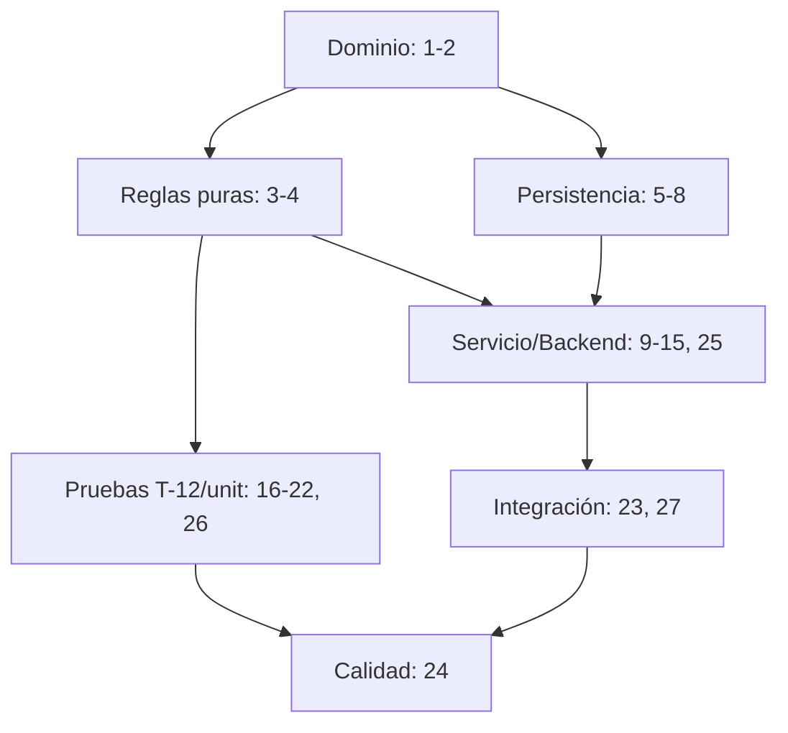
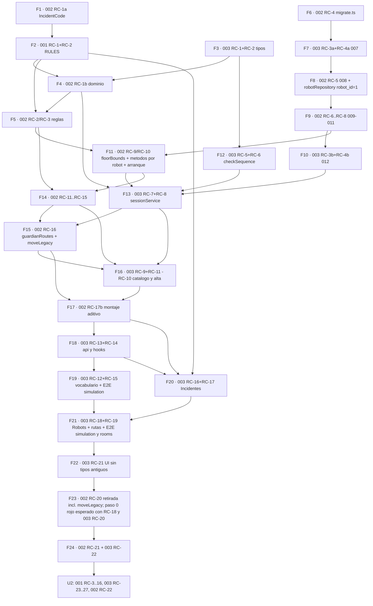

# Implementation Plan: Vigilante de seguridad (002-safety-guardian)

**Fase MADA:** CONSTRUIR
**HU cubiertas:** HU-04, HU-05
**Estado:** Tareas 1–27 implementadas (773823a) y aprobadas (2026-11-23); refuerzo RC-01 (rev2 + rev3 +
rev4 + rev5) pendiente de aprobación humana

## Overview

Plan de implementación del vigilante (HU-04, HU-05). Orden: dominio → reglas puras (TDD) →
persistencia → servicio/backend → reinicio seguro → pruebas (T-12) → calidad. La geometría se
reutiliza de la spec 001; la UI la cubre la spec 003.

## Tasks

- [x] 1. Añadir al dominio `RobotStateName`, `PositionQuality`, `DecisionCode`, `GuardianInput`, `GuardianDecision`, `PositionReading` en `@home-guardian/domain`
  - _Requisitos: 1, 2, 7.1_
- [x] 2. Añadir esquemas Zod `moveSchema` (destino) y `positionSchema` (lectura de posición) y exportarlos desde `index.ts`
  - _Requisitos: 7.1, 8.1_
- [x] 3. (TDD, prueba roja primero) Implementar `rules/stateMachine.ts` con la tabla de transiciones, `completeMove` (MOVING → IDLE) y las prohibiciones P-1 (SAFE_STOP y DEGRADED → MOVING) y P-2 (datos no confiables → MOVING)
  - _Requisitos: 1.5, 3.4, 3.5_
- [x] 4. (TDD) Implementar `rules/guardian.ts` `evaluateMovement` con el orden estricto estado → UNRELIABLE → MISSING → repo caído → origen → destino → trayectoria → AUTHORIZED, reutilizando `isCollision` (spec 001)
  - _Requisitos: 1.1, 1.2, 1.3, 1.4, 1.5, 1.6, 2.1, 2.2, 2.3, 2.4, 2.5, 7.3_
- [x] 5. Crear migraciones `create_incidents.sql` (append-only con `zones_snapshot`) y `create_audit_log.sql` (append-only para rechazos por estado)
  - _Requisitos: 5.1, 5.3, 5.4_
- [x] 6. Crear migración `add_position_quality.sql` (`ALTER TABLE robot_state ADD position_quality`) y sembrar el robot con estado `IDLE`, posición válida y `position_quality='RELIABLE'`
  - _Requisitos: 6.1, 6.3_
- [x] 7. Implementar `incidentRepository` (solo inserción y listado)
  - _Requisitos: 5.2, 5.4_
- [x] 8. Extender `robotRepository` para leer/actualizar estado, posición y `positionQuality`
  - _Requisitos: 2.1, 3.1, 4.1_
- [x] 9. Implementar `guardianService`: leer snapshot, cargar zonas (fallo → null), invocar `evaluateMovement`, aplicar transición; en AUTHORIZED actualizar posición al destino y completar `MOVING → IDLE` (persistir IDLE); registrar evaluación con snapshot de zonas
  - _Requisitos: 1.5, 2.4, 3.1, 3.2, 5.1_
- [x] 10. En `guardianService`, crear incidente solo en denegación que para; en rechazo por estado (`SAFE_STOP_ACTIVE`/`BUSY`) no crear incidente pero registrar el rechazo en el log de auditoría
  - _Requisitos: 5.2, 5.3_
- [x] 11. Implementar recuperación (`recover`): exigir estado en parada, posición segura y `positionQuality=RELIABLE` → RECOVERING → IDLE; si no, rechazar sin efectos
  - _Requisitos: 4.1, 4.2, 4.3_
- [x] 12. Implementar `db/bootstrap.ts` (reinicio seguro ADR-10): arrancar con `positionQuality=RELIABLE` y estado `IDLE` (seed), degradar `MOVING` persistido → `SAFE_STOP`, y pasar a `MISSING`/`UNRELIABLE` solo ante señal de pérdida explícita
  - _Requisitos: 6.1, 6.2, 6.3, 6.4_
- [x] 13. Implementar `robotController` (state, move, recover, position) mapeando decisión → HTTP (200 AUTHORIZED/DENIED, 409 REJECTED, 422 payload)
  - _Requisitos: 1.5, 3.3, 7.2, 8.2_
- [x] 14. Implementar `incidentController` y `GET /api/incidents`
  - _Requisitos: 5.1_
- [x] 15. Crear `routes/robotRoutes.ts` (`/api/robot/state|move|recover|position`) y `routes/incidentRoutes.ts` (`/api/incidents`); montar en `app.ts` y ejecutar bootstrap al arrancar
  - _Requisitos: Contrato de API, 6.1, 8.1_
- [x] 16. Pruebas T-12 grupo A (9): destino dentro/fuera/borde → RESTRICTED_ZONE_VIOLATION / AUTHORIZED
  - _Requisitos: 1.3, 7.4_
- [x] 17. Pruebas T-12 grupo B (5): trayectoria cruza/tangente/no cruza → TRAJECTORY_CROSSES_ZONE / AUTHORIZED
  - _Requisitos: 1.4, 7.4_
- [x] 18. Pruebas T-12 grupo C (3): sin zonas activas → siempre AUTHORIZED
  - _Requisitos: 1.5, 7.4_
- [x] 19. Pruebas T-12 grupo D (5): radio `r=10`; y grupo E (3): margen `m=5`
  - _Requisitos: 1.1, 7.4_
- [x] 20. Pruebas T-12 grupo F (2): `UNRELIABLE` → INSUFFICIENT_DATA, `MISSING` → MISSING_POSITION; y grupo G (1): repositorio caído → ZONE_DATA_UNAVAILABLE
  - _Requisitos: 2.2, 2.3, 2.4, 7.4_
- [x] 21. Pruebas unit de transiciones prohibidas (P-1 SAFE_STOP→MOVING; P-2 datos no confiables→MOVING) y origen en zona → ORIGIN_IN_RESTRICTED_ZONE
  - _Requisitos: 1.2, 3.4, 3.5_
- [x] 22. Pruebas unit del servicio: registro siempre, incidente solo en denegación, rechazo sin incidente, recover válido/ inválido, bootstrap ADR-10
  - _Requisitos: 4.1, 4.2, 5.2, 5.3, 6.1, 6.2_
- [x] 23. Pruebas de integración (Supertest): `/api/robot/state|move|recover` (200/409/422) y `/api/incidents` (append-only)
  - _Requisitos: Contrato de API, 3.3, 5.1_
- [x] 24. Calidad: ESLint + Prettier sin errores, cero `any`, sin secretos, T-12 verde sin frontend ni BD real, pipeline CI verde
  - _Requisitos: 7.2, 7.3, 7.4_

- [x] 25. Implementar el aporte de lectura de posición: `POST /api/robot/position` (valida `positionSchema`; fija posición y `positionQuality`), en controller/service/ruta
  - _Requisitos: 8.1, 8.2, 8.4_
- [x] 26. Prueba unit de vivacidad: dos movimientos válidos consecutivos ambos `AUTHORIZED` (sin `BUSY`), vía `completeMove`
  - _Requisitos: 1.5_
- [x] 27. Prueba de integración: tras una señal de pérdida explícita (`positionQuality=MISSING`), `POST /position` con `RELIABLE` habilita un `move` `AUTHORIZED` a destino libre
  - _Requisitos: 8.1, 8.3_

## Task Dependency Graph



```json
{
  "waves": [
    { "id": 0, "tasks": ["1", "2"] },
    { "id": 1, "tasks": ["3", "4"] },
    { "id": 2, "tasks": ["5", "6", "7", "8"] },
    { "id": 3, "tasks": ["9", "10", "11", "12", "13", "14", "15", "25"] },
    { "id": 4, "tasks": ["16", "17", "18", "19", "20", "21", "22", "26"] },
    { "id": 5, "tasks": ["23", "27"] },
    { "id": 6, "tasks": ["24"] }
  ]
}
```

## Notes

- TDD obligatorio en las reglas puras (tareas 3 y 4): prueba roja antes de implementar.
- `evaluateMovement` reutiliza `isCollision` de la spec 001; no recalcular geometría.
- `incidents` es append-only (sin UPDATE/DELETE); incluye snapshot de zonas por decisión.
- T-12 (28 escenarios) debe correr con dobles de repositorio, sin frontend ni BD real.
- La UI del vigilante la cubre la spec `003-movement-simulation`.
- Compuerta Fase 3 (CONSTRUIR): todas las tareas completas, cada criterio con al menos una
  prueba, revisión del humano antes de pasar a VERIFICAR.

### Trazabilidad requisito → tarea (resumen)
| Requisito | Tareas |
|-----------|--------|
| R1 (geometría/vivacidad) | 3, 4, 9, 16, 17, 18, 19, 21, 26 |
| R2 (orden/datos) | 4, 20 |
| R3 (parada/prohibidas) | 3, 9, 13, 21 |
| R4 (recuperación) | 11, 22 |
| R5 (incidentes) | 7, 9, 10, 14, 23 |
| R6 (reinicio seguro/seed) | 6, 12, 22 |
| R8 (lectura de posición) | 2, 25, 27 |
| R7 (RNF/T-12) | 2, 4, 13, 16-20, 24 |

---

## Refuerzo RC-01 — tareas de convergencia [RC-01 rev2] [RC-01 rev3] [RC-01 rev4] [RC-01 rev5] [RC-01 rev6]

Delta sobre lo implementado en 773823a (ver `requirements.md` §13 y `design.md` [RC-01]/[RC-01 rev2]/
[RC-01 rev3]). Las tareas 1–27 se conservan tal cual.

> **Sustituye al plan RC-01 inicial** (bloques A–D de 5da075e, nunca ejecutado): tenía dependencias
> cíclicas entre specs (B-1), una doble migración de la UI sin tarea en la 003 (B-2) e integraciones
> intermedias con dos vigilantes (I-1). El plan inicial puede consultarse en el historial de git.
>
> **[RC-01 rev3]** Ajustes de la ronda final del analista (d84eb08): orden intercalado único de U1
> (N-5), RC-1 partida en RC-1a/RC-1b, `checkStartPosition` (N-2), `acceptRequest` (N-4), convivencia
> tras la 008 (N-6), `denialRule` eliminado (N-9), RC-19 integrada en RC-20 (N-14) y A1 siempre en
> (120, 90) (Q-I). Las tareas cambiadas llevan la marca **[rev3]**.
>
> **[RC-01 rev4]** Pasada del analista sobre la rev3 local: montaje aditivo de `/api/robots` en
> la nueva RC-17b y RC-20 solo como retirada (decisión 2, I-2); 003 RC-21 antes de 002 RC-20 (I-1);
> RC-9/RC-10 antes de las sesiones de la 003 (I-3); `ROBOT_START_NOT_VERIFIABLE` (decisión 1);
> filas antiguas de `audit_log` con `robot_id` NULL y trigger (decisión 3, B-1). Las tareas
> cambiadas llevan la marca **[rev4]**.
>
> **[RC-01 rev5]** Pasada del analista sobre la rev4 local (N4-1..N4-4, M4-1..M4-5) y dos decisiones
> del humano (2026-11-23): **(1)** la unidad de "verde" es el **par "prueba roja → implementación"**
> (una fila de la tabla), no cada tarea suelta (N4-2); **(2)** vía temporal **`moveLegacy`** para el
> controller antiguo mientras conviven los dos vigilantes en la rama de trabajo (N4-4). Además: el E2E
> pasa al final de cada par desde el paso 4, con la adaptación mínima en 003 RC-15 y RC-19 (N4-1);
> RC-11 se limita a `SAFE_STOP_ACTIVE`/`BUSY` (M4-5); el `append` antiguo de `audit_log` escribe `x`/`y`
> (M4-4); y los restos de la rev3 sobre el montaje quedan tachados (M4-2). Las tareas cambiadas llevan
> la marca **[rev5]**.
>
> **[RC-01 rev6]** Pasada final del analista sobre la rev5 (N5-1..N5-7) y tres decisiones del humano
> (2026-11-23): **(1)** `#/supervision` se mantiene como ruta por defecto y los E2E existentes son
> **dos** archivos, `simulation.spec.ts` y `rooms.spec.ts` (003 RC-15 y RC-19 los adaptan; `data-testid`
> por robot `robot-<id>`) (N5-1); **(2)** la prueba de dos robots de RC-17 pasa a **RC-10** y **RC-17 se
> retira** (N5-3): la tabla queda en **24 filas**; **(3)** solo `robotController.test.ts`,
> `robot.api.test.ts` y una `moveLegacy.test.ts` dedicada pueden referenciar `moveLegacy`, y RC-20
> retira esa prueba y los handlers legacy de `controllers/robotController.ts` (N5-2). Además: la fila de
> Incidentes de la 003 declara su dependencia de `incidentsApi` (N5-4), «las 4 sentencias (6 métodos)»
> (N5-5) y los restos de la rev3/rev4/rev5 quedan marcados (N5-6). Las tareas cambiadas llevan la marca
> **[rev6]**.

**Reglas del plan**
- **Dos unidades de integración.** `[U1]` "vigilante único + incidentes + robots y sesiones" (prioridad
  del humano) y `[U2]` "supervisión completa y zonas". Nada intermedio se integra en
  `integration`/`develop`; dentro de la rama de trabajo cada **fila** de la tabla (par prueba roja → implementación, **[rev5]**) termina en verde: el código antiguo
  (`/api/simulation`, `/api/robot`, `get`/`save`) sigue funcionando hasta su tarea de retirada (RC-20),
  que va dentro de U1 (R10.6). **[rev4]** Desde RC-17b, `/api/robots` y el `/api/incidents` nuevo
  están montados en `app.ts` **junto** a los antiguos dentro de la rama de trabajo (decisión 2); esa
  convivencia nunca se integra porque U1 llega entera a `integration`/`develop`.
- **Pasos de U1** (orden obligatorio): 1 dominio aditivo → 2 migraciones → 3 backend probado con apps de
  prueba ~~**sin montar** en `app.ts`~~ **[rev5]** (M4-2) y, al final, **montaje aditivo** en `app.ts` (RC-17b) (la 003 lo parte en 3a sesiones y 3b catálogo) → 4 UI de la spec
  003 → 5 ~~montaje +~~ retirada + arquitectura + E2E *([rev5] M4-2: el montaje pasó a RC-17b, paso 3)*. **[rev3]** El orden fino entre las tres specs es el
  de la tabla "Orden intercalado de U1" (abajo); ninguna tarea depende de otra que vaya después en ella.
- **TDD:** cada tarea marcada "(prueba roja primero)" escribe la prueba, la **ve fallar** y conserva la
  salida como evidencia (art. XV) antes de implementar.
- **[rev5] Unidad de "verde" (decisión 1, N4-2):** el par "prueba roja → implementación" (en la 001 y la
  003 son dos tareas seguidas; en la 002 cada RC ya incluye las dos) se ejecuta junto y ocupa **una fila**
  de la tabla "Orden intercalado de U1". La suite está en verde **al terminar la fila**; entre las dos
  tareas del par el rojo es el esperado de TDD (art. V) y nunca cruza filas. El único rojo que cruza
  tareas es el "rojo esperado" declarado **dentro** de RC-20, paso (0). Ninguna tarea "prueba roja
  primero" va después de su implementación.
- **Rechazos auditados (B-5):** toda tarea que añade un 409 auditable incluye una prueba que lee
  `audit_log` después de la respuesta (Property 16).
- **Dependencias de otras specs** citadas por nombre: `[001-RULES]` (constante `RULES` y
  `ruleForDecision(code: IncidentCode)`, spec 001 RC-1/RC-2), `[003-types]` (`MoveCommand`,
  `moveCommandSchema`, `LastRequest`, `Robot`, spec 003 RC-1/RC-2), `[003-robots]`
  (`007_create_robots.sql`, spec 003 RC-3a/RC-4a; catálogo y alta, spec 003 paso 3b),
  `[003-sessions]` (`012_create_robot_sessions.sql`, spec 003 RC-3b/RC-4b; `checkSequence`,
  `sessionService.startSession` y **[rev3]** `sessionService.acceptRequest` **[rev4]** `(robotId, cmd, currentState)` y `sessionService.getLastRequest(robotId)`, spec 003 paso 3a),
  `[003-UI]` (UI contra `/api/robots/:robotId/*`, spec 003 paso 4).

### [U1] Paso 1 — Dominio (aditivo, build en verde)

- [ ] RC-1a. `[U1·1]` **[rev3]** Dominio: `IncidentCode = DecisionCode | 'POSITION_QUALITY_LOST'` (N-8). Va **antes** de `[001-RULES]`, que la usa en `ruleForDecision`
  - _Requisitos: R5.5, R5.11_
  - _Pruebas afectadas: ninguna existente (aditivo); nueva en `domain/tests/`._
- [ ] RC-1b. `[U1·1]` Dominio: `RobotId`, `TransitionCause` (con `MIGRATION_BASELINE`), `RecoveryRejectionCause`, `RecoverResponse`, `RobotStatus` (con `lastRequest: LastRequest | null` de `[003-types]`), `Incident`/`IncidentDetail` (con `zoneName` y `decisionCode: IncidentCode`), `ServiceResult<T>` **[rev3]** único para las tres specs (`{ kind: 'ok'; value } | { kind: 'rejected'; code; status: 409; cause?; message }`) y `RejectionCode` (**[rev4]** incluye `ROBOT_START_NOT_VERIFIABLE`); esquemas `robotIdParamSchema`, `incidentIdParamSchema`, `incidentListQuerySchema`; `zoneName` en `GuardianDecision` (**[rev4]** opcional, `zoneName?`, para que el paso siga siendo aditivo, M-5). Sin tocar los tipos de la spec 003 ni definir tipos de sesión
  - _Requisitos: R5.6, R5.7, R5.10, R9, R12.3_
  - _Requiere: `[001-RULES]` (para `RuleId`), `[003-types]`_
  - _Pruebas afectadas: ninguna existente (aditivo); nuevas en `domain/tests/`._
- [ ] RC-2. `[U1·1]` **[rev3]** (prueba roja primero) `canTransition` como lista blanca T1–T9 (T10 queda fuera: la escribe la migración) y el uso de `ruleForDecision` de `[001-RULES]` con estrechamiento de tipos a `IncidentCode` (6 códigos de denegación + `POSITION_QUALITY_LOST` → `R-SIGNAL-01`), **sin** helper propio (`denialRule` descartado, N-9); después implementarlo en `rules/`
  - _Requisitos: §2.2 (design T1–T10), R5.5, R5.11, R9_
  - _Pruebas afectadas: `backend/tests/unit/stateMachine.test.ts`, `prohibitedTransitions.test.ts` (pasan a lista blanca)._
- [ ] RC-3. `[U1·1]` **[rev3]** (prueba roja primero) Reglas puras `evaluateRecovery` (orden `UNRELIABLE_DATA` → `ZONE_DATA_UNAVAILABLE` → `UNSAFE_POSITION`, zonas inactivas ignoradas, pad r+m) y `evaluateStartPosition` (dentro de zona activa expandida → `ROBOT_START_IN_RESTRICTED_ZONE`; zonas no disponibles → rechazo **[rev4]** con razón `ZONE_DATA_UNAVAILABLE`, que el servicio traduce a `ROBOT_START_NOT_VERIFIABLE`; zonas inactivas ignoradas) (N-2); después extraer/implementar en `rules/guardian.ts`
  - _Requisitos: R4.4, R12.2_
  - _Pruebas afectadas: `guardianService.test.ts`, `guardianService.requirements.test.ts` (la validación de `recover` sale del servicio)._

### [U1] Paso 2 — Migraciones (orden de entrega = orden de aplicación)

- [ ] RC-4. `[U1·2]` (prueba roja primero) Endurecer `db/migrate.ts`: si una migración pendiente tiene número menor que la última aplicada, falla con un error claro y no aplica nada; después implementarlo
  - _Requisitos: R10.5 (esquema coherente), DD-227_
  - _Pruebas afectadas: `backend/tests/unit/migrate.test.ts`._
- [ ] RC-5. `[U1·2]` **[rev3]** (prueba roja primero) Migración `008_robot_state_per_robot.sql`: copia **siempre** la fila `id = 1` tal cual como A1 (en una base nueva está en (120, 90); Q-I, sin lógica de detección) y crea la de V2 en (488, 290), `IDLE`, `RELIABLE`; `position_quality` sin `DEFAULT` y con CHECK de sus 3 valores; CHECK de 5 estados; fechas ISO. En la misma tarea, **adaptar las 4 sentencias** (que dan servicio a 6 métodos; ~~seis sentencias~~ **[rev6]** N5-5) de `repositories/robotRepository.ts` (`WHERE id = 1` → `robot_id = 1`, A1) para que `get`/`save`/`getFull`/`saveFull`/`getPositionQuality`/`setPositionQuality` sigan funcionando hasta RC-20 (N-6). Después implementarlas
  - _Requisitos: R12.1, R12.5, R10.5_
  - _Requiere: `[003-robots]` (007 aplicada antes: spec 003 RC-3a/RC-4a)_
  - _Pruebas afectadas: `simulationRepositories.test.ts` (hoy exige una sola fila y rechaza `id=2`), `migrate.test.ts` (lista de tablas y `WHERE id = 1`), `guardianService.test.ts`, `guardianService.requirements.test.ts`, `bootstrap.test.ts`, `liveness.test.ts`, `robot.api.test.ts`, `robotPositionRecovery.api.test.ts`._
- [ ] RC-6. `[U1·2]` (prueba roja primero) Migración `009_incidents_robot_rule_zone.sql`: `robot_id`, `rule`, `zone_name` (NULL en filas antiguas, sin reescribirlas; sin CHECK sobre `decision_code`, N-15); después implementarla
  - _Requisitos: R5.5, R5.9_
  - _Pruebas afectadas: `incidentRepository.test.ts`._
- [ ] RC-7. `[U1·2]` (prueba roja primero) Migración `010_create_state_transition_log.sql`: tabla, CHECKs (incluido `MIGRATION_BASELINE`), triggers append-only y una fila base por robot existente (A1 y V2); `transitionLogRepository`; después implementarlas
  - _Requisitos: R9.1, R9.7, R9.8, R5.9_
- [ ] RC-8. `[U1·2]` **[rev4]** (prueba roja primero) Migración `011_audit_log_generalize.sql`: copia todas las filas antiguas **con `robot_id` NULL** sin modificarlas (B-1, decisión 3); `x`/`y` y `state` nullables, `detail`, CHECK de `event_code` (incluidos `SESSION_STARTED`, `ROBOT_START_IN_RESTRICTED_ZONE` y `ROBOT_START_NOT_VERIFIABLE`); **después de la copia**, trigger `BEFORE INSERT` que aborta si `robot_id` o `state` es NULL salvo en los dos rechazos de alta (sustituye a los CHECK condicionados de la rev3); triggers append-only recreados. Ampliar `auditLogRepository` (fechas ISO al leer) y hacer que el `append` antiguo pase `robot_id = 1` (A1) **[rev5]** (M4-4) y escriba en `x`/`y` (la 011 renombra `dest_x`/`dest_y`) hasta RC-20. Pruebas, sobre una base con filas de la 006: las filas antiguas se conservan intactas con `robot_id` NULL; un rechazo de alta sin robot ni estado se inserta; cualquier otro evento nuevo sin `robot_id`/`state` falla; los rechazos de `/api/robot/*` siguen auditándose, y **[rev5]** (M4-4) el `append` antiguo escribe en `x`/`y` (no en `dest_x`/`dest_y`) con `robot_id = 1`. Después implementarlas
  - _Requisitos: R5.8–R5.10, R8.7_
  - _Pruebas afectadas: `robotPositionRecovery.api.test.ts` (lee el audit), `robot.api.test.ts`, `guardianService.requirements.test.ts` (rechazos auditados del código antiguo)._
  - _Nota: `012_create_robot_sessions.sql` la entrega `[003-sessions]` justo después (spec 003 RC-3b/RC-4b)._

### [U1] Paso 3 — Backend por robot (probado con apps de prueba) ~~sin montar en `app.ts`~~ **[rev5]** (M4-2) y, al final, montaje aditivo (RC-17b)

> **[rev3]** Este paso se intercala con la spec 003: su paso 3a (sesiones) va **antes** de RC-16 y su
> paso 3b (catálogo y alta) **después** de RC-15 y RC-16. Ver "Orden intercalado de U1".
> **[rev4]** RC-9 y RC-10 van **antes** del paso 3a de la 003: `startSession` lee el estado con
> `robotRepository.getStatus` (I-3). El paso termina con RC-17b (montaje aditivo).

- [ ] RC-9. `[U1·3]` Trasladar `assertDestinationWithinFloor` de `services/movementService.ts` a `services/floorBounds.ts` sin cambiar su comportamiento (lo usará `guardianService`)
  - _Requisitos: R1.9, R10_
  - _Pruebas afectadas: `movementService.test.ts` (import)._
- [ ] RC-10. `[U1·3]` **[rev3]** (prueba roja primero) Helper `transition` + Property 11 por robot: filas exactas de `state_transition_log` para `move` autorizado (T1+T2 con `MOVING` persistido), denegado (T3/T4 con `incidentId`), `recover` (T6+T7 con snapshot), arranque (T8 sembrando `MOVING`) y la fila base; sin filas en rechazos. **[rev6]** (N5-3) Incluye la prueba de arranque seguro con **dos** robots, uno con `MOVING` sembrado → solo ese pasa a `SAFE_STOP` con T8 (era la prueba de RC-17, que se retira: aquí se ve fallar, porque aquí se implementa el arranque para todos los robots). Crear en `robotRepository` los métodos **por robot** `getStatus(robotId)`, `saveState(robotId, …)` y `saveQuality(robotId, …)` (N-6), sin retirar todavía los antiguos. Después implementarlo en `guardianService` y `db/bootstrap.ts` (todos los robots; también en `db/init.ts`). **[rev4]** (M-7) Mientras conviven, el controller antiguo de `/api/robot/*` invoca el servicio por robot con `robotId = 1` (A1) hasta RC-20 — **[rev5]** (decisión 2): hasta RC-16 con `move(1, destination)` (que aún no exige sesión) y desde RC-16 con `moveLegacy`
  - _Requisitos: R9.1–R9.8, R6.5, R4.6_
  - _Pruebas afectadas: `guardianService.test.ts`, `guardianService.requirements.test.ts`, `liveness.test.ts` (suponían `MOVING` no persistido), `bootstrap.test.ts`, `robotController.test.ts`, `robot.api.test.ts` (controller antiguo con `robotId = 1`)._
- [ ] RC-11. `[U1·3]` (prueba roja primero) `ServiceResult` y Property 16: para `SAFE_STOP_ACTIVE` y `BUSY`, la fila de `audit_log` existe tras el 409 y el estado no cambia (**[rev5]** M4-5: las aserciones de `RECOVERY_NOT_ALLOWED` y `POSITION_CONFLICT` pasan a RC-12 y RC-13, que son quienes las implementan); `AppError`/`errorHandler` con `cause` opcional. Después implementarlo
  - _Requisitos: R5.10, R7.2_ ~~R4.4, R8.5~~ **[rev6]** (N5-6: esas aserciones pasaron a RC-12 y RC-13 en la rev5)
  - _Pruebas afectadas: `robotController.test.ts`._
- [ ] RC-12. `[U1·3]` (prueba roja primero) Contrato de `recover`: `transitioned`, `409 RECOVERY_NOT_ALLOWED` + `cause`, `RECOVER_NOOP` en `IDLE`, **[rev5]** (M4-5) y, por Property 16, la fila de `audit_log` existe tras `409 RECOVERY_NOT_ALLOWED` con el estado sin cambios; después implementarlo
  - _Requisitos: R4.4, R4.5_
  - _Pruebas afectadas: `robotPositionRecovery.api.test.ts`, `robot.api.test.ts` (hoy esperan `{ recovered, reason }` y 409 en `IDLE`)._
- [ ] RC-13. `[U1·3]` (prueba roja primero) Lecturas de posición: `RELIABLE` coincidente → solo calidad; no coincidente → `409 POSITION_CONFLICT` auditado; `RELIABLE` fuera del plano → 422; pérdida aceptada aunque la posición venga fuera del plano; en `IDLE` T5 + incidente `R-SIGNAL-01` (`POSITION_QUALITY_LOST`, origen = destino = posición actual); en parada solo la calidad, sin incidente; **[rev5]** (M4-5) tras `409 POSITION_CONFLICT` la fila de `audit_log` existe y posición y calidad no cambian (Property 16); Property 13. Después implementar `setPosition`
  - _Requisitos: R3.6, R5.11, R8.5–R8.7_
  - _Pruebas afectadas: `robotPositionRecovery.api.test.ts` (prueba 27: relocalizaba), `guardianService.requirements.test.ts`._
- [ ] RC-14. `[U1·3]` (prueba roja primero) Incidentes: nuevos con `robot_id`, `rule`, `zone_name`; antiguos con `robotId: null` y `rule` derivada; `GET /api/incidents` del más reciente al más antiguo con `?robotId=` y `404 ROBOT_NOT_FOUND`; `GET /api/incidents/:id` con `zonesSnapshot` y `404 INCIDENT_NOT_FOUND`; fechas ISO; tipo de fila `IncidentRow`; `decisionCode: IncidentCode`. Después implementar repositorio, controller y rutas (app de prueba)
  - _Requisitos: R5.5–R5.7_
  - _Pruebas afectadas: `incidentRepository.test.ts`, `incidentController.test.ts` (orden ascendente actual)._
- [ ] RC-15. `[U1·3]` **[rev3]** (prueba roja primero) Alta de robot en el vigilante (N-2): `checkStartPosition(position)` devuelve `ok` fuera de zona activa y `rejected` (409 `ROBOT_START_IN_RESTRICTED_ZONE`) dentro, auditando con `robot_id`/`state` nulos, `x`/`y` = posición y `detail = { name, type }` (Property 16, N-3); **[rev4]** con las zonas no legibles devuelve `rejected` (409 `ROBOT_START_NOT_VERIFIABLE`, `cause: ZONE_DATA_UNAVAILABLE` en la respuesta y en el audit), también sin filas en `robots`/`robot_state` y con la auditoría confirmada (decisión 1); `initRobot(robotId, position): void` hace un `INSERT` simple y registra T9; con la fila existente o una posición insegura lanza excepción y la transacción se revierte. Después implementarlos. (El catálogo `[003-robots]` los invoca en su paso 3b: `checkStartPosition` antes del `INSERT` en `robots`, `initRobot` después.)
  - _Requisitos: R12.2, R9.5, R5.10_
  - _Pruebas afectadas: ninguna existente (nuevas en `guardianService*.test.ts`)._
- [ ] RC-16. `[U1·3]` **[rev3]** (prueba roja primero) API por robot en `routes/guardianRoutes.ts` (`mergeParams`): `/api/robots/:robotId/{state,move,recover,position}` (**[rev4]** `/sessions` la monta la spec 003 en `robotsRoutes`, M-2), `404 ROBOT_NOT_FOUND`, Property 15 (aislamiento), `lastRequest` en `state` (**[rev4]** vía `sessionService.getLastRequest(robotId)`, I-4); `move` con `MoveCommand` (`422 INVALID_MOVE_REQUEST`) y orden de validación R11.5, invocando **`sessionService.acceptRequest`** **[rev4]** `(robotId, cmd, currentState)` de `[003-sessions]` (no usa `sessionRepository` ni escribe `robot_sessions`, N-4); ~~`sessions` delega en `sessionService.startSession`~~ *(sustituido por rev4, M-2)*; `INVALID_SESSION`/`DUPLICATE_EVENT` auditados (Property 14, 16). Usa los métodos por robot de RC-10. **[rev5]** (decisión 2, N4-4) `guardianService` separa el núcleo de `move` en un paso común: `move(robotId, cmd)` exige sesión (invoca `acceptRequest`) y **`moveLegacy(robotId = 1, destination)`**, sin `acceptRequest`, lo usa **solo** el controller antiguo de `/api/robot/move`. Es un **desvío declarado de R11** (R11, nota), válido solo dentro de la rama de trabajo, que nunca se integra (U1 llega entera) y se retira en RC-20. **[rev6]** (N5-2) El «controller antiguo» no es un archivo aparte: `controllers/robotController.ts` sirve a las rutas antiguas y a las por robot; `moveLegacy` solo lo llama el handler legacy de `move` de `/api/robot/*`. Después implementarla, probándola con una app de prueba
  - _Requisitos: R1.8, R1.9, R11.1–R11.6, R12.3, R12.4, R5.8_
  - _Requiere: spec 003 paso 3a (`checkSequence`, `sessionService`)._
  - _Pruebas afectadas **[rev5]**: ~~`guardianService.test.ts`, `guardianService.requirements.test.ts` y `liveness.test.ts` … se adaptan a `MoveCommand` o llaman a `moveLegacy`~~ **[rev6]** (N5-2) **solo** `robot.api.test.ts`, `robotController.test.ts` (el controller antiguo pasa a `moveLegacy`; sus aserciones no cambian) y la prueba **nueva dedicada `moveLegacy.test.ts`** (evalúa con el mismo vigilante sin sesión; el `move` por robot sin sesión sigue dando `INVALID_SESSION`) pueden referenciar `moveLegacy`. `guardianService.test.ts`, `guardianService.requirements.test.ts` y `liveness.test.ts` (el `move` por robot ahora exige sesión) se adaptan **siempre a `MoveCommand`** y no llaman a `moveLegacy`, porque RC-20 no las retira. `bootstrap.test.ts` (sin cambios)._
- ~~RC-17. `[U1·3]` (prueba roja primero) Arranque seguro por robot: dos robots, uno con `MOVING` sembrado → solo ese pasa a `SAFE_STOP` con T8; después implementarlo~~ *([RC-01 rev6] N5-3: **retirada por rev6, su prueba pasa a RC-10**, donde se implementa el arranque para todos los robots y donde sí puede verse fallar. Sin casilla; el ID no se reutiliza.)*
  - ~~_Requisitos: R6.5_~~ *(lo cubre RC-10)*
  - ~~_Pruebas afectadas: `bootstrap.test.ts`._~~ *(lo cubre RC-10)*
- [ ] RC-17b. `[U1·3]` **[rev4]** (prueba roja primero) **Montaje aditivo** (decisión 2, I-2): montar en `app.ts`, dentro de la rama de trabajo, el catálogo `[003-robots]` (`robotsRoutes`, que incluye `/sessions`) en `/api/robots`, `guardianRoutes` debajo y sustituir en su sitio el `/api/incidents` por el contrato nuevo (misma ruta, vigente desde RC-14), **sin** retirar `/api/simulation/*` ni `/api/robot/*`. Pruebas: Supertest contra la app real (`createApp`) con las rutas nuevas respondiendo y las antiguas todavía operativas. Esta convivencia no se integra nunca (U1 se integra entera, R10.6)
  - _Requisitos: R10.6, R12.3, R5.6_
  - _Requiere: spec 003 paso 3b (catálogo y `robotsRoutes`)._
  - _Pruebas afectadas: `robot.wiring.test.ts` (montaje de `app.ts`), `incidentController.test.ts`._

### [U1] Paso 4 — UI de la spec 003

- (Sin tareas de esta spec.) `[003-UI]` migra la UI a `/api/robots/:robotId/*` en una sola vez (Q-F).

### [U1] Paso 5 — Retirada, arquitectura y E2E (una sola entrega) ~~Montaje, retirada, arquitectura y E2E~~ **[rev5]** (M4-2: el montaje es RC-17b, al final del paso 3)

- [ ] RC-18. `[U1·5]` **[rev4]** ("rojo esperado": se escribe y se ve fallar **al empezar RC-20**, dentro de la misma tarea, para que la suite no quede en rojo entre tareas) Prueba de arquitectura de la Property 12: imports de `src` (incluidos `import type`), literal `robot_state` en SQL solo en `repositories/robotRepository.ts`; y pruebas de integración `/api/simulation/*` y `/api/robot/*` → 404. **[rev3]** Coordinada con la prueba roja de la spec 003 RC-20 (una sola prueba de arquitectura; la de la 003 cubre la parte de la UI). **[rev5]** (decisión 2) Añade la aserción de que `moveLegacy` ya no existe en `guardianService` ni en el controller antiguo **[rev6]** (N5-2) y de que **ninguna prueba restante lo referencia** (escaneo estático de `tests/`; `moveLegacy.test.ts` ya se retiró)
  - _Requisitos: R10.2, R10.3, R10.5_
- [ ] ~~RC-19. `[U1·5]` Montar en `app.ts` el catálogo `[003-robots]` en `/api/robots` y `guardianRoutes` debajo; montar las rutas de incidentes nuevas~~ *(Sustituida por RC-01 rev3: integrada en RC-20, una sola tarea dueña del montaje y la retirada, N-14.)*
- [ ] RC-20. `[U1·5]` **[rev4]** **Tarea dueña de la retirada** (N-14; el montaje pasó a RC-17b, decisión 2), en un solo cambio: (0) escribir RC-18 y la prueba roja de la spec 003 RC-20 y verlas fallar; ~~(1) montar en `app.ts` el catálogo `[003-robots]` en `/api/robots`, `guardianRoutes` debajo y las rutas de incidentes nuevas~~ *(sustituido por rev4: lo hace RC-17b)*; (2) trasladar `pointSchema` de `domain/src/schemas/simulation.schema.ts` a `domain/src/schemas/point.schema.ts` (lo usa `moveCommandSchema`); (3) retirar `routes/simulationRoutes.ts`, `controllers/simulationController.ts`, `services/movementService.ts`, `rules/watchmanRule.ts`, `routes/robotRoutes.ts` (`/api/robot` singular), los métodos antiguos de `robotRepository` (`get`/`save`/`getFull`/`saveFull`/`getPositionQuality`/`setPositionQuality`) y el tipo `RobotSnapshot`, los tipos `Decision`/`MoveResult`, `simulation.schema.ts` y el alias `moveSchema = moveRequestSchema` de `domain/src/schemas/robot.schema.ts` (I-9) y, **[rev5]** (decisión 2), `guardianService.moveLegacy`, su prueba dedicada `moveLegacy.test.ts` y, **[rev6]** (N5-2), los **handlers legacy** de `controllers/robotController.ts` (ese archivo sirve a las rutas antiguas y a las por robot: tras RC-20 persiste solo con los handlers por robot). RC-18 y la prueba roja de la spec 003 RC-20 pasan a verde
  - _Requisitos: R10.1–R10.6, R12_
  - _Requiere: **[rev4]** spec 003 RC-21 (la UI ya no importa `Decision`/`MoveResult`/`RobotSnapshot` ni `simulation.schema.ts`, I-1)._
  - _Pruebas que se retiran: `watchmanRule.test.ts`, `movementService.test.ts`, `simulation.api.test.ts` y **[rev6]** `moveLegacy.test.ts`. Pruebas afectadas: `robot.wiring.test.ts`, `robot.api.test.ts`, `robotController.test.ts`, `domain/tests/robotSchema.test.ts`, `domain/tests/simulationSchema.test.ts`._
- [ ] RC-21. `[U1·5]` Integración Supertest de extremo a extremo: alta de robot → alta en zona activa (409 auditado sin robot) → sesión → move denegado (incidente con `rule` y `zoneName`) → misma secuencia (`DUPLICATE_EVENT`) → move rechazado `SAFE_STOP_ACTIVE` → recover `UNSAFE_POSITION` → desactivar la zona (spec 001) → recover OK → **[rev4]** alta con zonas no legibles (`ROBOT_START_NOT_VERIFIABLE` con `cause`, auditado, sin robot) → señal de pérdida (incidente `R-SIGNAL-01`, `DEGRADED`) → lectura `RELIABLE` coincidente → recover OK; comprobando las filas exactas de `state_transition_log`, `audit_log` e `incidents`
  - _Requisitos: R4, R5, R9, R11, R12_

### [U2] Supervisión completa y zonas

- [ ] RC-22. `[U2]` Calidad final: ESLint, typecheck, Prettier y pruebas en verde; cero `any`; T-12 sigue verde; sin dependencias de U2 en esta spec más allá de comprobar que el registro de cambios de zona de la spec 001 (`013`) no altera el vigilante
  - _Requisitos: R7_

### [RC-01 rev5] Orden intercalado de U1 (tabla única para las specs 001, 002 y 003)

**Unidad de "verde" [rev5] (decisión 1, N4-2).** Cada fila es un **par "prueba roja → implementación"** (o una
tarea de la 002, que ya incluye las dos cosas): sus tareas se ejecutan seguidas y **la suite termina en
verde al final de la fila**. Entre las dos tareas de un par el rojo es el esperado de TDD (art. V) y nunca
cruza filas. El único rojo que cruza tareas es el "rojo esperado" declarado **dentro** de 002 RC-20, paso
(0). Cada fila solo depende de filas anteriores. ~~El E2E existente (`simulation.spec.ts`) pasa al final de **cada** fila desde el paso 4 …~~ **[rev6]** (N5-1) Los **E2E existentes** son **dos**: `simulation.spec.ts` y `rooms.spec.ts`. Pasan al final de **cada** fila desde el paso 4: 003 RC-15 adapta `simulation.spec.ts` al vocabulario y fija un `data-testid` por robot (`robot-<id>`); 003 RC-19 lo adapta a las rutas y adapta `rooms.spec.ts` a `/#/zonas`; 003 RC-22 los **amplía**. Los grafos de las tres specs citan esta tabla. IDs: 001 =
`.kiro/specs/001-restricted-zones/tasks.md`, 002 = este archivo, 003 = `.kiro/specs/003-movement-simulation/tasks.md`.

| # | Paso | Spec · tarea(s) | Qué entrega | Depende de |
|---|------|-----------------|-------------|-----------|
| 1 | 1 | 002 · RC-1a | `IncidentCode` | — |
| 2 | 1 | 001 · (RC-1 + RC-2) | `RULES`, `RuleId`, `ruleForDecision(code: IncidentCode)` | 1 |
| 3 | 1 | 003 · (RC-1 + RC-2) | `Robot`, `RobotInput`, `MoveCommand`, `moveCommandSchema`, `LastRequest`, `SessionInfo` | — |
| 4 | 1 | 002 · RC-1b | `RobotStatus`, `Incident`, `ServiceResult`, `RejectionCode` (con `ROBOT_START_NOT_VERIFIABLE`), `zoneName?` | 2, 3 |
| 5 | 1 | 002 · RC-2, RC-3 | lista blanca T1–T9; `evaluateRecovery`, `evaluateStartPosition` | 2, 4 |
| 6 | 2 | 002 · RC-4 | `migrate.ts` endurecido | — |
| 7 | 2 | 003 · (RC-3a + RC-4a) | `007_create_robots.sql` + `robotCatalogRepository` | 6 |
| 8 | 2 | 002 · RC-5 | `008_robot_state_per_robot.sql` + `robotRepository` con `robot_id = 1` (las 4 sentencias, 6 métodos) | 7 |
| 9 | 2 | 002 · RC-6, RC-7, RC-8 | `009`, `010` (fila base), `011` (filas antiguas con `robot_id` NULL + trigger; `append` antiguo con `robot_id = 1` y `x`/`y`) | 8 |
| 10 | 2 | 003 · (RC-3b + RC-4b) | `012_create_robot_sessions.sql` + `sessionRepository` | 9 |
| 11 | 3 | 002 · RC-9, RC-10 | `floorBounds`; `transition` + métodos por robot (`getStatus`, `saveState`, `saveQuality`); controller antiguo con `robotId = 1`; **[rev6]** arranque seguro para **todos** los robots (con la prueba de dos robots que era de RC-17) | 5, 9 |
| 12 | 3a | 003 · (RC-5 + RC-6) | `checkSequence` (pura) | 3 |
| 13 | 3a | 003 · (RC-7 + RC-8) | `sessionService.startSession` (lee `getStatus`, audita `SESSION_STARTED`), `acceptRequest(robotId, cmd, currentState)`, `getLastRequest` | 4, 10, 11, 12 |
| 14 | 3 | 002 · RC-11 → RC-15 | `ServiceResult` (`SAFE_STOP_ACTIVE`/`BUSY`), `recover`, lecturas, incidentes, `checkStartPosition` (incl. `ROBOT_START_NOT_VERIFIABLE`) + `initRobot` | 5, 11 |
| 15 | 3 | 002 · RC-16 | `guardianRoutes` (`state`, `move`, `recover`, `position`) con `acceptRequest` y `getLastRequest`; `moveLegacy` para el controller antiguo y su `moveLegacy.test.ts` dedicada (app de prueba) | 13, 14 |
| 16 | 3b | 003 · (RC-9 + RC-11 → RC-10) | catálogo y alta (`checkStartPosition` → `INSERT robots` → `initRobot`), `robotsRoutes` con `/sessions` (app de prueba) | 13, 14, 15 |
| 17 | 3 | 002 · RC-17b | **montaje aditivo** en `app.ts` de `/api/robots` y del `/api/incidents` nuevo, junto a los antiguos | 15, 16 |
| 18 | 4 | 003 · (RC-13 + RC-14) | `robotsApi`, `incidentsApi`, `useRobot`, `useRobots` | 17 |
| 19 | 4 | 003 · (RC-12 + RC-15) | `DecisionPanel` y `SimulationPage` con el vocabulario nuevo y los 5 estados; `data-testid` por robot (`robot-<id>`); **E2E: `simulation.spec.ts` adaptado al vocabulario y al robot seleccionado** | 18 |
| 20 | 4 | 003 · (RC-16 + RC-17) | vista Incidentes | 2, 17, 18 |
| 21 | 4 | 003 · (RC-18 + RC-19) | Robots, barra lateral de 4 entradas, ruta `#/supervision`; **E2E: `simulation.spec.ts` adaptado a las rutas y `rooms.spec.ts` a `/#/zonas`** | 19, 20 |
| 22 | 5 | 003 · RC-21 | UI sin `simulationApi`, `useSimulation` ni re-exportaciones de los tipos antiguos (I-1) | 21 |
| 23 | 5 | 002 · RC-20 (paso (0): RC-18 + 003 · RC-20, **rojo esperado**; después la retirada incl. `moveLegacy`, `moveLegacy.test.ts` y los handlers legacy → verde) | pruebas de arquitectura y de rutas retiradas; traslado de `pointSchema`; retirada de lo antiguo | 22 |
| 24 | 5 | 002 · RC-21 + 003 · RC-22 | Supertest de extremo a extremo y E2E ampliado (`simulation.spec.ts` y `rooms.spec.ts`) | 23 |

> **[rev5] Cambios respecto a la tabla rev4.** (a) Cada par prueba→implementación de la 001 y la 003 ocupa una
> sola fila (N4-2): rev4 11+12 → filas 12–13 (ahora `checkSequence` y `sessionService` son dos pares), rev4 16
> → fila 17, rev4 18 → filas 19–22. (b) El par (RC-13 + RC-14) va **antes** que (RC-12 + RC-15) porque RC-15
> consume `useRobot`/`useRobots` de RC-14. (c) 003 RC-11, que en la 003 figura como "prueba roja primero" pero
> va **después** de RC-10, se ejecuta con RC-9 **antes** de RC-10 (regla del contrato: ninguna prueba roja
> después de su implementación). (d) Filas 20 y 22: adaptación del E2E al final del par (N4-1). (e) Fila 15:
> `moveLegacy` (decisión 2). (f) Fila 24: el rojo esperado es el paso (0) de 002 RC-20.
>
> **A alinear con la 003:** si la 003 cambia los pares, el orden de (RC-13 + RC-14) frente a (RC-12 + RC-15) o la
> posición de su RC-11, esta tabla manda y el grafo de la 003 debe copiarla.
>
> *(Sustituye a la tabla rev4, en la que 002 RC-20 iba después de 003 RC-21 con las pruebas rojas sueltas entre
> filas —E2E y suite en rojo entre tareas, N4-1 y N4-2— y RC-11 de la 003 después de su implementación.)*
>
> **[rev6] Cambios respecto a la tabla rev5 (N5-1, N5-2, N5-3, N5-4).** (a) Se **elimina la fila 16** de la
> rev5 (002 RC-17): su prueba de dos robots pasa a RC-10 (fila 11) y RC-17 se retira; las filas 17–25 de la
> rev5 pasan a ser **16–24** (los números de fila de las notas rev5 de arriba usan la numeración rev5).
> (b) Fila 20 (Incidentes, antes 21): depende también de la fila 18 (`incidentsApi`, N5-4). (c) Filas 19 y 21
> (antes 20 y 22) y 24: los E2E existentes son `simulation.spec.ts` y `rooms.spec.ts` (N5-1). (d) Fila 15:
> `moveLegacy.test.ts` dedicada; fila 23: la retira junto con los handlers legacy (N5-2). (e) Las aristas
> extra del grafo de la 003 (p. ej. fila 12 tras la 3, fila 19 → 20) son **orden de ejecución**, no
> dependencias: la columna «Depende de» es la fuente (N5-4).

U2 (después de integrar U1): 001 · RC-3 → RC-16 (`013_create_zone_change_log`, tarjeta de reglas,
prueba de orden de migraciones), 003 · RC-23 → RC-27 (supervisión completa) y 002 · RC-22 (calidad).

### Dependencias del refuerzo



```json
{
  "rc01_rev6_units": [
    { "id": "U1", "order": "ver tabla 'Orden intercalado de U1' (rev6, 24 filas)", "green_unit": "par prueba roja -> implementacion (una fila)",
      "steps": {
        "1": ["F1", "F2", "F3", "F4", "F5"],
        "2": ["F6", "F7", "F8", "F9", "F10"],
        "3": ["F11", "F12", "F13", "F14", "F15", "F16", "F17"],
        "4": ["F18", "F19", "F20", "F21"],
        "5": ["F22", "F23 (RC-18 y 003 RC-20 como rojo esperado dentro de RC-20, paso 0)", "F24"] },
      "rows_to_tasks": {
        "F1": "002 RC-1a", "F2": "001 RC-1+RC-2", "F3": "003 RC-1+RC-2", "F4": "002 RC-1b", "F5": "002 RC-2, RC-3",
        "F6": "002 RC-4", "F7": "003 RC-3a+RC-4a", "F8": "002 RC-5", "F9": "002 RC-6, RC-7, RC-8", "F10": "003 RC-3b+RC-4b",
        "F11": "002 RC-9, RC-10", "F12": "003 RC-5+RC-6", "F13": "003 RC-7+RC-8", "F14": "002 RC-11..RC-15",
        "F15": "002 RC-16", "F16": "003 RC-9+RC-11 -> RC-10", "F17": "002 RC-17b",
        "F18": "003 RC-13+RC-14", "F19": "003 RC-12+RC-15", "F20": "003 RC-16+RC-17", "F21": "003 RC-18+RC-19",
        "F22": "003 RC-21", "F23": "002 RC-20", "F24": "002 RC-21 + 003 RC-22" },
      "retired": [
        "RC-19 (integrada en RC-20, rev3; el montaje es RC-17b desde rev4)",
        "RC-17 (rev6, N5-3: su prueba de dos robots pasa a RC-10)"],
      "integration": "una sola entrega" },
    { "id": "U2", "tasks": ["002 RC-22"], "together_with": ["001 (RC-3..RC-16)", "003 (RC-23..RC-27)"] }
  ]
}
```

*([RC-01 rev6] Sustituye al grafo y al JSON de la rev5, de 25 filas, en los que la fila 16 era 002 RC-17.)*

### Notas del refuerzo
- **Una sola migración de la UI (Q-F):** no existe etapa `/api/robot`; la UI de la 003 pasa de
  `/api/simulation/*` a `/api/robots/:robotId/*` en el paso U1-4.
- **Vigilante único en cada integración (R10.6):** U1 se integra entera o no se integra.
- **[rev3] Posición de A1 (Q-I):** siempre la de la fila actual, (120, 90) en base nueva; no hay
  detección de "base nueva" ni `UPDATE` en la 008.
- **[rev4] Convivencia en la rama (decisión 2):** desde RC-17b hasta RC-20, `/api/simulation`,
  `/api/robot` y `/api/robots` están montados a la vez **solo en la rama de trabajo**. Ninguna
  integración intermedia existe: U1 se integra entera, ya sin lo antiguo (R10.6).
- **[rev4] Filas antiguas de `audit_log` (decisión 3):** se conservan con `robot_id` NULL; no se
  atribuyen a A1 (art. XV).
- **[rev5] Unidad de "verde" (decisión 1):** el par "prueba roja → implementación" ocupa una fila; la
  suite está en verde al terminar la fila. El único rojo que cruza tareas es el de RC-20, paso (0).
- **[rev5] `moveLegacy` (decisión 2, N4-4):** desde RC-16 hasta RC-20 el controller antiguo
  `/api/robot/move` llama a `guardianService.moveLegacy(1, destination)` (sin sesión ni secuencia). Es un
  desvío declarado de R11, solo en la rama de trabajo; nunca se integra y RC-20 lo retira, con una
  aserción en la prueba de arquitectura (RC-18).
- **[rev5] E2E (N4-1):** `simulation.spec.ts` pasa en verde al final de cada fila desde el paso 4
  (003 RC-15: vocabulario; 003 RC-19: rutas); 003 RC-22 lo amplía. **[rev6] (N5-1)** Los E2E existentes son
  dos: también `rooms.spec.ts` (003 RC-19: `page.goto('/#/zonas')` en sus 4 pruebas, porque la ruta por
  defecto pasa a `#/supervision`); `FloorPlan` usa `data-testid="robot-<id>"` (003 RC-15).
- **[rev6] RC-17 retirada (N5-3):** la prueba de dos robots (arranque seguro) pasa a RC-10; la tabla
  tiene 24 filas. El ID RC-17 no se reutiliza.
- **[rev6] `moveLegacy` (N5-2):** solo `robotController.test.ts`, `robot.api.test.ts` y `moveLegacy.test.ts`
  pueden referenciarlo; RC-20 retira `moveLegacy.test.ts` y los handlers legacy de
  `controllers/robotController.ts` (RC-18 comprueba que no queda ninguna referencia).
- `tasks.meta.json` registra ejecuciones reales de las tareas 1–27; no se añaden entradas para tareas
  RC no ejecutadas (art. XV).

### Trazabilidad RC-01 (rev2 + rev3 + rev4 + rev5 + rev6) → tarea
| Requisito / Property | Tareas |
|----------------------|--------|
| R1.8, R1.9 | RC-9, RC-16 |
| R3.6, R5.11 | RC-1a, RC-2, RC-13, RC-21 |
| R4.4–R4.6 | RC-3, RC-10, RC-11, RC-12 |
| R5.5–R5.10 | RC-1a, RC-6, RC-8, RC-11, RC-14, RC-15, RC-16 |
| R6.5 | RC-10 (~~RC-17~~ retirada, rev6) |
| R8.5–R8.7 / Property 13 | RC-13 |
| R9 (incl. R9.8) / Property 11 | RC-2, RC-7, RC-10, RC-21 |
| R10 (incl. R10.5, R10.6) / Property 12 | RC-4, RC-5, RC-18, RC-20 |
| R11 / Property 14 | RC-16, RC-21 |
| R12 / Property 15 | RC-3, RC-5, RC-15, RC-16, RC-20 |
| Property 16 (rechazos auditados) | RC-8, RC-11, **[rev6]** RC-12, RC-13, RC-15, RC-16, RC-21 |
| **[rev4]** `ROBOT_START_NOT_VERIFIABLE` (R12.2, R5.10) | RC-1b, RC-3, RC-8, RC-15, RC-21 |
| **[rev4]** Montaje aditivo (R10.6) | RC-17b, RC-20 |
| **[rev5]** `moveLegacy` (desvío declarado de R11; R10.7) | RC-10, RC-16, RC-18, RC-20 |
| **[rev5]** Property 16 de `RECOVERY_NOT_ALLOWED` y `POSITION_CONFLICT` (M4-5) | RC-12, RC-13 |
| **[rev5]** `append` antiguo de `audit_log` con `x`/`y` (M4-4) | RC-8 |
| **[rev5]** Unidad de "verde" y E2E al final de cada par (N4-1, N4-2) | tabla "Orden intercalado de U1", filas 19 y 21 (numeración rev6; 20 y 22 en la rev5) |
| **[rev6]** E2E existentes `simulation.spec.ts` y `rooms.spec.ts` al final de cada par (N5-1) | 003 RC-15, 003 RC-19, filas 19, 21 y 24 |
| **[rev6]** `moveLegacy` acotado a tres pruebas y retirado con sus handlers (N5-2) | RC-16, RC-18, RC-20 |
| **[rev6]** Prueba de dos robots en RC-10; RC-17 retirada (N5-3) | RC-10, tabla (fila 11) |
| **[rev6]** Incidentes depende de `incidentsApi` (N5-4) | tabla, fila 20 |
