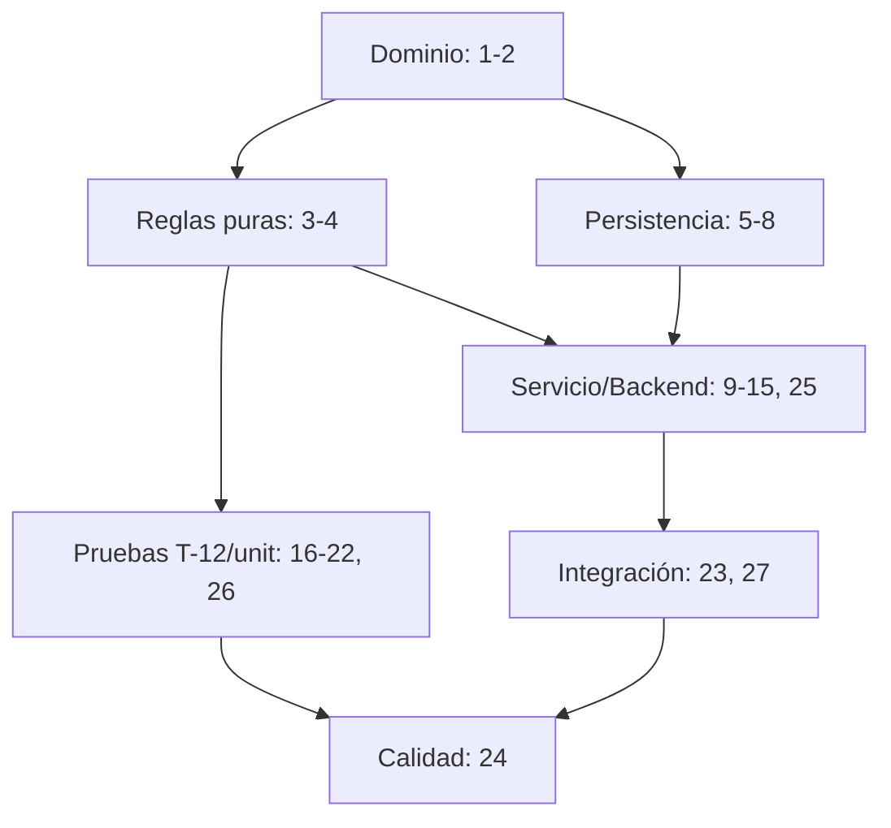
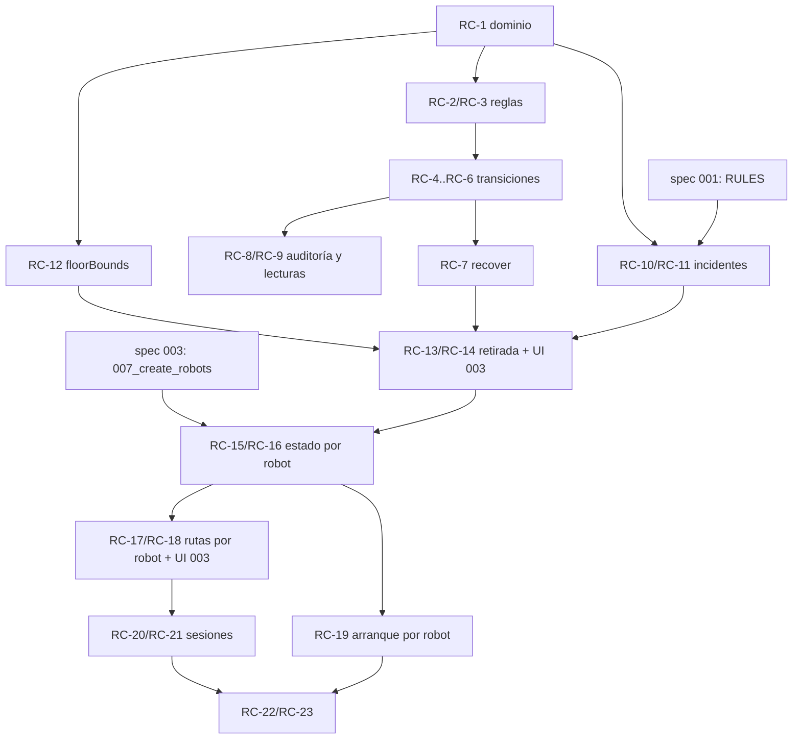

# Implementation Plan: Vigilante de seguridad (002-safety-guardian)

**Fase MADA:** CONSTRUIR
**HU cubiertas:** HU-04, HU-05
**Estado:** Tareas 1–27 implementadas (773823a); refuerzo RC-01 pendiente de aprobación humana
(requiere `requirements.md` y `design.md` aprobados, incluido RC-01)

## Overview

Plan de implementación del vigilante (HU-04, HU-05). Orden: dominio → reglas puras (TDD) →
persistencia → servicio/backend → reinicio seguro → pruebas (T-12) → calidad. La geometría se
reutiliza de la spec 001; la UI la cubre la spec 003.

## Tasks

- [x] 1. Añadir al dominio `RobotStateName`, `PositionQuality`, `DecisionCode`, `GuardianInput`, `GuardianDecision`, `PositionReading` en `@home-guardian/domain`
  - _Requisitos: 1, 2, 7.1_
- [x] 2. Añadir esquemas Zod `moveSchema` (destino) y `positionSchema` (lectura de posición) y exportarlos desde `index.ts`
  - _Requisitos: 7.1, 8.1_
- [x] 3. (TDD, prueba roja primero) Implementar `rules/stateMachine.ts` con la tabla de transiciones, `completeMove` (MOVING → IDLE) y las prohibiciones P-1 (SAFE_STOP y DEGRADED → MOVING) y P-2 (datos no confiables → MOVING)
  - _Requisitos: 1.5, 3.4, 3.5_
- [x] 4. (TDD) Implementar `rules/guardian.ts` `evaluateMovement` con el orden estricto estado → UNRELIABLE → MISSING → repo caído → origen → destino → trayectoria → AUTHORIZED, reutilizando `isCollision` (spec 001)
  - _Requisitos: 1.1, 1.2, 1.3, 1.4, 1.5, 1.6, 2.1, 2.2, 2.3, 2.4, 2.5, 7.3_
- [x] 5. Crear migraciones `create_incidents.sql` (append-only con `zones_snapshot`) y `create_audit_log.sql` (append-only para rechazos por estado)
  - _Requisitos: 5.1, 5.3, 5.4_
- [x] 6. Crear migración `add_position_quality.sql` (`ALTER TABLE robot_state ADD position_quality`) y sembrar el robot con estado `IDLE`, posición válida y `position_quality='RELIABLE'`
  - _Requisitos: 6.1, 6.3_
- [x] 7. Implementar `incidentRepository` (solo inserción y listado)
  - _Requisitos: 5.2, 5.4_
- [x] 8. Extender `robotRepository` para leer/actualizar estado, posición y `positionQuality`
  - _Requisitos: 2.1, 3.1, 4.1_
- [x] 9. Implementar `guardianService`: leer snapshot, cargar zonas (fallo → null), invocar `evaluateMovement`, aplicar transición; en AUTHORIZED actualizar posición al destino y completar `MOVING → IDLE` (persistir IDLE); registrar evaluación con snapshot de zonas
  - _Requisitos: 1.5, 2.4, 3.1, 3.2, 5.1_
- [x] 10. En `guardianService`, crear incidente solo en denegación que para; en rechazo por estado (`SAFE_STOP_ACTIVE`/`BUSY`) no crear incidente pero registrar el rechazo en el log de auditoría
  - _Requisitos: 5.2, 5.3_
- [x] 11. Implementar recuperación (`recover`): exigir estado en parada, posición segura y `positionQuality=RELIABLE` → RECOVERING → IDLE; si no, rechazar sin efectos
  - _Requisitos: 4.1, 4.2, 4.3_
- [x] 12. Implementar `db/bootstrap.ts` (reinicio seguro ADR-10): arrancar con `positionQuality=RELIABLE` y estado `IDLE` (seed), degradar `MOVING` persistido → `SAFE_STOP`, y pasar a `MISSING`/`UNRELIABLE` solo ante señal de pérdida explícita
  - _Requisitos: 6.1, 6.2, 6.3, 6.4_
- [x] 13. Implementar `robotController` (state, move, recover, position) mapeando decisión → HTTP (200 AUTHORIZED/DENIED, 409 REJECTED, 422 payload)
  - _Requisitos: 1.5, 3.3, 7.2, 8.2_
- [x] 14. Implementar `incidentController` y `GET /api/incidents`
  - _Requisitos: 5.1_
- [x] 15. Crear `routes/robotRoutes.ts` (`/api/robot/state|move|recover|position`) y `routes/incidentRoutes.ts` (`/api/incidents`); montar en `app.ts` y ejecutar bootstrap al arrancar
  - _Requisitos: Contrato de API, 6.1, 8.1_
- [x] 16. Pruebas T-12 grupo A (9): destino dentro/fuera/borde → RESTRICTED_ZONE_VIOLATION / AUTHORIZED
  - _Requisitos: 1.3, 7.4_
- [x] 17. Pruebas T-12 grupo B (5): trayectoria cruza/tangente/no cruza → TRAJECTORY_CROSSES_ZONE / AUTHORIZED
  - _Requisitos: 1.4, 7.4_
- [x] 18. Pruebas T-12 grupo C (3): sin zonas activas → siempre AUTHORIZED
  - _Requisitos: 1.5, 7.4_
- [x] 19. Pruebas T-12 grupo D (5): radio `r=10`; y grupo E (3): margen `m=5`
  - _Requisitos: 1.1, 7.4_
- [x] 20. Pruebas T-12 grupo F (2): `UNRELIABLE` → INSUFFICIENT_DATA, `MISSING` → MISSING_POSITION; y grupo G (1): repositorio caído → ZONE_DATA_UNAVAILABLE
  - _Requisitos: 2.2, 2.3, 2.4, 7.4_
- [x] 21. Pruebas unit de transiciones prohibidas (P-1 SAFE_STOP→MOVING; P-2 datos no confiables→MOVING) y origen en zona → ORIGIN_IN_RESTRICTED_ZONE
  - _Requisitos: 1.2, 3.4, 3.5_
- [x] 22. Pruebas unit del servicio: registro siempre, incidente solo en denegación, rechazo sin incidente, recover válido/ inválido, bootstrap ADR-10
  - _Requisitos: 4.1, 4.2, 5.2, 5.3, 6.1, 6.2_
- [x] 23. Pruebas de integración (Supertest): `/api/robot/state|move|recover` (200/409/422) y `/api/incidents` (append-only)
  - _Requisitos: Contrato de API, 3.3, 5.1_
- [x] 24. Calidad: ESLint + Prettier sin errores, cero `any`, sin secretos, T-12 verde sin frontend ni BD real, pipeline CI verde
  - _Requisitos: 7.2, 7.3, 7.4_

- [x] 25. Implementar el aporte de lectura de posición: `POST /api/robot/position` (valida `positionSchema`; fija posición y `positionQuality`), en controller/service/ruta
  - _Requisitos: 8.1, 8.2, 8.4_
- [x] 26. Prueba unit de vivacidad: dos movimientos válidos consecutivos ambos `AUTHORIZED` (sin `BUSY`), vía `completeMove`
  - _Requisitos: 1.5_
- [x] 27. Prueba de integración: tras una señal de pérdida explícita (`positionQuality=MISSING`), `POST /position` con `RELIABLE` habilita un `move` `AUTHORIZED` a destino libre
  - _Requisitos: 8.1, 8.3_

## Task Dependency Graph



```json
{
  "waves": [
    { "id": 0, "tasks": ["1", "2"] },
    { "id": 1, "tasks": ["3", "4"] },
    { "id": 2, "tasks": ["5", "6", "7", "8"] },
    { "id": 3, "tasks": ["9", "10", "11", "12", "13", "14", "15", "25"] },
    { "id": 4, "tasks": ["16", "17", "18", "19", "20", "21", "22", "26"] },
    { "id": 5, "tasks": ["23", "27"] },
    { "id": 6, "tasks": ["24"] }
  ]
}
```

## Notes

- TDD obligatorio en las reglas puras (tareas 3 y 4): prueba roja antes de implementar.
- `evaluateMovement` reutiliza `isCollision` de la spec 001; no recalcular geometría.
- `incidents` es append-only (sin UPDATE/DELETE); incluye snapshot de zonas por decisión.
- T-12 (28 escenarios) debe correr con dobles de repositorio, sin frontend ni BD real.
- La UI del vigilante la cubre la spec `003-movement-simulation`.
- Compuerta Fase 3 (CONSTRUIR): todas las tareas completas, cada criterio con al menos una
  prueba, revisión del humano antes de pasar a VERIFICAR.

### Trazabilidad requisito → tarea (resumen)
| Requisito | Tareas |
|-----------|--------|
| R1 (geometría/vivacidad) | 3, 4, 9, 16, 17, 18, 19, 21, 26 |
| R2 (orden/datos) | 4, 20 |
| R3 (parada/prohibidas) | 3, 9, 13, 21 |
| R4 (recuperación) | 11, 22 |
| R5 (incidentes) | 7, 9, 10, 14, 23 |
| R6 (reinicio seguro/seed) | 6, 12, 22 |
| R8 (lectura de posición) | 2, 25, 27 |
| R7 (RNF/T-12) | 2, 4, 13, 16-20, 24 |

---

## Refuerzo RC-01 — tareas de convergencia

Delta sobre lo implementado en 773823a (ver `requirements.md` §13 y `design.md` [RC-01]). Las
tareas 1–27 se conservan tal cual. Todas las tareas RC siguen TDD: la prueba en rojo se escribe y
se **ve fallar** antes de implementar, y su salida se conserva como evidencia (art. XV).

### Bloque A — Vigilante único, registro de transiciones e incidentes con regla (prioridad)

- [ ] RC-1. Dominio (aditivo): `TransitionCause`, `RecoveryRejectionCause`, `RecoverResponse`, `RobotStatus`, `LastRequest`, `GuardedMoveRequest`, `Incident`, `IncidentDetail`; esquemas `guardedMoveRequestSchema`, `robotIdParamSchema`, `incidentIdParamSchema`, `incidentListQuerySchema`; `zoneName` en `GuardianDecision`. Sin tocar todavía los tipos de la spec 003 (el build sigue en verde)
  - _Requisitos: R5.6, R5.7, R9, R11.2, R12.3_
- [ ] RC-2. (Prueba roja primero) `canTransition` como lista blanca T1–T9 y `ruleForDecision` (6 códigos → `R-ZONA-01`/`R-SIGNAL-01`/`R-DATA-01`); después implementar ambas en `rules/`
  - _Requisitos: §2.2 (lista blanca, design T1–T9), R5.5, R9_
- [ ] RC-3. (Prueba roja primero) `evaluateRecovery` pura: orden `UNRELIABLE_DATA` → `ZONE_DATA_UNAVAILABLE` → `UNSAFE_POSITION`, zonas inactivas ignoradas, pad r+m; después extraerla de `guardianService` a `rules/guardian.ts`
  - _Requisitos: R4.4_
- [ ] RC-4. (Prueba roja primero) Migración `010_create_state_transition_log.sql` (CHECKs y triggers append-only) y `transitionLogRepository`; después implementarlas
  - _Requisitos: R9.1, R5.9_
- [ ] RC-5. (Prueba roja primero) Property 11 en el servicio: filas exactas de `state_transition_log` para `move` autorizado (T1+T2, con `MOVING` persistido dentro de la transacción), denegado (T3/T4 con `incidentId`), `recover` (T6+T7 con snapshot) y arranque (T8 sembrando `MOVING` en la base); sin filas en rechazos
  - _Requisitos: R9.1–R9.7, R6.5, R4.6_
- [ ] RC-6. Implementar el helper `transition` en `guardianService` y en `db/bootstrap.ts`, persistiendo `MOVING` y `RECOVERING`; hacer verde RC-5 y actualizar las pruebas existentes que suponían `MOVING` no persistido
  - _Requisitos: R9, R6.5_
- [ ] RC-7. (Prueba roja primero) Contrato de `recover`: `transitioned`, `409 RECOVERY_NOT_ALLOWED` con `cause`, `RECOVER_NOOP` en `IDLE`; después implementarlo, ampliando `AppError` y `errorHandler` con `cause` y actualizando las pruebas de `recover` existentes (hoy esperan `{ recovered, reason }`)
  - _Requisitos: R4.4, R4.5, R7.2_
- [ ] RC-8. (Prueba roja primero) Migración `011_audit_log_generalize.sql`: conserva todas las filas, `robot_id`, `x`/`y` nullable, `detail`, CHECK de `event_code`; después implementarla y ampliar `auditLogRepository`
  - _Requisitos: R5.8, R5.9, R8.7_
- [ ] RC-9. (Prueba roja primero) Lecturas de posición: `RELIABLE` coincidente → solo calidad; no coincidente → `409 POSITION_CONFLICT` auditado; fuera del plano → 422; pérdida (`UNRELIABLE`/`MISSING`) aceptada aunque la posición esté fuera del plano, `IDLE → DEGRADED` (T5) y sin incidente; Property 13. Después implementar `setPosition` y ajustar la prueba existente 27 para usar la posición actual
  - _Requisitos: R3.6, R8.5–R8.7_
- [ ] RC-10. (Prueba roja primero) Migración `009_incidents_robot_rule.sql`; incidente nuevo con `robot_id`, `rule` y `zoneName`; lectura de filas antiguas con `robotId: null` y `rule` derivada; después implementarlo en `incidentRepository` y en el servicio
  - _Requisitos: R5.5_
- [ ] RC-11. (Prueba roja primero) `GET /api/incidents` del más reciente al más antiguo (hoy `ORDER BY id` ascendente), con `?robotId=` y `404 ROBOT_NOT_FOUND`; `GET /api/incidents/:id` con `zonesSnapshot` y `404 INCIDENT_NOT_FOUND`; después implementar controller y rutas
  - _Requisitos: R5.6, R5.7_
- [ ] RC-12. Trasladar `assertDestinationWithinFloor` de `services/movementService.ts` a `services/floorBounds.ts` (lo usa `guardianService`), sin cambiar su comportamiento
  - _Requisitos: R1.9, R10_

### Bloque B — Retirada del vigilante provisional (entrega conjunta con la UI de la spec 003)

- [ ] RC-13. (Prueba roja primero: debe fallar hoy) Prueba de arquitectura de la Property 12 (imports de `src`, incluidos `import type`, y literal `robot_state` en SQL solo en `repositories/robotRepository.ts`) y prueba de integración `/api/simulation/*` → 404
  - _Requisitos: R10.2, R10.3_
- [ ] RC-14. Retirar `routes/simulationRoutes.ts`, `controllers/simulationController.ts`, `services/movementService.ts`, `rules/watchmanRule.ts`, sus pruebas y los tipos `Decision`/`MoveResult` de la spec 003; desmontar `/api/simulation` en `app.ts`. **Se integra en la misma entrega que la migración de la UI de la spec 003 a `/api/robot*`**; RC-13 pasa a verde
  - _Requisitos: R10.1–R10.4_

### Bloque C — Multi-robot y sesiones

- [ ] RC-15. (Prueba roja primero) Migración `008_robot_state_per_robot.sql`: la fila `id = 1` pasa a "Aspiradora A1" conservando estado, posición y calidad; "Vigilante V2" en (488, 290) `IDLE`/`RELIABLE`; `DEFAULT 'RELIABLE'`. Requiere la migración `007_create_robots.sql` de la spec 003
  - _Requisitos: R12.1, R12.5_
- [ ] RC-16. Implementar la migración 008, `robotRepository` por robot y `guardianService.initRobot` (T9 `ROBOT_REGISTERED`), invocado por el alta del catálogo de la spec 003 en la misma transacción
  - _Requisitos: R12.2, R9.5_
- [ ] RC-17. (Prueba roja primero) API por robot: `/api/robots/:robotId/{state,move,recover,position}`, `404 ROBOT_NOT_FOUND`, Property 15 (aislamiento) y `/api/robot/*` → 404
  - _Requisitos: R1.8, R12.3, R12.4, R10.2_
- [ ] RC-18. Implementar `routes/guardianRoutes.ts` (`mergeParams`) y retirar `routes/robotRoutes.ts` (`/api/robot` singular), actualizando las pruebas existentes de `/api/robot`. **Se integra junto con la UI de la spec 003 que usa las rutas por robot**
  - _Requisitos: R10.2, R12_
- [ ] RC-19. (Prueba roja primero) Arranque seguro por robot: dos robots, uno con `MOVING` sembrado → solo ese pasa a `SAFE_STOP` con T8; después implementarlo en `db/bootstrap.ts` (y en `db/init.ts`)
  - _Requisitos: R6.5_
- [ ] RC-20. (Prueba roja primero) Sesión y secuencia: `POST /sessions` → 201 y auditoría `SESSION_STARTED`; orden de validación de R11.5; `409 INVALID_SESSION` y `409 DUPLICATE_EVENT` sin evaluar, sin cambio de estado y sin incidente; consumo de la secuencia; `lastRequest` en `GET /state`; Property 14
  - _Requisitos: R11.1–R11.6, R5.8_
- [ ] RC-21. Implementar la validación de sesión y secuencia en `move` usando `robot_sessions`, `sessionRepository` y `checkSequence`/`acceptRequest` de la spec 003 (migración `012_create_robot_sessions.sql` y `sessionService.startSession` son de la 003, RC-15/RC-17)
  - _Requisitos: R11_

### Bloque D — Integración y calidad

- [ ] RC-22. Integración Supertest de extremo a extremo: alta de robot (spec 003) → sesión → move denegado (incidente con `rule`) → move con la misma secuencia → `DUPLICATE_EVENT` → move rechazado `SAFE_STOP_ACTIVE` → recover rechazado `UNSAFE_POSITION` → desactivar la zona (spec 001) → recover OK; comprobando las filas exactas de `state_transition_log`, `audit_log` e `incidents`
  - _Requisitos: R4, R5, R9, R11, R12_
- [ ] RC-23. Calidad: ESLint, typecheck, Prettier y pruebas en verde; cero `any`; T-12 sigue verde
  - _Requisitos: R7_

### Dependencias del refuerzo



```json
{
  "rc01_waves": [
    { "id": "A", "tasks": ["RC-1", "RC-2", "RC-3", "RC-4", "RC-5", "RC-6", "RC-7", "RC-8", "RC-9", "RC-10", "RC-11", "RC-12"] },
    { "id": "B", "tasks": ["RC-13", "RC-14"], "together_with": "003-movement-simulation (UI → /api/robot)" },
    { "id": "C", "tasks": ["RC-15", "RC-16", "RC-17", "RC-18", "RC-19", "RC-20", "RC-21"], "requires": ["003: 007_create_robots.sql"], "together_with": "003-movement-simulation (UI → /api/robots/:robotId)" },
    { "id": "D", "tasks": ["RC-22", "RC-23"] }
  ]
}
```

### Notas del refuerzo
- **Orden pedido:** primero el bloque A (vigilante único y registro de transiciones, incidentes con
  regla), luego la retirada (B) y por último multi-robot y sesiones (C).
- **Vigilante único en cada integración:** la retirada de `/api/simulation/*` (RC-14) se integra en
  la **misma entrega** que la migración de la UI de la spec 003; nunca se integra una versión con
  dos vigilantes ni con una UI que llame a rutas retiradas. Lo mismo para la retirada de
  `/api/robot/*` singular (RC-18) y el paso de la UI a `/api/robots/:robotId/*`.
- **Doble migración de la UI:** con este orden, la UI de la spec 003 pasa primero a `/api/robot`
  (bloque B, un robot) y después a `/api/robots/:robotId` (bloque C). Si se prefiere una sola
  migración de la UI, los bloques B y C se integran juntos. **Decisión de la unificación RC-01:**
  se acepta la doble migración (es un cambio de ruta en `robotApi`) para entregar antes el
  refuerzo 1 y la vista de incidentes, que tienen prioridad.
- **Numeración de migraciones:** 008–012 suponen que la spec 003 añade `007_create_robots.sql`; se
  ajusta al coordinar con las migraciones de las specs 001 y 003.
- **Pruebas existentes afectadas:** las de `recover` (forma de respuesta), `setPosition`
  (relocalización), el orden de `GET /api/incidents`, las rutas `/api/robot/*` y las que suponen
  `MOVING` no persistido se actualizan en la tarea que cambia ese comportamiento, no se borran.
- `tasks.meta.json` registra ejecuciones reales de las tareas 1–27; no se añaden entradas para
  tareas RC no ejecutadas (art. XV).

### Trazabilidad RC-01 → tarea
| Requisito / Property | Tareas |
|----------------------|--------|
| R1.8, R1.9 | RC-12, RC-17 |
| R3.6 | RC-9 |
| R4.4–R4.6 | RC-3, RC-5, RC-7 |
| R5.5–R5.9 | RC-4, RC-8, RC-10, RC-11, RC-20 |
| R6.5 | RC-5, RC-6, RC-19 |
| R8.5–R8.7 | RC-9 |
| R9 / Property 11 | RC-2, RC-4, RC-5, RC-6, RC-22 |
| R10 / Property 12 | RC-12, RC-13, RC-14, RC-18 |
| R11 / Property 14 | RC-20, RC-21, RC-22 |
| R12 / Property 15 | RC-15, RC-16, RC-17, RC-18 |
| Property 13 | RC-9 |

