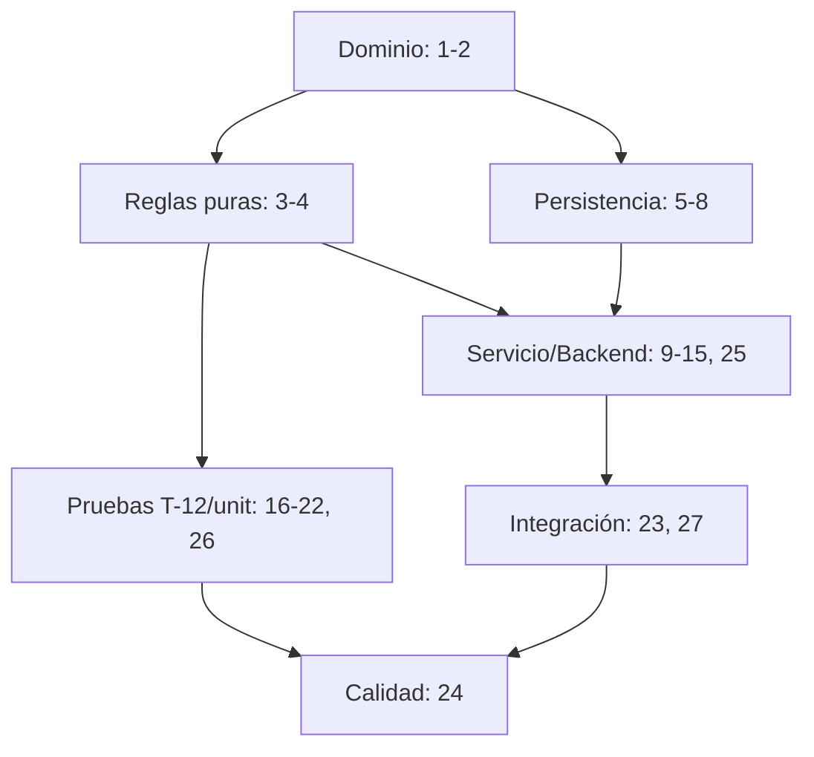
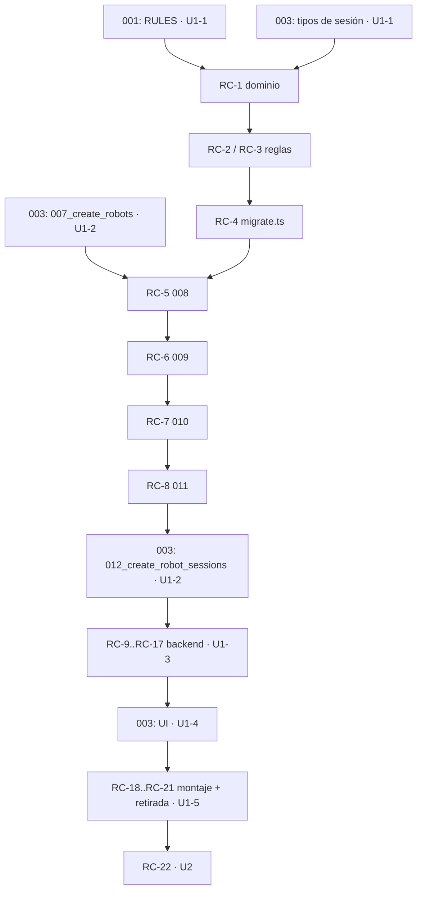

# Implementation Plan: Vigilante de seguridad (002-safety-guardian)

**Fase MADA:** CONSTRUIR
**HU cubiertas:** HU-04, HU-05
**Estado:** Tareas 1–27 implementadas (773823a) y aprobadas (2026-11-23); refuerzo RC-01 (rev2)
pendiente de aprobación humana

## Overview

Plan de implementación del vigilante (HU-04, HU-05). Orden: dominio → reglas puras (TDD) →
persistencia → servicio/backend → reinicio seguro → pruebas (T-12) → calidad. La geometría se
reutiliza de la spec 001; la UI la cubre la spec 003.

## Tasks

- [x] 1. Añadir al dominio `RobotStateName`, `PositionQuality`, `DecisionCode`, `GuardianInput`, `GuardianDecision`, `PositionReading` en `@home-guardian/domain`
  - _Requisitos: 1, 2, 7.1_
- [x] 2. Añadir esquemas Zod `moveSchema` (destino) y `positionSchema` (lectura de posición) y exportarlos desde `index.ts`
  - _Requisitos: 7.1, 8.1_
- [x] 3. (TDD, prueba roja primero) Implementar `rules/stateMachine.ts` con la tabla de transiciones, `completeMove` (MOVING → IDLE) y las prohibiciones P-1 (SAFE_STOP y DEGRADED → MOVING) y P-2 (datos no confiables → MOVING)
  - _Requisitos: 1.5, 3.4, 3.5_
- [x] 4. (TDD) Implementar `rules/guardian.ts` `evaluateMovement` con el orden estricto estado → UNRELIABLE → MISSING → repo caído → origen → destino → trayectoria → AUTHORIZED, reutilizando `isCollision` (spec 001)
  - _Requisitos: 1.1, 1.2, 1.3, 1.4, 1.5, 1.6, 2.1, 2.2, 2.3, 2.4, 2.5, 7.3_
- [x] 5. Crear migraciones `create_incidents.sql` (append-only con `zones_snapshot`) y `create_audit_log.sql` (append-only para rechazos por estado)
  - _Requisitos: 5.1, 5.3, 5.4_
- [x] 6. Crear migración `add_position_quality.sql` (`ALTER TABLE robot_state ADD position_quality`) y sembrar el robot con estado `IDLE`, posición válida y `position_quality='RELIABLE'`
  - _Requisitos: 6.1, 6.3_
- [x] 7. Implementar `incidentRepository` (solo inserción y listado)
  - _Requisitos: 5.2, 5.4_
- [x] 8. Extender `robotRepository` para leer/actualizar estado, posición y `positionQuality`
  - _Requisitos: 2.1, 3.1, 4.1_
- [x] 9. Implementar `guardianService`: leer snapshot, cargar zonas (fallo → null), invocar `evaluateMovement`, aplicar transición; en AUTHORIZED actualizar posición al destino y completar `MOVING → IDLE` (persistir IDLE); registrar evaluación con snapshot de zonas
  - _Requisitos: 1.5, 2.4, 3.1, 3.2, 5.1_
- [x] 10. En `guardianService`, crear incidente solo en denegación que para; en rechazo por estado (`SAFE_STOP_ACTIVE`/`BUSY`) no crear incidente pero registrar el rechazo en el log de auditoría
  - _Requisitos: 5.2, 5.3_
- [x] 11. Implementar recuperación (`recover`): exigir estado en parada, posición segura y `positionQuality=RELIABLE` → RECOVERING → IDLE; si no, rechazar sin efectos
  - _Requisitos: 4.1, 4.2, 4.3_
- [x] 12. Implementar `db/bootstrap.ts` (reinicio seguro ADR-10): arrancar con `positionQuality=RELIABLE` y estado `IDLE` (seed), degradar `MOVING` persistido → `SAFE_STOP`, y pasar a `MISSING`/`UNRELIABLE` solo ante señal de pérdida explícita
  - _Requisitos: 6.1, 6.2, 6.3, 6.4_
- [x] 13. Implementar `robotController` (state, move, recover, position) mapeando decisión → HTTP (200 AUTHORIZED/DENIED, 409 REJECTED, 422 payload)
  - _Requisitos: 1.5, 3.3, 7.2, 8.2_
- [x] 14. Implementar `incidentController` y `GET /api/incidents`
  - _Requisitos: 5.1_
- [x] 15. Crear `routes/robotRoutes.ts` (`/api/robot/state|move|recover|position`) y `routes/incidentRoutes.ts` (`/api/incidents`); montar en `app.ts` y ejecutar bootstrap al arrancar
  - _Requisitos: Contrato de API, 6.1, 8.1_
- [x] 16. Pruebas T-12 grupo A (9): destino dentro/fuera/borde → RESTRICTED_ZONE_VIOLATION / AUTHORIZED
  - _Requisitos: 1.3, 7.4_
- [x] 17. Pruebas T-12 grupo B (5): trayectoria cruza/tangente/no cruza → TRAJECTORY_CROSSES_ZONE / AUTHORIZED
  - _Requisitos: 1.4, 7.4_
- [x] 18. Pruebas T-12 grupo C (3): sin zonas activas → siempre AUTHORIZED
  - _Requisitos: 1.5, 7.4_
- [x] 19. Pruebas T-12 grupo D (5): radio `r=10`; y grupo E (3): margen `m=5`
  - _Requisitos: 1.1, 7.4_
- [x] 20. Pruebas T-12 grupo F (2): `UNRELIABLE` → INSUFFICIENT_DATA, `MISSING` → MISSING_POSITION; y grupo G (1): repositorio caído → ZONE_DATA_UNAVAILABLE
  - _Requisitos: 2.2, 2.3, 2.4, 7.4_
- [x] 21. Pruebas unit de transiciones prohibidas (P-1 SAFE_STOP→MOVING; P-2 datos no confiables→MOVING) y origen en zona → ORIGIN_IN_RESTRICTED_ZONE
  - _Requisitos: 1.2, 3.4, 3.5_
- [x] 22. Pruebas unit del servicio: registro siempre, incidente solo en denegación, rechazo sin incidente, recover válido/ inválido, bootstrap ADR-10
  - _Requisitos: 4.1, 4.2, 5.2, 5.3, 6.1, 6.2_
- [x] 23. Pruebas de integración (Supertest): `/api/robot/state|move|recover` (200/409/422) y `/api/incidents` (append-only)
  - _Requisitos: Contrato de API, 3.3, 5.1_
- [x] 24. Calidad: ESLint + Prettier sin errores, cero `any`, sin secretos, T-12 verde sin frontend ni BD real, pipeline CI verde
  - _Requisitos: 7.2, 7.3, 7.4_

- [x] 25. Implementar el aporte de lectura de posición: `POST /api/robot/position` (valida `positionSchema`; fija posición y `positionQuality`), en controller/service/ruta
  - _Requisitos: 8.1, 8.2, 8.4_
- [x] 26. Prueba unit de vivacidad: dos movimientos válidos consecutivos ambos `AUTHORIZED` (sin `BUSY`), vía `completeMove`
  - _Requisitos: 1.5_
- [x] 27. Prueba de integración: tras una señal de pérdida explícita (`positionQuality=MISSING`), `POST /position` con `RELIABLE` habilita un `move` `AUTHORIZED` a destino libre
  - _Requisitos: 8.1, 8.3_

## Task Dependency Graph



```json
{
  "waves": [
    { "id": 0, "tasks": ["1", "2"] },
    { "id": 1, "tasks": ["3", "4"] },
    { "id": 2, "tasks": ["5", "6", "7", "8"] },
    { "id": 3, "tasks": ["9", "10", "11", "12", "13", "14", "15", "25"] },
    { "id": 4, "tasks": ["16", "17", "18", "19", "20", "21", "22", "26"] },
    { "id": 5, "tasks": ["23", "27"] },
    { "id": 6, "tasks": ["24"] }
  ]
}
```

## Notes

- TDD obligatorio en las reglas puras (tareas 3 y 4): prueba roja antes de implementar.
- `evaluateMovement` reutiliza `isCollision` de la spec 001; no recalcular geometría.
- `incidents` es append-only (sin UPDATE/DELETE); incluye snapshot de zonas por decisión.
- T-12 (28 escenarios) debe correr con dobles de repositorio, sin frontend ni BD real.
- La UI del vigilante la cubre la spec `003-movement-simulation`.
- Compuerta Fase 3 (CONSTRUIR): todas las tareas completas, cada criterio con al menos una
  prueba, revisión del humano antes de pasar a VERIFICAR.

### Trazabilidad requisito → tarea (resumen)
| Requisito | Tareas |
|-----------|--------|
| R1 (geometría/vivacidad) | 3, 4, 9, 16, 17, 18, 19, 21, 26 |
| R2 (orden/datos) | 4, 20 |
| R3 (parada/prohibidas) | 3, 9, 13, 21 |
| R4 (recuperación) | 11, 22 |
| R5 (incidentes) | 7, 9, 10, 14, 23 |
| R6 (reinicio seguro/seed) | 6, 12, 22 |
| R8 (lectura de posición) | 2, 25, 27 |
| R7 (RNF/T-12) | 2, 4, 13, 16-20, 24 |

---

## Refuerzo RC-01 — tareas de convergencia [RC-01 rev2]

Delta sobre lo implementado en 773823a (ver `requirements.md` §13 y `design.md` [RC-01]/[RC-01 rev2]).
Las tareas 1–27 se conservan tal cual.

> **Sustituye al plan RC-01 inicial** (bloques A–D de 5da075e, nunca ejecutado): tenía dependencias
> cíclicas entre specs (B-1), una doble migración de la UI sin tarea en la 003 (B-2) e integraciones
> intermedias con dos vigilantes (I-1). El plan inicial puede consultarse en el historial de git.

**Reglas del plan**
- **Dos unidades de integración.** `[U1]` "vigilante único + incidentes + robots y sesiones" (prioridad
  del humano) y `[U2]` "supervisión completa y zonas". Nada intermedio se integra en
  `integration`/`develop`; dentro de la rama de trabajo cada tarea termina en verde: el código antiguo
  (`/api/simulation`, `/api/robot`, `get`/`save`) sigue funcionando hasta su tarea de retirada, que va
  dentro de U1 (R10.6).
- **Pasos de U1** (orden obligatorio): 1 dominio aditivo → 2 migraciones → 3 backend probado con apps de
  prueba **sin montar** en `app.ts` → 4 UI de la spec 003 → 5 montaje + retirada + arquitectura + E2E.
  Ninguna tarea depende de otra de un paso posterior.
- **TDD:** cada tarea marcada "(prueba roja primero)" escribe la prueba, la **ve fallar** y conserva la
  salida como evidencia (art. XV) antes de implementar.
- **Rechazos auditados (B-5):** toda tarea que añade un 409 auditable incluye una prueba que lee
  `audit_log` después de la respuesta (Property 16).
- **Dependencias de otras specs** citadas por nombre: `[001-RULES]` (constante `RULES` y
  `ruleForDecision`, spec 001 paso U1-1), `[003-robots]` (`007_create_robots.sql`, spec 003 paso U1-2),
  `[003-sessions]` (`012_create_robot_sessions.sql`, `MoveCommand`, `LastRequest`, `checkSequence`,
  `sessionService.startSession`, spec 003 pasos U1-1/U1-2/U1-3), `[003-UI]` (UI contra
  `/api/robots/:robotId/*`, spec 003 paso U1-4).

### [U1] Paso 1 — Dominio (aditivo, build en verde)

- [ ] RC-1. `[U1·1]` Dominio: `RobotId`, `TransitionCause` (con `MIGRATION_BASELINE`), `RecoveryRejectionCause`, `RecoverResponse`, `RobotStatus` (con `lastRequest: LastRequest | null` de `[003-sessions]`), `Incident`/`IncidentDetail` (con `zoneName` y `decisionCode` que admite `POSITION_QUALITY_LOST`), `ServiceResult`/`RejectionCode`; esquemas `robotIdParamSchema`, `incidentIdParamSchema`, `incidentListQuerySchema`; `zoneName` en `GuardianDecision`. Sin tocar los tipos de la spec 003 ni definir tipos de sesión.
  - _Requisitos: R5.6, R5.7, R5.10, R9, R12.3_
  - _Requiere: `[001-RULES]` (para `RuleId`), `[003-sessions]` (tipos)_
  - _Pruebas afectadas: ninguna existente (aditivo); nuevas en `domain/tests/`._
- [ ] RC-2. `[U1·1]` (prueba roja primero) `canTransition` como lista blanca T1–T9 (T10 queda fuera: la escribe la migración) y el helper de estrechamiento `denialRule(code)` sobre `ruleForDecision` de `[001-RULES]` (6 códigos de denegación + `POSITION_QUALITY_LOST` → `R-SIGNAL-01`); después implementarlos en `rules/`
  - _Requisitos: §2.2 (design T1–T10), R5.5, R5.11, R9_
  - _Pruebas afectadas: `backend/tests/unit/stateMachine.test.ts`, `prohibitedTransitions.test.ts` (pasan a lista blanca)._
- [ ] RC-3. `[U1·1]` (prueba roja primero) `evaluateRecovery` pura: orden `UNRELIABLE_DATA` → `ZONE_DATA_UNAVAILABLE` → `UNSAFE_POSITION`, zonas inactivas ignoradas, pad r+m; después extraerla de `guardianService` a `rules/guardian.ts`
  - _Requisitos: R4.4_
  - _Pruebas afectadas: `guardianService.test.ts`, `guardianService.requirements.test.ts` (la validación sale del servicio)._

### [U1] Paso 2 — Migraciones (orden de entrega = orden de aplicación)

- [ ] RC-4. `[U1·2]` (prueba roja primero) Endurecer `db/migrate.ts`: si una migración pendiente tiene número menor que la última aplicada, falla con un error claro y no aplica nada; después implementarlo
  - _Requisitos: R10.5 (esquema coherente), DD-227_
  - _Pruebas afectadas: `backend/tests/unit/migrate.test.ts`._
- [ ] RC-5. `[U1·2]` (prueba roja primero) Migración `008_robot_state_per_robot.sql`: base existente (fila `id = 1` → A1 conservando estado, posición y calidad; V2 en (488, 290)) y base nueva (A1 en (160, 123), V2 en (488, 290)); `position_quality` sin `DEFAULT`; CHECK de 5 estados; fechas ISO. Después implementarla. Los métodos `get`/`save` actuales de `robotRepository` siguen funcionando sobre A1 hasta RC-24
  - _Requisitos: R12.1, R12.5, R10.5_
  - _Requiere: `[003-robots]` (007 aplicada antes)_
  - _Pruebas afectadas: `simulationRepositories.test.ts` (hoy exige una sola fila y rechaza `id=2`), `migrate.test.ts` (lista de tablas y `WHERE id = 1`), `bootstrap.test.ts`, `liveness.test.ts`._
- [ ] RC-6. `[U1·2]` (prueba roja primero) Migración `009_incidents_robot_rule_zone.sql`: `robot_id`, `rule`, `zone_name` (NULL en filas antiguas, sin reescribirlas); después implementarla
  - _Requisitos: R5.5, R5.9_
  - _Pruebas afectadas: `incidentRepository.test.ts`._
- [ ] RC-7. `[U1·2]` (prueba roja primero) Migración `010_create_state_transition_log.sql`: tabla, CHECKs (incluido `MIGRATION_BASELINE`), triggers append-only y una fila base por robot existente; `transitionLogRepository`; después implementarlas
  - _Requisitos: R9.1, R9.7, R9.8, R5.9_
- [ ] RC-8. `[U1·2]` (prueba roja primero) Migración `011_audit_log_generalize.sql`: copia todas las filas, `robot_id`, `x`/`y` nullable, `detail`, CHECK de `event_code` (incluidos `SESSION_STARTED` y `ROBOT_START_IN_RESTRICTED_ZONE`), triggers recreados; ampliar `auditLogRepository` (fechas ISO al leer); después implementarlas
  - _Requisitos: R5.8–R5.10, R8.7_
  - _Pruebas afectadas: `robotPositionRecovery.api.test.ts` (lee el audit)._
  - _Nota: `012_create_robot_sessions.sql` la entrega `[003-sessions]` en este mismo paso, después de 011._

### [U1] Paso 3 — Backend por robot (probado con apps de prueba, sin montar en `app.ts`)

- [ ] RC-9. `[U1·3]` Trasladar `assertDestinationWithinFloor` de `services/movementService.ts` a `services/floorBounds.ts` sin cambiar su comportamiento (lo usará `guardianService`)
  - _Requisitos: R1.9, R10_
  - _Pruebas afectadas: `movementService.test.ts` (import)._
- [ ] RC-10. `[U1·3]` (prueba roja primero) Helper `transition` + Property 11 por robot: filas exactas de `state_transition_log` para `move` autorizado (T1+T2 con `MOVING` persistido), denegado (T3/T4 con `incidentId`), `recover` (T6+T7 con snapshot), arranque (T8 sembrando `MOVING`) y la fila base; sin filas en rechazos. Después implementarlo en `guardianService` y `db/bootstrap.ts` (todos los robots; también en `db/init.ts`)
  - _Requisitos: R9.1–R9.8, R6.5, R4.6_
  - _Pruebas afectadas: `guardianService.test.ts`, `guardianService.requirements.test.ts`, `liveness.test.ts` (suponían `MOVING` no persistido), `bootstrap.test.ts`._
- [ ] RC-11. `[U1·3]` (prueba roja primero) `ServiceResult` y Property 16: para `SAFE_STOP_ACTIVE`, `BUSY`, `RECOVERY_NOT_ALLOWED` y `POSITION_CONFLICT`, la fila de `audit_log` existe tras el 409 y el estado no cambia; `AppError`/`errorHandler` con `cause` opcional. Después implementarlo
  - _Requisitos: R5.10, R4.4, R8.5, R7.2_
  - _Pruebas afectadas: `robotController.test.ts`._
- [ ] RC-12. `[U1·3]` (prueba roja primero) Contrato de `recover`: `transitioned`, `409 RECOVERY_NOT_ALLOWED` + `cause`, `RECOVER_NOOP` en `IDLE`; después implementarlo
  - _Requisitos: R4.4, R4.5_
  - _Pruebas afectadas: `robotPositionRecovery.api.test.ts`, `robot.api.test.ts` (hoy esperan `{ recovered, reason }` y 409 en `IDLE`)._
- [ ] RC-13. `[U1·3]` (prueba roja primero) Lecturas de posición: `RELIABLE` coincidente → solo calidad; no coincidente → `409 POSITION_CONFLICT` auditado; `RELIABLE` fuera del plano → 422; pérdida aceptada aunque la posición venga fuera del plano; en `IDLE` T5 + incidente `R-SIGNAL-01` (`POSITION_QUALITY_LOST`, origen = destino = posición actual); en parada solo la calidad, sin incidente; Property 13. Después implementar `setPosition`
  - _Requisitos: R3.6, R5.11, R8.5–R8.7_
  - _Pruebas afectadas: `robotPositionRecovery.api.test.ts` (prueba 27: relocalizaba), `guardianService.requirements.test.ts`._
- [ ] RC-14. `[U1·3]` (prueba roja primero) Incidentes: nuevos con `robot_id`, `rule`, `zone_name`; antiguos con `robotId: null` y `rule` derivada; `GET /api/incidents` del más reciente al más antiguo con `?robotId=` y `404 ROBOT_NOT_FOUND`; `GET /api/incidents/:id` con `zonesSnapshot` y `404 INCIDENT_NOT_FOUND`; fechas ISO; tipo de fila `IncidentRow`. Después implementar repositorio, controller y rutas (app de prueba)
  - _Requisitos: R5.5–R5.7_
  - _Pruebas afectadas: `incidentRepository.test.ts`, `incidentController.test.ts` (orden ascendente actual)._
- [ ] RC-15. `[U1·3]` (prueba roja primero) `initRobot`: `INSERT` simple que falla si la fila existe; T9; alta en zona activa → `ROBOT_START_IN_RESTRICTED_ZONE` auditado sin crear nada (Property 16); el catálogo `[003-robots]` lo invoca en su transacción. Después implementarlo
  - _Requisitos: R12.2, R9.5, R5.10_
- [ ] RC-16. `[U1·3]` (prueba roja primero) API por robot en `routes/guardianRoutes.ts` (`mergeParams`): `/api/robots/:robotId/{state,move,recover,position}`, `404 ROBOT_NOT_FOUND`, Property 15 (aislamiento), `lastRequest` en `state`; `move` con `MoveCommand` (`422 INVALID_MOVE_REQUEST`) y orden de validación R11.5 usando `checkSequence`/`sessionRepository` de `[003-sessions]`; `INVALID_SESSION`/`DUPLICATE_EVENT` auditados (Property 14, 16). Después implementarla, probándola con una app de prueba
  - _Requisitos: R1.8, R1.9, R11.2–R11.6, R12.3, R12.4, R5.8_
- [ ] RC-17. `[U1·3]` (prueba roja primero) Arranque seguro por robot: dos robots, uno con `MOVING` sembrado → solo ese pasa a `SAFE_STOP` con T8; después implementarlo
  - _Requisitos: R6.5_
  - _Pruebas afectadas: `bootstrap.test.ts`._

### [U1] Paso 4 — UI de la spec 003

- (Sin tareas de esta spec.) `[003-UI]` migra la UI a `/api/robots/:robotId/*` en una sola vez (Q-F).

### [U1] Paso 5 — Montaje, retirada, arquitectura y E2E (una sola entrega)

- [ ] RC-18. `[U1·5]` (prueba roja primero: debe fallar hoy) Prueba de arquitectura de la Property 12: imports de `src` (incluidos `import type`), literal `robot_state` en SQL solo en `repositories/robotRepository.ts`; y pruebas de integración `/api/simulation/*` y `/api/robot/*` → 404
  - _Requisitos: R10.2, R10.3, R10.5_
- [ ] RC-19. `[U1·5]` Montar en `app.ts` el catálogo `[003-robots]` en `/api/robots` y `guardianRoutes` debajo; montar las rutas de incidentes nuevas
  - _Requisitos: R10.1, R12_
  - _Pruebas afectadas: `robot.wiring.test.ts`._
- [ ] RC-20. `[U1·5]` Retirar `routes/simulationRoutes.ts`, `controllers/simulationController.ts`, `services/movementService.ts`, `rules/watchmanRule.ts`, `routes/robotRoutes.ts` (`/api/robot` singular), los métodos `get`/`save` y el tipo `RobotSnapshot` de `robotRepository`, los tipos `Decision`/`MoveResult` y el alias `moveSchema = moveRequestSchema` de `domain/src/schemas/robot.schema.ts` (I-9). RC-18 pasa a verde
  - _Requisitos: R10.1–R10.6_
  - _Pruebas que se retiran: `watchmanRule.test.ts`, `movementService.test.ts`, `simulation.api.test.ts`. Pruebas afectadas: `robot.api.test.ts`, `robotController.test.ts`, `domain/tests/robotSchema.test.ts`, `domain/tests/simulationSchema.test.ts`._
- [ ] RC-21. `[U1·5]` Integración Supertest de extremo a extremo: alta de robot → alta en zona activa (409 auditado) → sesión → move denegado (incidente con `rule` y `zoneName`) → misma secuencia (`DUPLICATE_EVENT`) → move rechazado `SAFE_STOP_ACTIVE` → recover `UNSAFE_POSITION` → desactivar la zona (spec 001) → recover OK → señal de pérdida (incidente `R-SIGNAL-01`, `DEGRADED`) → lectura `RELIABLE` coincidente → recover OK; comprobando las filas exactas de `state_transition_log`, `audit_log` e `incidents`
  - _Requisitos: R4, R5, R9, R11, R12_

### [U2] Supervisión completa y zonas

- [ ] RC-22. `[U2]` Calidad final: ESLint, typecheck, Prettier y pruebas en verde; cero `any`; T-12 sigue verde; sin dependencias de U2 en esta spec más allá de comprobar que el registro de cambios de zona de la spec 001 (`013`) no altera el vigilante
  - _Requisitos: R7_

### Dependencias del refuerzo



```json
{
  "rc01_rev2_units": [
    { "id": "U1", "steps": {
        "1": ["RC-1", "RC-2", "RC-3"],
        "2": ["RC-4", "RC-5", "RC-6", "RC-7", "RC-8"],
        "3": ["RC-9", "RC-10", "RC-11", "RC-12", "RC-13", "RC-14", "RC-15", "RC-16", "RC-17"],
        "4": [],
        "5": ["RC-18", "RC-19", "RC-20", "RC-21"] },
      "together_with": ["001 (RULES, paso 1)", "003 (robots, sesiones y UI, pasos 1-5)"],
      "integration": "una sola entrega" },
    { "id": "U2", "tasks": ["RC-22"], "together_with": ["001 (zone_change_log 013, tarjeta de reglas)", "003 (supervisión completa)"] }
  ]
}
```

### Notas del refuerzo
- **Una sola migración de la UI (Q-F):** no existe etapa `/api/robot`; la UI de la 003 pasa de
  `/api/simulation/*` a `/api/robots/:robotId/*` en el paso U1-4.
- **Vigilante único en cada integración (R10.6):** U1 se integra entera o no se integra.
- `tasks.meta.json` registra ejecuciones reales de las tareas 1–27; no se añaden entradas para tareas
  RC no ejecutadas (art. XV).

### Trazabilidad RC-01 rev2 → tarea
| Requisito / Property | Tareas |
|----------------------|--------|
| R1.8, R1.9 | RC-9, RC-16 |
| R3.6, R5.11 | RC-2, RC-13, RC-21 |
| R4.4–R4.6 | RC-3, RC-10, RC-11, RC-12 |
| R5.5–R5.10 | RC-6, RC-8, RC-11, RC-14, RC-16 |
| R6.5 | RC-10, RC-17 |
| R8.5–R8.7 / Property 13 | RC-13 |
| R9 (incl. R9.8) / Property 11 | RC-2, RC-7, RC-10, RC-21 |
| R10 (incl. R10.5, R10.6) / Property 12 | RC-4, RC-5, RC-18, RC-19, RC-20 |
| R11 / Property 14 | RC-16, RC-21 |
| R12 / Property 15 | RC-5, RC-15, RC-16, RC-19 |
| Property 16 (rechazos auditados) | RC-11, RC-13, RC-15, RC-16, RC-21 |
