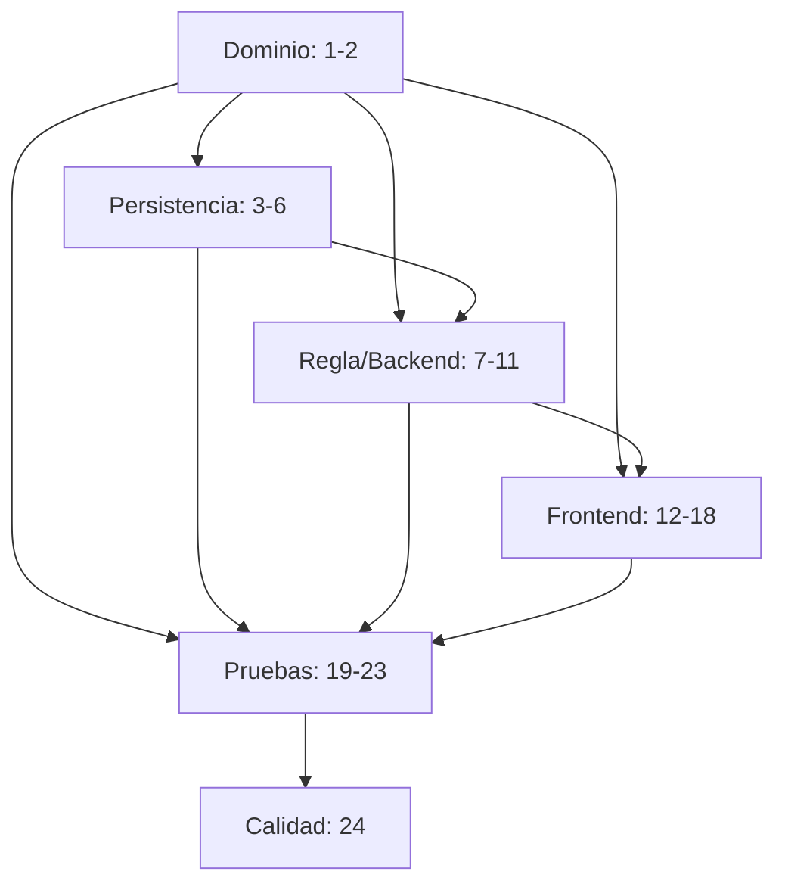
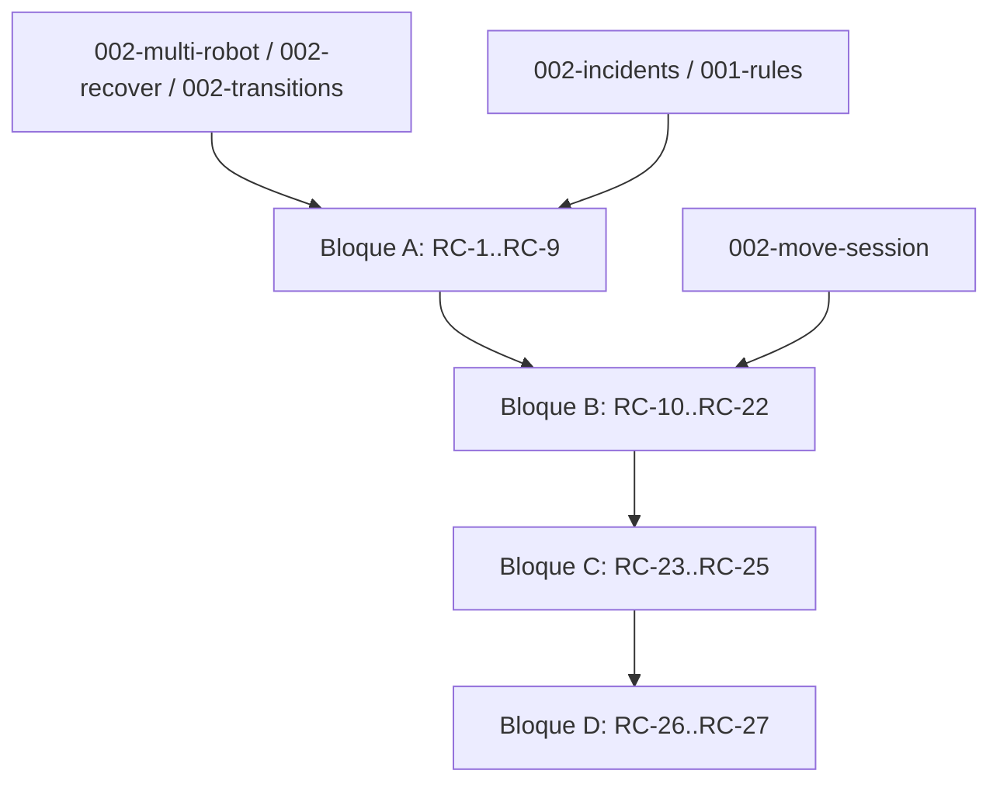

# Implementation Plan: Simulación de movimiento (003-movement-simulation)

**Fase MADA:** CONSTRUIR
**HU cubiertas:** HU-03
**Estado:** Tareas 1–24 implementadas (revisión QA: RECHAZADO por B-1). Refuerzo RC-01: pendiente de inicio (requiere aprobación humana del refuerzo en requirements.md y design.md)

## Overview

Plan de implementación de la HU-03. Orden: dominio → persistencia → regla/servicio/backend →
frontend → pruebas → calidad. La decisión vive en el backend (regla pura `decideMovement`
que reutiliza `isCollision` de la spec 001); la UI solo muestra la respuesta de la API.

## Tasks

- [x] 1. Añadir al dominio `@home-guardian/domain` los tipos `RobotStateName`, `Decision`, `RobotSnapshot`, `MoveRequest`, `MoveResult`
  - _Requisitos: RF-02, RF-03, RNF-02_
- [x] 2. Añadir esquemas Zod `pointSchema` y `moveRequestSchema` y exportarlos desde `index.ts`
  - _Requisitos: RNF-01, RF-01.2_
- [x] 3. Crear migración `create_robot_state.sql` (tabla singleton `robot_state` con estado y posición)
  - _Requisitos: RF-02.1, DD-103_
- [x] 4. Crear migración `create_movement_log.sql` (tabla append-only `movement_log`)
  - _Requisitos: RF-05.1, DD-105_
- [x] 5. Implementar `robotRepository` (leer snapshot, actualizar estado/posición) con SQL parametrizado
  - _Requisitos: RF-02.1, RF-03.1, RF-03.2_
- [x] 6. Implementar `movementLogRepository` (solo inserción de decisiones)
  - _Requisitos: RF-05.1_
- [x] 7. (TDD, prueba roja primero) Implementar la regla pura `decideMovement` reutilizando `isCollision` (spec 001): ALLOW, PREVENTIVE_STOP (destino y trayectoria), DENIED_SAFE_STOP
  - _Requisitos: RF-02.2, RF-03.1, RF-03.2, RF-03.3, RNF-06_
- [x] 8. Implementar `movementService`: validar límites del plano (`DESTINATION_OUT_OF_BOUNDS`), leer zonas activas y robot, invocar `decideMovement`, persistir estado y log
  - _Requisitos: RF-01.4, RF-02.3, RF-05.1, DD-107_
- [x] 9. Implementar `simulationController` mapeando decisión → HTTP (200 ALLOW/PREVENTIVE_STOP, 409 DENIED_SAFE_STOP, 422 fuera de plano/payload)
  - _Requisitos: RF-04, DD-101, DD-102_
- [x] 10. Crear `routes/simulationRoutes.ts` (`GET /robot`, `POST /move`, `POST /reset`) y montar en `app.ts`
  - _Requisitos: Contrato de API_
- [x] 11. Implementar `reset` (SAFE_STOP → IDLE conservando posición) como única salida de SAFE_STOP
  - _Requisitos: DD-106_
- [x] 12. Crear `api/client.ts` + `simulationApi` (getRobot, move, reset)
  - _Requisitos: Convención frontend_
- [x] 13. Crear `hooks/useSimulation.ts` con estados de carga/error por operación
  - _Requisitos: RF-04.5_
- [x] 14. Reutilizar `FloorPlan` para capturar destino por clic (viewport→coords de plano) y pintar la posición del robot
  - _Requisitos: RF-01.1, RF-04.4_
- [x] 15. Crear `components/CoordInput.tsx` (destino por coordenadas) produciendo el mismo `Point` que el clic
  - _Requisitos: RF-01.2, RF-01.3, CA-03.7_
- [x] 16. Crear `components/DecisionPanel.tsx` que muestra decisión/estado/razón sin recalcular reglas (parada preventiva + `zoneName`; `SAFE_STOP_ACTIVE`)
  - _Requisitos: RF-04.1, RF-04.2, RF-04.3, CA-03.6_
- [x] 17. Integrar `pages/SimulationPage.tsx` (plano + entrada + panel) y actualizar posición/estado tras cada solicitud
  - _Requisitos: RF-04.4_
- [x] 18. Dejar placeholder reservado de inyección de fallos de sensor / alerta A-04 / prueba T-18 (sin implementar)
  - _Requisitos: Fuera de alcance (reservado)_
- [x] 19. Pruebas unit de `decideMovement`: ALLOW, PREVENTIVE_STOP (destino en zona), PREVENTIVE_STOP (trayectoria cruza), DENIED desde SAFE_STOP, determinismo
  - _Requisitos: CA-03.1, CA-03.2, CA-03.3, CA-03.4, RNF-06_
- [x] 20. Pruebas unit del servicio: 422 DESTINATION_OUT_OF_BOUNDS, persistencia de estado y de `movement_log`
  - _Requisitos: CA-03.5, RF-05.1_
- [x] 21. Pruebas de integración (Supertest): GET /robot, POST /move 200/409/422, POST /reset, registro en movement_log
  - _Requisitos: Contrato de API, CA-03.1..CA-03.5, CA-03.8_
- [x] 22. Pruebas de componentes (RTL): DecisionPanel no recalcula; destino por clic == por coordenadas
  - _Requisitos: CA-03.6, CA-03.7_
- [x] 23. Prueba E2E (Playwright): clic en zona → parada preventiva visible; reset → IDLE
  - _Requisitos: HU-03, CA-03.2, CA-03.4_
- [ ] 24. Calidad: ESLint + Prettier sin errores, cero `any`, sin secretos, pipeline CI verde
  - _Requisitos: RNF-02, Compuerta de oro_
  - Parcial (2026-11-22): ESLint sin errores, typecheck y build OK, cero `any`, sin secretos;
    archivos de la HU formateados con el estilo del repo (comillas simples, 100 columnas).
    **Pendiente:** el repo no tiene configuración de Prettier (`npm run format:check` falla
    en todo el repo con los valores por defecto) ni workflow de GitHub Actions, así que no
    hay "pipeline CI verde" que mostrar.

## Task Dependency Graph



```json
{
  "waves": [
    { "id": 0, "tasks": ["1", "2"] },
    { "id": 1, "tasks": ["3", "4", "5", "6"] },
    { "id": 2, "tasks": ["7", "8", "9", "10", "11"] },
    { "id": 3, "tasks": ["12", "13", "14", "15", "16", "17", "18"] },
    { "id": 4, "tasks": ["19", "20", "21", "22", "23"] },
    { "id": 5, "tasks": ["24"] }
  ]
}
```

## Notes

- TDD obligatorio en `decideMovement` (tarea 7): prueba roja antes de implementar.
- La UI nunca evalúa reglas: solo muestra la respuesta de la API (art. III).
- `movement_log` es append-only (sin UPDATE/DELETE); registro inmutable de decisiones.
- Reservado (no implementar en esta spec): inyección de fallos de sensor, alerta A-04,
  prueba T-18, y estados DEGRADED/RECOVERING.
- Compuerta Fase 3 (CONSTRUIR): todas las tareas completas, cada CA con al menos una prueba,
  revisión del humano antes de pasar a VERIFICAR.

### Trazabilidad CA → tarea
| CA | Tareas |
|----|--------|
| CA-03.1 | 7, 8, 19, 21 |
| CA-03.2 | 7, 16, 19, 21, 23 |
| CA-03.3 | 7, 19, 21 |
| CA-03.4 | 7, 11, 16, 19, 21, 23 |
| CA-03.5 | 8, 20, 21 |
| CA-03.6 | 16, 22 |
| CA-03.7 | 14, 15, 22 |
| CA-03.8 | 6, 8, 21 |

---

## Refuerzo RC-01 — tareas de convergencia

Convergencia con las 5 HU del prototipo (requirements §1 [RC-01], design DD-108..DD-115). Reglas
del plan:
- **TDD:** cada bloque empieza con sus pruebas en rojo (ejecutadas y vistas fallar, con evidencia
  real, art. XV) antes de implementar.
- **Nunca dos vigilantes integrados:** el bloque A se integra completo (UI migrada + retirada de
  `/api/simulation/*`) o no se integra.
- **Dependencias externas** (se citan por nombre porque las specs 001 y 002 numeran por su cuenta):
  - [002-multi-robot] contrato multi-robot del vigilante de la spec 002:
    `/api/robots/:robotId/state|move|recover|position`, `robot_state` con una fila por robot.
  - [002-recover] `recover` con `transitioned` y `409 RECOVERY_NOT_ALLOWED` + `cause` (spec 002).
  - [002-incidents] incidentes con `robot_id` y `rule` y `GET /api/incidents(/:id)` (spec 002).
  - [002-transitions] `state_transition_log` (spec 002).
  - [002-move-session] el `move` de la 002 invoca `acceptRequest` antes del vigilante (spec 002).
  - [001-rules] catálogo `RULES` en el dominio (spec 001).
- Orden: **A** (refuerzo 1 + vista de incidentes) → **B** (robots y sesiones) → **C** (UI
  general del prototipo) → **D** (calidad).

### Bloque A — Un solo vigilante en la UI y vista de incidentes (prioridad)

- [ ] RC-1. (Prueba roja primero) Pruebas RTL de `DecisionPanel` con el vocabulario de la 002: `AUTHORIZED`, `DENIED` (code, zona, `incidentId`), `REJECTED` con `SAFE_STOP_ACTIVE` y con `BUSY`, sin código inventado cuando falta
  - _Requisitos: RF-04.1, RF-04.2, RF-04.3, CA-03.2, CA-03.4, CA-03.6_
- [ ] RC-2. (Prueba roja primero) Pruebas RTL de `useRobot` y del cliente `robotsApi`: estado, move, recover (`transitioned` true/false, `409 RECOVERY_NOT_ALLOWED` con `cause`); un `409 REJECTED` se devuelve como decisión
  - _Requisitos: RF-11.2, RF-11.3, RF-04.5, CA-03.13, CA-03.14_
- [ ] RC-3. Implementar `robotsApi` en `api/client.ts` y el hook `useRobot(robotId)` (sustituyen a `simulationApi`/`useSimulation`) contra las rutas por robot
  - _Requisitos: RF-11.1, RF-04.4, RF-04.5_ — requiere [002-multi-robot], [002-recover]
- [ ] RC-4. Adaptar `DecisionPanel` y `SimulationPage` al vocabulario de la 002; botón "Liberar parada" → `recover` con mensajes según `transitioned`/`cause`; mostrar los 5 estados y `positionQuality` con los colores del prototipo
  - _Requisitos: RF-04.2, RF-04.3, RF-04.6, RF-11.2, RF-11.3, CA-03.13, CA-03.14_
- [ ] RC-5. (Prueba roja primero) Pruebas RTL de `IncidentsPage`: tabla Fecha · Robot · Regla · Zona · Decisión, contador "N eventos", detalle con snapshot, estado vacío, botones HU-06/HU-07 deshabilitados
  - _Requisitos: RF-09.1..RF-09.5, CA-03.15_
- [ ] RC-6. Implementar `incidentsApi`, `useIncidents`, `IncidentsPage`, `IncidentTable` e `IncidentDetail` (solo lectura)
  - _Requisitos: RF-09.1..RF-09.5_ — requiere [002-incidents], [001-rules]
- [ ] RC-7. (Prueba roja primero) Prueba de integración: `/api/simulation/*` → 404; escaneo estático: la UI no importa reglas de dominio
  - _Requisitos: RF-11.1, RF-11.4, RF-02.3, CA-03.17, Property 9, Property 10_
- [ ] RC-8. Retirar `rules/watchmanRule.ts`, `services/movementService.ts`, `controllers/simulationController.ts`, `routes/simulationRoutes.ts`, su montaje en `app.ts`, `simulationApi`, `useSimulation`, los tipos `Decision`/`MoveResult` y sus pruebas (`watchmanRule.test.ts`, `movementService.test.ts`, `simulation.api.test.ts` y las RTL que dependan de ellos); `movement_log` se conserva como histórico
  - _Requisitos: RF-11.1, RF-11.4, DD-108, DD-109, CA-03.8_ — requiere [002-transitions]; misma entrega que RC-3..RC-6
- [ ] RC-9. E2E (actualizar `simulation.spec.ts`): clic en zona → `DENIED` con incidente visible en "Incidentes"; nuevo movimiento → `REJECTED SAFE_STOP_ACTIVE`; "Liberar parada" → `IDLE` con "Parada liberada"; robot dentro de una zona activa → recover rechazado con `UNSAFE_POSITION`; desactivar la zona → recover OK
  - _Requisitos: CA-03.1, CA-03.2, CA-03.4, CA-03.13, CA-03.14, CA-03.15_

### Bloque B — Catálogo de robots y sesiones

- [ ] RC-10. (Prueba roja primero) Pruebas de `robotInputSchema` y `moveCommandSchema` en el dominio (nombre 1–60 tras trim, solo espacios, tipo inválido, campos extra → inválido; `sessionId` UUID; `sequence` entero ≥ 1)
  - _Requisitos: RF-07.2, RF-08.2, RNF-01_
- [ ] RC-11. Añadir al dominio `RobotType`, `Robot`, `RobotInput`, `MoveCommand`, `SessionInfo`, `LastAcceptedRequest`, `robotInputSchema` y `moveCommandSchema` (aditivo, sin romper el build)
  - _Requisitos: RF-07, RF-08, RNF-02_
- [ ] RC-12. (Prueba roja primero) Pruebas unitarias de `checkSequence`: sesión vigente/ajena/nula, secuencia mayor/igual/menor, primera solicitud
  - _Requisitos: RF-08.3, RF-08.4, Property 7, CA-03.11, CA-03.12_
- [ ] RC-13. Implementar `rules/sequenceRule.ts` (`checkSequence`, pura)
  - _Requisitos: RF-08.3, RF-08.4, DD-112_
- [ ] RC-14. (Prueba roja primero) Pruebas de migraciones y repositorios: tabla `robots` (CHECK de nombre y tipo, UNIQUE), seed de los 2 robots del prototipo, `robot_sessions`
  - _Requisitos: RF-07.3, RF-07.5, RF-07.6, RF-08.5_
- [ ] RC-15. Migraciones `007_create_robots.sql` (con seed de los 2 robots; la asociación de la fila actual de `robot_state` a `Aspiradora A1` la hace la migración 008 de la spec 002) y `012_create_robot_sessions.sql`; `robotCatalogRepository` y `sessionRepository` (SQL parametrizado). La numeración se asigna según el orden del plan conjunto con la 002
  - _Requisitos: RF-07.5, RF-07.6, RF-08.5, DD-110, DD-111_ — coordinar con [002-multi-robot]
- [ ] RC-16. (Prueba roja primero) Pruebas de `robotCatalogService` y `sessionService`: estado inicial asignado por el backend, duplicado → 409, inexistente → 404, nueva sesión invalida la anterior, última solicitud persistida
  - _Requisitos: RF-07.1..RF-07.7, RF-08.1, RF-08.5, Property 8, CA-03.9, CA-03.10, CA-03.12_
- [ ] RC-17. Implementar `robotCatalogService` (crea `robots` e invoca `guardianService.initRobot` de la 002 en la misma transacción; el catálogo no escribe `robot_state`) y `sessionService` (`newSession`, `acceptRequest`)
  - _Requisitos: RF-07.1, RF-07.4, RF-08.1, RF-08.5_ — requiere [002-multi-robot]
- [ ] RC-18. (Prueba roja primero) Integración Supertest: `GET/POST /api/robots`, `GET /api/robots/:robotId` (201/422/409/404), `POST /api/robots/:robotId/sessions`, `move` con `INVALID_SESSION` y `DUPLICATE_EVENT` (sin incidente, auditado)
  - _Requisitos: RF-07, RF-08.3, RF-08.4, CA-03.9..CA-03.12_ — requiere [002-move-session]
- [ ] RC-19. Implementar `robotsController`, `routes/robotsRoutes.ts` (monta también las subrutas por robot de la 002) y el montaje en `app.ts`
  - _Requisitos: RF-07, RF-08.1_
- [ ] RC-20. (Prueba roja primero) Pruebas RTL de `RobotsPage`, `RobotCard`, `RegisterRobotModal` (errores 422/409 visibles) y `TelemetryPanel` (JSON tal cual)
  - _Requisitos: RF-07.8, RF-08.7, CA-03.9, CA-03.10_
- [ ] RC-21. Implementar `useRobots`, `RobotsPage`, `RobotCard`, `RegisterRobotModal`, `TelemetryPanel`; `useRobot` lleva `sessionId` y `sequence` automáticos; botón "↻ Nueva sesión"
  - _Requisitos: RF-07.8, RF-08.1, RF-08.6, RF-08.7, DD-113_
- [ ] RC-22. E2E: registrar robot → aparece en la lista y en el plano en (120, 90) en `IDLE`; reenviar una solicitud con la misma `sequence` → `DUPLICATE_EVENT` visible y sin incidente nuevo
  - _Requisitos: CA-03.9, CA-03.11_

### Bloque C — Supervisión multi-robot y navegación del prototipo

- [ ] RC-23. (Prueba roja primero) Pruebas RTL: barra lateral con las 4 vistas; `FloorPlan` con N robots y colores por estado/tipo; selector de robot que determina a quién aplican clic, coordenadas, "Enviar a escaleras" y "Liberar parada"; indicadores derivados de la API; "Enviar a escaleras" con zona activa e inactiva
  - _Requisitos: RF-10.1..RF-10.5, CA-03.7, CA-03.16_
- [ ] RC-24. Implementar `App.tsx` (barra lateral y rutas hash), `SimulationPage` multi-robot (selector, indicadores, "Enviar a escaleras") y `FloorPlan` con N robots
  - _Requisitos: RF-10.1..RF-10.5, DD-114, DD-115_
- [ ] RC-25. E2E: los dos robots del seed visibles; seleccionar `Vigilante V2` y enviarlo a escaleras → `DENIED` solo para ese robot; el otro sigue en `IDLE`
  - _Requisitos: CA-03.16, CA-03.2_

### Bloque D — Calidad y documentación

- [ ] RC-26. Calidad: lint, typecheck, build y todas las pruebas (unit, integración, RTL, E2E) en verde con evidencia real; cero `any`; sin secretos
  - _Requisitos: RNF-02, Compuerta de oro_
- [ ] RC-27. Tras la aprobación humana: actualizar el estado de requirements/design y cerrar el hallazgo B-1 en la revisión QA
  - _Requisitos: art. XII, art. XV_

### Dependencias RC-01



### Trazabilidad CA [RC-01] → tareas
| CA | Tareas |
|----|--------|
| CA-03.1 | RC-3, RC-9 |
| CA-03.2 | RC-1, RC-4, RC-9, RC-25 |
| CA-03.3 | RC-1 (la decisión la prueba la spec 002) |
| CA-03.4 | RC-1, RC-4, RC-9 |
| CA-03.5 | RC-3 (la validación la prueba la spec 002; la UI conserva `CoordInput`) |
| CA-03.6 | RC-1, RC-7 |
| CA-03.7 | RC-23 |
| CA-03.8 | RC-8 |
| CA-03.9 | RC-16, RC-18, RC-20, RC-22 |
| CA-03.10 | RC-16, RC-18, RC-20 |
| CA-03.11 | RC-12, RC-18, RC-22 |
| CA-03.12 | RC-12, RC-16, RC-18 |
| CA-03.13 | RC-2, RC-4, RC-9 |
| CA-03.14 | RC-2, RC-4, RC-9 |
| CA-03.15 | RC-5, RC-6, RC-9 |
| CA-03.16 | RC-23, RC-24, RC-25 |
| CA-03.17 | RC-7, RC-8 |
