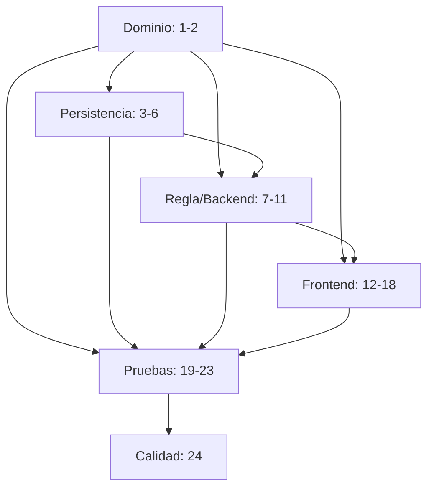
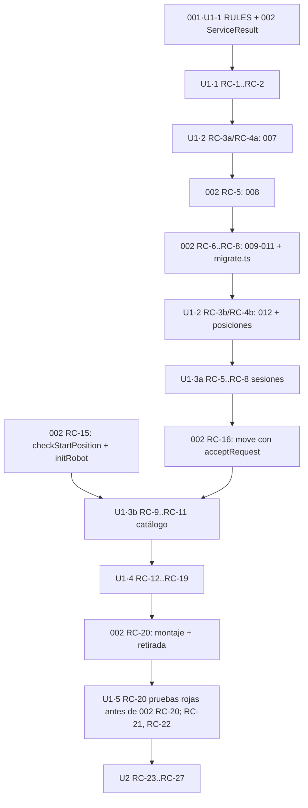
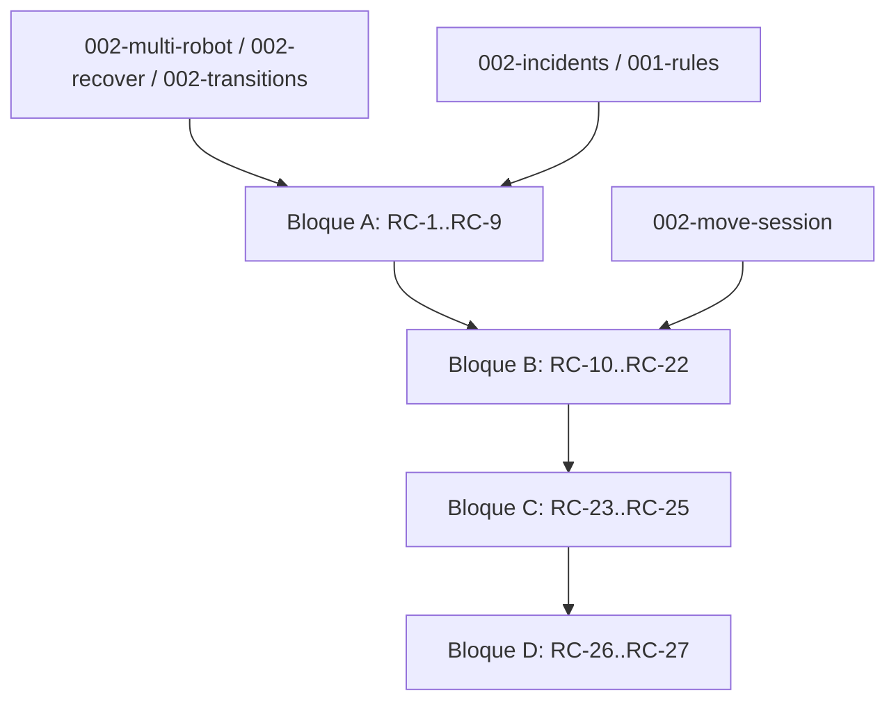
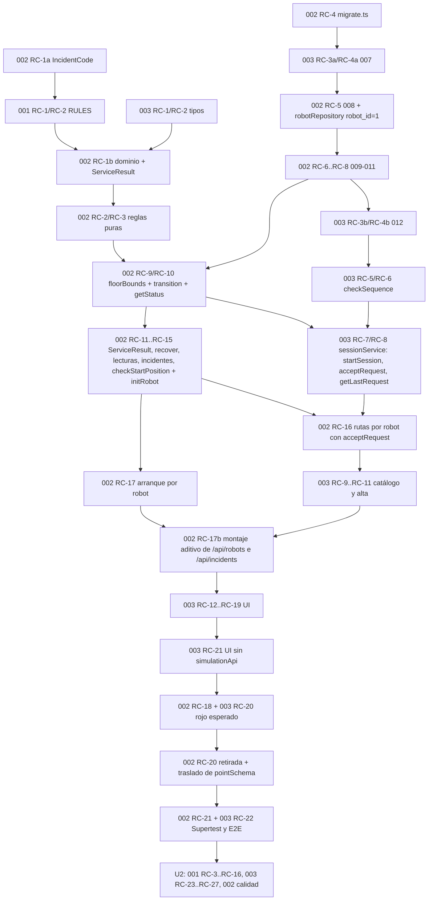
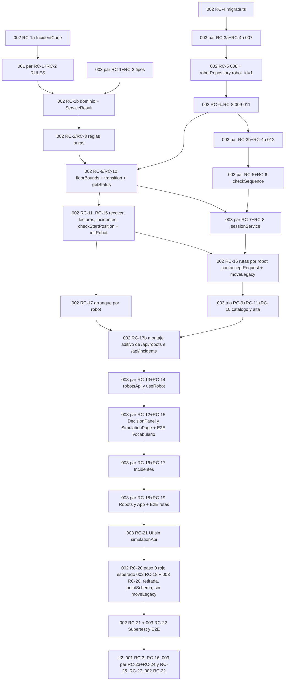
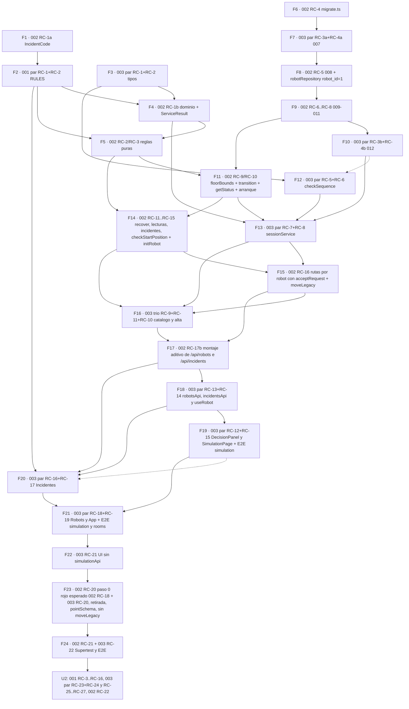

# Implementation Plan: Simulación de movimiento (003-movement-simulation)

**Fase MADA:** CONSTRUIR
**HU cubiertas:** HU-03
**Estado:** Tareas 1–24 implementadas; revisión QA RECHAZADA por B-1 — se resuelve con RC-01. Refuerzo RC-01 (rev2 a rev6): pendiente de inicio (requiere aprobación humana del refuerzo en requirements.md y design.md)

## Overview

Plan de implementación de la HU-03. Orden: dominio → persistencia → regla/servicio/backend →
frontend → pruebas → calidad. La decisión vive en el backend (regla pura `decideMovement`
que reutiliza `isCollision` de la spec 001); la UI solo muestra la respuesta de la API.

## Tasks

- [x] 1. Añadir al dominio `@home-guardian/domain` los tipos `RobotStateName`, `Decision`, `RobotSnapshot`, `MoveRequest`, `MoveResult`
  - _Requisitos: RF-02, RF-03, RNF-02_
- [x] 2. Añadir esquemas Zod `pointSchema` y `moveRequestSchema` y exportarlos desde `index.ts`
  - _Requisitos: RNF-01, RF-01.2_
- [x] 3. Crear migración `create_robot_state.sql` (tabla singleton `robot_state` con estado y posición)
  - _Requisitos: RF-02.1, DD-103_
- [x] 4. Crear migración `create_movement_log.sql` (tabla append-only `movement_log`)
  - _Requisitos: RF-05.1, DD-105_
- [x] 5. Implementar `robotRepository` (leer snapshot, actualizar estado/posición) con SQL parametrizado
  - _Requisitos: RF-02.1, RF-03.1, RF-03.2_
- [x] 6. Implementar `movementLogRepository` (solo inserción de decisiones)
  - _Requisitos: RF-05.1_
- [x] 7. (TDD, prueba roja primero) Implementar la regla pura `decideMovement` reutilizando `isCollision` (spec 001): ALLOW, PREVENTIVE_STOP (destino y trayectoria), DENIED_SAFE_STOP
  - _Requisitos: RF-02.2, RF-03.1, RF-03.2, RF-03.3, RNF-06_
- [x] 8. Implementar `movementService`: validar límites del plano (`DESTINATION_OUT_OF_BOUNDS`), leer zonas activas y robot, invocar `decideMovement`, persistir estado y log
  - _Requisitos: RF-01.4, RF-02.3, RF-05.1, DD-107_
- [x] 9. Implementar `simulationController` mapeando decisión → HTTP (200 ALLOW/PREVENTIVE_STOP, 409 DENIED_SAFE_STOP, 422 fuera de plano/payload)
  - _Requisitos: RF-04, DD-101, DD-102_
- [x] 10. Crear `routes/simulationRoutes.ts` (`GET /robot`, `POST /move`, `POST /reset`) y montar en `app.ts`
  - _Requisitos: Contrato de API_
- [x] 11. Implementar `reset` (SAFE_STOP → IDLE conservando posición) como única salida de SAFE_STOP
  - _Requisitos: DD-106_
- [x] 12. Crear `api/client.ts` + `simulationApi` (getRobot, move, reset)
  - _Requisitos: Convención frontend_
- [x] 13. Crear `hooks/useSimulation.ts` con estados de carga/error por operación
  - _Requisitos: RF-04.5_
- [x] 14. Reutilizar `FloorPlan` para capturar destino por clic (viewport→coords de plano) y pintar la posición del robot
  - _Requisitos: RF-01.1, RF-04.4_
- [x] 15. Crear `components/CoordInput.tsx` (destino por coordenadas) produciendo el mismo `Point` que el clic
  - _Requisitos: RF-01.2, RF-01.3, CA-03.7_
- [x] 16. Crear `components/DecisionPanel.tsx` que muestra decisión/estado/razón sin recalcular reglas (parada preventiva + `zoneName`; `SAFE_STOP_ACTIVE`)
  - _Requisitos: RF-04.1, RF-04.2, RF-04.3, CA-03.6_
- [x] 17. Integrar `pages/SimulationPage.tsx` (plano + entrada + panel) y actualizar posición/estado tras cada solicitud
  - _Requisitos: RF-04.4_
- [x] 18. Dejar placeholder reservado de inyección de fallos de sensor / alerta A-04 / prueba T-18 (sin implementar)
  - _Requisitos: Fuera de alcance (reservado)_
- [x] 19. Pruebas unit de `decideMovement`: ALLOW, PREVENTIVE_STOP (destino en zona), PREVENTIVE_STOP (trayectoria cruza), DENIED desde SAFE_STOP, determinismo
  - _Requisitos: CA-03.1, CA-03.2, CA-03.3, CA-03.4, RNF-06_
- [x] 20. Pruebas unit del servicio: 422 DESTINATION_OUT_OF_BOUNDS, persistencia de estado y de `movement_log`
  - _Requisitos: CA-03.5, RF-05.1_
- [x] 21. Pruebas de integración (Supertest): GET /robot, POST /move 200/409/422, POST /reset, registro en movement_log
  - _Requisitos: Contrato de API, CA-03.1..CA-03.5, CA-03.8_
- [x] 22. Pruebas de componentes (RTL): DecisionPanel no recalcula; destino por clic == por coordenadas
  - _Requisitos: CA-03.6, CA-03.7_
- [x] 23. Prueba E2E (Playwright): clic en zona → parada preventiva visible; reset → IDLE
  - _Requisitos: HU-03, CA-03.2, CA-03.4_
- [ ] 24. Calidad: ESLint + Prettier sin errores, cero `any`, sin secretos, pipeline CI verde
  - _Requisitos: RNF-02, Compuerta de oro_
  - Parcial (2026-11-22): ESLint sin errores, typecheck y build OK, cero `any`, sin secretos;
    archivos de la HU formateados con el estilo del repo (comillas simples, 100 columnas).
    **Pendiente:** el repo no tiene configuración de Prettier (`npm run format:check` falla
    en todo el repo con los valores por defecto) ni workflow de GitHub Actions, así que no
    hay "pipeline CI verde" que mostrar.

## Task Dependency Graph



```json
{
  "waves": [
    { "id": 0, "tasks": ["1", "2"] },
    { "id": 1, "tasks": ["3", "4", "5", "6"] },
    { "id": 2, "tasks": ["7", "8", "9", "10", "11"] },
    { "id": 3, "tasks": ["12", "13", "14", "15", "16", "17", "18"] },
    { "id": 4, "tasks": ["19", "20", "21", "22", "23"] },
    { "id": 5, "tasks": ["24"] }
  ]
}
```

## Notes

- TDD obligatorio en `decideMovement` (tarea 7): prueba roja antes de implementar.
- La UI nunca evalúa reglas: solo muestra la respuesta de la API (art. III).
- `movement_log` es append-only (sin UPDATE/DELETE); registro inmutable de decisiones.
- Reservado (no implementar en esta spec): inyección de fallos de sensor, alerta A-04,
  prueba T-18, y estados DEGRADED/RECOVERING.
- Compuerta Fase 3 (CONSTRUIR): todas las tareas completas, cada CA con al menos una prueba,
  revisión del humano antes de pasar a VERIFICAR.

### Trazabilidad CA → tarea
| CA | Tareas |
|----|--------|
| CA-03.1 | 7, 8, 19, 21 |
| CA-03.2 | 7, 16, 19, 21, 23 |
| CA-03.3 | 7, 19, 21 |
| CA-03.4 | 7, 11, 16, 19, 21, 23 |
| CA-03.5 | 8, 20, 21 |
| CA-03.6 | 16, 22 |
| CA-03.7 | 14, 15, 22 |
| CA-03.8 | 6, 8, 21 |

---

## Refuerzo RC-01 rev2 — plan vigente [RC-01 rev2]

Sustituye al plan RC-01 original (conservado abajo como histórico, con prefijo `v1-`). Resuelve
B-1 (ciclos), B-2 (doble migración de la UI), I-1 (dos vigilantes en integraciones intermedias),
I-2 (orden de migraciones) e I-8 (pruebas afectadas por archivo) del informe del analista.

> **[RC-01 rev3]** Ajustes de la ronda final del analista (N-2, N-4, N-5, N-12, N-13, N-14) y de las
> decisiones del humano (Q-I, vistas excluidas):
> - **Orden único (N-5):** el orden exacto de las tareas de las specs 001, 002 y 003 dentro de U1
>   es la tabla **"Orden intercalado de U1"** del `tasks.md` de la spec 002; el grafo de abajo la
>   cita y no la contradice.
> - El paso 2 se divide en **RC-3a/RC-4a** (`007`, antes de la 002 RC-5) y **RC-3b/RC-4b** (`012` y
>   posiciones, después de la 002 RC-8). El paso 3 se divide en **3a** (sesiones, RC-5..RC-8, antes
>   de la 002 RC-16) y **3b** (catálogo, RC-9..RC-11, después de la 002 RC-15/RC-16).
> - ~~El montaje en `app.ts` y la retirada del vigilante provisional tienen **una sola tarea dueña:
>   la 002 RC-20** (N-14). RC-21 de esta spec pasa a "UI y pruebas de la UI tras la retirada".~~
>   *(Sustituido por RC-01 rev4/rev5: el montaje aditivo es la **002 RC-17b**; la **002 RC-20** solo
>   retira; RC-21 de esta spec va **antes** de ella.)*
> - Las vistas "Visión general" e "Ingeniería · SDD" quedan fuera de alcance (requirements §7): no
>   hay tareas para ellas y la barra lateral tiene solo 4 entradas (RC-18/RC-19).

> **[RC-01 rev4]** Ajustes de la pasada del analista sobre la rev3 y de las decisiones del humano:
> - **Montaje aditivo (decisión 2, I-2):** la spec 002 monta `/api/robots` e `/api/incidents` en
>   `app.ts` **de forma aditiva** al final de su paso 3 (tarea 002 RC-17b, "montaje aditivo de /api/robots (002,
>   final del paso 3)"), junto a las rutas antiguas. La UI del paso 4 (RC-12..RC-19) depende de ese
>   montaje, y el E2E se mantiene en verde. El paso 5 solo **retira** lo antiguo. Nada intermedio se
>   integra: U1 llega entera a `integration`, así que nunca hay dos vigilantes integrados.
> - **I-1:** RC-21 (retirar `simulationApi`, `useSimulation` y re-exportaciones de `types/index.ts`)
>   va **antes** de la 002 RC-20, que retira `Decision`, `MoveResult`, `RobotSnapshot` y
>   `simulation.schema.ts`; así el typecheck del frontend nunca queda en rojo.
> - **I-3/I-4:** `acceptRequest(robotId, cmd, currentState)`, `getLastRequest(robotId)`;
>   `startSession` lee el estado con `robotRepository.getStatus` (002 RC-10, que va antes de RC-7).
> - **Decisión 1:** alta con zonas no legibles → `409 ROBOT_START_NOT_VERIFIABLE` (RC-9, RC-18).
> - **I-6:** el grafo vigente es el de "Dependencias RC-01 rev4" (al final), copiado del orden de la
>   tabla de la 002.

> **[RC-01 rev5]** Ajustes de la pasada del analista sobre la rev4 (N4-1..N4-4, M4-1..M4-5) y de las
> decisiones del humano (2026-11-23):
> - **Unidad de "verde" = el par "prueba roja → implementación" (decisión 1, N4-2).** Cada par se
>   ejecuta seguido y ocupa **una sola fila** de la tabla "Orden intercalado de U1" (spec 002). Las
>   tareas siguen separadas para que se vea el rojo (art. V), pero la suite se exige en verde al
>   final de cada par, no entre sus dos tareas. El único rojo que cruza filas es el "rojo esperado"
>   declarado dentro de la 002 RC-20, paso (0). Cada tarea afectada lleva su marca `[par: …]`.
> - **Pares de esta spec (una fila cada uno):** (RC-1 + RC-2), (RC-3a + RC-4a), (RC-3b + RC-4b),
>   (RC-5 + RC-6), (RC-7 + RC-8), **trío** (RC-9 + RC-11 + RC-10), (RC-13 + RC-14), (RC-12 + RC-15),
>   (RC-16 + RC-17), (RC-18 + RC-19) y, en U2, (RC-23 + RC-24).
> - **Orden de ejecución dentro del paso 4:** (RC-13 + RC-14) → (RC-12 + RC-15) → (RC-16 + RC-17) →
>   (RC-18 + RC-19). RC-15 usa `useRobot`/`robotsApi` (RC-14), así que la capa de datos va antes que
>   el par de `DecisionPanel`/`SimulationPage`; si RC-12 fuese primero, su prueba quedaría en rojo
>   durante el par (RC-13 + RC-14).
> - **RC-11 (resolución de N4-2):** era una tarea "prueba roja primero" situada **después** de su
>   implementación (RC-10), así que no podía verse en rojo. Se **mueve antes de RC-10** (los IDs no
>   cambian; el orden de ejecución es RC-9, RC-11, RC-10) y forma un **trío** con RC-9 y RC-10: las
>   pruebas unitarias del servicio (RC-9) y la integración Supertest (RC-11) fallan hasta que RC-10
>   implementa el catálogo y `robotsRoutes`. Es válido porque todo lo que RC-11 ejercita aparte del
>   catálogo (`acceptRequest`, `getLastRequest`, rutas por robot de la 002) ya existe en filas
>   anteriores de la tabla (RC-8 y 002 RC-16). Se descarta quitarle la etiqueta: la integración
>   verifica las filas de `audit_log` tras cada `409` (Property 11), un comportamiento crítico.
> - **N4-1 (E2E):** RC-15 adapta lo mínimo de `frontend/tests/e2e/simulation.spec.ts` al vocabulario
>   (`AUTHORIZED`/`DENIED`/`REJECTED`, `state: IDLE`) y RC-19 a las rutas nuevas y a la barra de 4
>   entradas, de modo que el E2E existente siga en verde al cerrar cada par. RC-22 queda como
>   **ampliación** (los casos nuevos).
> - **N4-3 (restos):** tachados o marcados como sustituidos los textos del bloque rev3 y de RC-21 que
>   contradecían el orden vigente. RC-21 se reescribe: retira solo la UI antigua, requiere
>   RC-12..RC-19 y la 002 RC-17b, y va **antes** de la 002 RC-20; las pruebas del backend y del
>   dominio retiradas, y el traslado de `pointSchema`, son de la 002 RC-20.
> - **M4-1 (CA-03.28):** la prueba de la barra lateral (RC-18) afirma que no hay ningún nodo con los
>   textos de las vistas excluidas, ni entradas deshabilitadas, ni «Fuera del MVP»/«reservado», ni el
>   encabezado del grupo. La tarjeta «Fuera del MVP» del catálogo de reglas de la spec 001 está en
>   «Zonas y reglas», no en la barra lateral: la aserción se limita al contenedor de la barra.
> - **M4-3 (rojo esperado):** el "rojo esperado" vive **dentro de la 002 RC-20, paso (0)**; en el
>   grafo, los nodos C3 y C4 de la rev4 se fusionan en uno solo (ver "Dependencias RC-01 rev5").
> - **Decisión 2 (lado 003):** esta spec no usa el controlador antiguo `/api/robot/*`. Mientras
>   conviven, la 002 lo mantiene con la vía temporal `moveLegacy(robotId = 1, destination)` (sin
>   sesión); RC-20 de esta spec añade la aserción de que `moveLegacy` ya no existe tras la 002 RC-20.

> **[RC-01 rev6]** Pasada final del analista sobre la rev5 (N5-1..N5-7) y decisiones del humano
> (2026-11-23):
> - **N5-1 (E2E):** `#/supervision` se mantiene como ruta por defecto. Los E2E existentes son **dos**:
>   `simulation.spec.ts` y `rooms.spec.ts`. RC-15 fija un `data-testid` **por robot** (`robot-<id>`) y
>   adapta `simulation.spec.ts` al robot seleccionado; RC-19 adapta `simulation.spec.ts` a las rutas y
>   `rooms.spec.ts` a `/#/zonas`. Sin eso, el par no termina en verde: con dos robots un único
>   `data-testid="robot"` viola el modo estricto de Playwright, y con la ruta por defecto nueva las 4
>   pruebas de `rooms.spec.ts` (que abren `/`) fallan (DD-139).
> - **N5-3:** la tabla de la 002 queda en **24 filas**: se elimina la de 002 RC-17 (su prueba pasa a
>   002 RC-10). Los números de fila del grafo y de las notas siguen la numeración rev6.
> - **N5-4:** (RC-16 + RC-17) depende también de (RC-13 + RC-14), que implementa `incidentsApi`
>   (fila 18 → fila 20; DD-140). Las aristas **discontinuas** del grafo (p. ej. fila 12 tras la 10,
>   fila 19 → 20) son solo **orden de ejecución**, no dependencias; la columna «Depende de» de la tabla
>   de la 002 manda.
> - **N5-6:** restos de la rev3/rev4/rev5 marcados como sustituidos (reglas del plan, encabezados de los
>   pasos 3 y 5).

**Reglas del plan**
- **Dos unidades de integración.** Nada intermedio se integra en `integration`/`develop`. Dentro de
  la rama de trabajo ~~cada tarea termina en verde~~ **[RC-01 rev6]** (N5-6) cada **fila** de la tabla (par prueba roja → implementación) termina en verde: el código antiguo sigue funcionando hasta su
  tarea de retirada, que va dentro de la misma unidad.
- **U1 — vigilante único + incidentes + robots y sesiones** (prioridad del humano), pasos 1–5:
  1. dominio aditivo; 2. migraciones en orden de entrega; 3. backend probado con apps de prueba
  ~~**sin montar** en `app.ts`~~ **[RC-01 rev6]** (con montaje aditivo al final, 002 RC-17b); 4. UI contra `/api/robots/:robotId/*` (una sola migración, Q-F);
  5. ~~montaje en `app.ts` +~~ retirada del vigilante provisional + prueba de arquitectura + E2E.
  **[RC-01 rev4]** El montaje pasa al final del paso 3 (aditivo, spec 002); el paso 5 queda en
  retirada + prueba de arquitectura + E2E. **[RC-01 rev6]** (N5-6) Los textos tachados son los de la rev3.
- **U2 — supervisión completa y zonas:** indicadores, "Enviar a escaleras", panel de telemetría,
  y lo de la spec 001 (registro de cambios de zona `013`, tarjeta de reglas), calidad.
- **TDD:** toda tarea "(Prueba roja primero)" se ejecuta y se ve fallar con evidencia real
  (art. XV) antes de su implementación. **[RC-01 rev5]** La unidad de verde es el **par** prueba
  roja → implementación (ver arriba); ninguna tarea "prueba roja primero" va después de su
  implementación.
- **Sin dependencias hacia delante:** cada tarea solo requiere tareas de un paso igual o anterior,
  de esta spec o de las otras. Dependencias externas por paso:
  - [001·U1-1] `RULES` y `ruleForDecision` (spec 001, única definición).
  - [002·U1-2] migraciones `008_robot_state_per_robot`, `009_incidents_robot_rule_zone`,
    `010_create_state_transition_log` (con fila base `MIGRATION_BASELINE`), `011_audit_log_generalize`
    y el endurecimiento de `migrate.ts` (spec 002).
  - [002·U1-3] `guardianService` por robot: `initRobot` (`INSERT` simple), `move` que invoca
    `acceptRequest` y audita sus rechazos, `recover` con `transitioned`/`cause`, `position` con
    `POSITION_CONFLICT` y pérdida → `DEGRADED` + incidente `R-SIGNAL-01`, incidentes con
    `robot_id`/`rule`/`zone_name` y `GET /api/incidents(/:id)` (spec 002).
  - [002·U1-5] ~~montaje de las rutas por robot y~~ *(rev4/rev5: el montaje es la 002 RC-17b)* retirada de `/api/robot/*` singular, de
    `RobotSnapshot`, de `get`/`save` del `robotRepository` y del alias `moveSchema` (spec 002, I-9).
  - **[RC-01 rev3]** Dependencias concretas por tarea de la 002 (ver su "Orden intercalado de U1"):
    [002·RC-5] migración `008` (requiere RC-4a); [002·RC-8] migración `011` (antes de RC-4b);
    [002·RC-15] `checkStartPosition` + `initRobot(robotId, position)` (antes de RC-9..RC-10);
    [002·RC-16] `move` que invoca `acceptRequest` (después de RC-8 de esta spec);
    ~~[002·RC-20] montaje en `app.ts` + retirada, dueña única (antes de RC-21);~~ **[RC-01 rev5]**
    [002·RC-17b] montaje aditivo en `app.ts` (final del paso 3); [002·RC-20] solo retirada, **después** de RC-21;
    `ServiceResult<T>` de la 002 (paso 1) para `acceptRequest`.

### U1 · paso 1 — Dominio (aditivo, build en verde)

- [x] RC-1. [U1·1] **[par: RC-1 + RC-2]** (Prueba roja primero) Pruebas de dominio de `robotInputSchema` (nombre 1–60 tras `trim`, solo espacios, tipo inválido, campos extra → inválido) y `moveCommandSchema` (`sessionId` UUID, `sequence` entero ≥ 1, `destination` punto)
  - _Requisitos: RF-07.2, RF-08.2, RNF-01_
  - _Pruebas: nuevas `domain/tests/robotCatalogSchema.test.ts` y `domain/tests/moveCommandSchema.test.ts`_
- [x] RC-2. [U1·1] **[par: RC-1 + RC-2]** Añadir al dominio `RobotType`, `Robot` (con `state: RobotStateName` y `lastRequest: LastRequest | null`), `RobotInput`, `MoveCommand`, `SessionInfo`, `LastRequest`, `robotInputSchema` y `moveCommandSchema`; exportar desde `index.ts` sin tocar los tipos de la 003 que aún usa la UI
  - _Requisitos: RF-07, RF-08, RF-08.9, RNF-02, DD-122_ — ~~requiere [001·U1-1] solo para los tipos de `rule` que muestra la UI~~ **[RC-01 rev4] (M-4)** sin dependencias (fila 3 de la tabla de la 002); el `RuleId` que muestra la UI se usa a partir de RC-16/RC-17

### U1 · paso 2 — Migraciones en orden de entrega

- ~~RC-3 y RC-4 (rev2)~~ *(Sustituidas por RC-3a/RC-4a y RC-3b/RC-4b en RC-01 rev3, N-5: agrupaban la `007` y la `012` y creaban un ciclo con la 002.)*
- [x] RC-3a. [U1·2] **[par: RC-3a + RC-4a]** **[RC-01 rev3]** (Prueba roja primero) Pruebas de `007_create_robots.sql`: CHECK de nombre (1–60 tras `trim`) y tipo, `UNIQUE(name)`, semilla A1 (id 1, `VACUUM`) y V2 (id 2, `GUARD`); `robotCatalogRepository` (lista, alta, búsqueda por id)
  - _Requisitos: RF-07.3, RF-07.5, DD-110_
  - _Pruebas: modifica `backend/tests/unit/migrate.test.ts` (lista de tablas y versiones); nueva `backend/tests/unit/robotCatalogMigrations.test.ts`_
- [x] RC-4a. [U1·2] **[par: RC-3a + RC-4a]** **[RC-01 rev3]** Crear `007_create_robots.sql` (primera migración de U1) y `robotCatalogRepository` con SQL parametrizado; fechas con `strftime('%Y-%m-%dT%H:%M:%fZ','now')`. **Antes** de la 002 RC-5 (`008`)
  - _Requisitos: RF-07.5, DD-110_
- [x] RC-3b. [U1·2] **[par: RC-3b + RC-4b]** **[RC-01 rev3]** (Prueba roja primero) Pruebas de `012_create_robot_sessions.sql` (esquema único: `session_id UNIQUE`, `last_sequence NOT NULL DEFAULT 0`, `last_destination_x/y`, `last_accepted_at`, FK a `robots`), de `sessionRepository` y, con la `008` de la 002 ya aplicada, de las posiciones (Q-I): base nueva → A1 en (120, 90) y V2 en (488, 290); base existente → A1 conserva la fila anterior y V2 se crea en (488, 290); la `012` se aplica después de la `011` (con `migrate.ts` endurecido)
  - _Requisitos: RF-07.6, RF-08.5, CA-03.19, DD-122, DD-124_ — requiere [002·RC-5] y [002·RC-8]
  - _Pruebas: amplía `backend/tests/unit/robotCatalogMigrations.test.ts` y `backend/tests/unit/migrate.test.ts`_
- [x] RC-4b. [U1·2] **[par: RC-3b + RC-4b]** **[RC-01 rev3]** Crear `012_create_robot_sessions.sql` y `sessionRepository` (SQL parametrizado), **después** de la 002 RC-8 (`011`)
  - _Requisitos: RF-08.5, DD-111, DD-122_ — requiere [002·RC-8]

### U1 · paso 3 — Backend ~~sin montar en `app.ts`~~ **[RC-01 rev6]** (apps de prueba; montaje aditivo al final, 002 RC-17b)

#### [RC-01 rev3] Paso 3a — Sesiones (RC-5..RC-8; **antes** de la 002 RC-16)

- [x] RC-5. [U1·3] **[par: RC-5 + RC-6]** (Prueba roja primero) Pruebas unitarias de `checkSequence`: sesión vigente, ajena o inexistente; `lastSequence = 0`; secuencia mayor, igual y menor
  - _Requisitos: RF-08.3, RF-08.4, Property 7, CA-03.11, CA-03.12_
  - _Pruebas: nueva `backend/tests/unit/sequenceRule.test.ts`_
- [x] RC-6. [U1·3] **[par: RC-5 + RC-6]** Implementar `rules/sequenceRule.ts` (`checkSequence`, pura)
  - _Requisitos: RF-08.3, RF-08.4, DD-112_
- [x] RC-7. [U1·3] **[par: RC-7 + RC-8]** (Prueba roja primero) Pruebas de `sessionService`: `startSession` invalida la anterior y deja `last_sequence = 0`; `acceptRequest` devuelve `{ kind: 'accepted' }` o `{ kind: 'rejected', code }` **sin lanzar** (B-5); la última solicitud aceptada se persiste y se expone como `LastRequest`. **[RC-01 rev3]** `acceptRequest(robotId, cmd): ServiceResult<LastRequest>` devuelve `{ kind: 'ok', value }` (sustituye a `{ kind: 'accepted' }`, N-4) y audita `INVALID_SESSION`/`DUPLICATE_EVENT`; `startSession` audita `SESSION_STARTED` (N-13, CA-03.34); filas de `audit_log` leídas tras confirmar. **[RC-01 rev4] (I-3, I-4)** `acceptRequest(robotId, cmd, currentState)` audita con el `currentState` recibido; `startSession` lee el estado con `robotRepository.getStatus(robotId)` de la 002; `getLastRequest(robotId)` devuelve la última solicitud aceptada o `null`
  - _Requisitos: RF-08.1, RF-08.4, RF-08.5, RF-08.8, RF-08.9, DD-117_; **[RC-01 rev4]** DD-132 — requiere [002·RC-10] (`getStatus`)
  - _Pruebas: nueva `backend/tests/unit/sessionService.test.ts`_
- [x] RC-8. [U1·3] **[par: RC-7 + RC-8]** Implementar `services/sessionService.ts` (`startSession`, `acceptRequest`; **[RC-01 rev4]** `getLastRequest`, y `acceptRequest(robotId, cmd, currentState)`) — requiere [002·RC-10]
  - _Requisitos: RF-08.1, RF-08.5, DD-117_
  - **[RC-01 rev3]** _Requisitos añadidos: CA-03.34, DD-127_ — `ServiceResult<T>` de la 002 (paso 1); es la única unión con el `move` de la 002 (que la invoca en su RC-16)

#### [RC-01 rev3] Paso 3b — Catálogo de robots (RC-9..RC-11; **después** de la 002 RC-15 y RC-16)
- [x] RC-9. [U1·3] **[par: RC-9 + RC-11 + RC-10]** (Prueba roja primero) Pruebas de `robotCatalogService.register`: estado inicial creado por `guardianService.initRobot` en la misma transacción; con la zona "Sala" activa → `{ kind: 'rejected', code: 'ROBOT_START_IN_RESTRICTED_ZONE' }`, fila en `audit_log` leída **después** de confirmar y sin filas nuevas en `robots`/`robot_state`; nombre repetido → `409 ROBOT_NAME_DUPLICATE`; si `initRobot` falla, no queda fila en `robots`. **[RC-01 rev3] (N-2)** El rechazo lo decide y audita `guardianService.checkStartPosition`, invocado **antes** del `INSERT` en `robots` (una sola fila de auditoría); `initRobot(robotId, { x: 120, y: 90 })` solo crea el estado y T9. **[RC-01 rev4]** Con el repositorio de zonas caído → `409 ROBOT_START_NOT_VERIFIABLE` con `cause: ZONE_DATA_UNAVAILABLE`, fila de auditoría y sin filas nuevas (CA-03.35); nombre repetido con "Sala" activa → `409 ROBOT_NAME_DUPLICATE` sin fila de auditoría (orden de validación, CA-03.36)
  - _Requisitos: RF-07.1, RF-07.3, RF-07.4, RF-07.9, Property 8, Property 11, CA-03.9, CA-03.22, DD-118_; **[RC-01 rev4]** RF-07.10, CA-03.35, CA-03.36, DD-129
  - _Pruebas: nueva `backend/tests/unit/robotCatalogService.test.ts`_
- [x] RC-11. [U1·3] **[par: RC-9 + RC-11 + RC-10]** **[RC-01 rev5] (N4-2)** *(se ejecuta antes de RC-10: movida desde su posición anterior para que pueda verse en rojo)* (Prueba roja primero) Integración Supertest sobre una app de prueba con las rutas de esta spec y las por robot de la 002 (sin `app.ts`): `GET/POST /api/robots` (201/422/409/404), `ROBOT_START_IN_RESTRICTED_ZONE`, `POST .../sessions`, `move` con `INVALID_SESSION`, `DUPLICATE_EVENT` e `INVALID_MOVE_REQUEST`; tras **cada** `409` se lee `audit_log` (Property 11); `lastRequest` en `GET .../state` (**[RC-01 rev4]** vía `getLastRequest`; también `409 ROBOT_START_NOT_VERIFIABLE` con `cause`)
  - _Requisitos: RF-06.1, RF-07, RF-08.3, RF-08.4, RF-08.8, RF-08.9, CA-03.9..CA-03.12, CA-03.20, CA-03.22, CA-03.25_ — requiere [002·U1-3]
  - _Pruebas: nueva `backend/tests/integration/robots.api.test.ts`_
- [x] RC-10. [U1·3] **[par: RC-9 + RC-11 + RC-10]** Implementar `robotCatalogService` (transacción `IMMEDIATE`: validación Q-D con la geometría de la 001, fila de `robots`, `initRobot`), `robotsController` y `routes/robotsRoutes.ts` (`GET/POST /api/robots`, `GET /api/robots/:robotId`, `POST /api/robots/:robotId/sessions`); probados con una app de prueba que monta solo estas rutas
  - _Requisitos: RF-07, RF-08.1, DD-110, DD-117, DD-118_ — requiere [002·U1-3] (`initRobot`)
  - **[RC-01 rev5] (N4-2)** Cierra el trío (RC-9 + RC-11 + RC-10): al terminar, las pruebas de RC-9 y RC-11 pasan a verde. DD-137.
  - **[RC-01 rev4] (M-2)** `robotsRoutes` es la **única** dueña de `POST /api/robots/:robotId/sessions`; las rutas `state|move|recover|position` las monta `guardianRoutes` de la 002 (DD-135). Orden de validación del alta (M-10): payload → nombre duplicado → `checkStartPosition`.
  - **[RC-01 rev3] (N-2)** La "validación Q-D con la geometría de la 001" queda sustituida: la transacción es `checkStartPosition(position)` → (si `ok`) `INSERT robots` → `initRobot(robotId, position)`. _Requisitos añadidos: RF-07.9, DD-126_ — requiere [002·RC-15]

### U1 · paso 4 — UI contra `/api/robots/:robotId/*` (una sola migración, Q-F)

> **[RC-01 rev4] (decisión 2)** Todas las tareas de este paso (RC-12..RC-19) requieren el
> **002 RC-17b — montaje aditivo de /api/robots (final del paso 3)**: la UI y el E2E encuentran las rutas
> nuevas montadas en `app.ts`, junto a las antiguas, y cada tarea termina en verde.
>
> **[RC-01 rev5] Orden de ejecución del paso 4 (unidad de verde = par):** (RC-13 + RC-14) →
> (RC-12 + RC-15) → (RC-16 + RC-17) → (RC-18 + RC-19). El E2E existente se mantiene en verde al cerrar
> cada par: RC-15 lo adapta al vocabulario y RC-19 a las rutas y a la barra de 4 entradas (N4-1).

- [x] RC-12. [U1·4] **[par: RC-12 + RC-15]** (Prueba roja primero) Pruebas RTL de `DecisionPanel` con el vocabulario de la 002: `AUTHORIZED`, `DENIED` (code, zona, `incidentId`), `REJECTED` con `SAFE_STOP_ACTIVE` y con `BUSY`, sin código inventado
  - _Requisitos: RF-04.1, RF-04.2, RF-04.3, CA-03.2, CA-03.4, CA-03.6_
  - _Pruebas: reescribe `frontend/tests/components/DecisionPanel.test.tsx`_
- [x] RC-13. [U1·4] **[par: RC-13 + RC-14]** (Prueba roja primero) Pruebas RTL de `robotsApi` y `useRobot(robotId)`: estado con `lastRequest`; `move` con `sessionId` y `sequence` automáticos (1, 2, 3); `recover` con `transitioned` true/false y `409 RECOVERY_NOT_ALLOWED` con `cause`; `409` de rechazo mostrados tal cual; "Perder conexión" envía `MISSING`; "Recuperar señal" envía `RELIABLE` con la posición del último estado y muestra `POSITION_CONFLICT` si llega
  - _Requisitos: RF-04.5, RF-08.6, RF-10.6, RF-10.7, RF-11.2, RF-11.3, CA-03.13, CA-03.14, CA-03.23, CA-03.31, CA-03.32_
  - _Pruebas: nueva `frontend/tests/components/useRobot.test.tsx`; sustituye a `useSimulation.test.tsx` (se retira en ~~RC-23~~ **[RC-01 rev4] (M-4)** RC-21)_
- [x] RC-14. [U1·4] **[par: RC-13 + RC-14]** Implementar `robotsApi` e `incidentsApi` en `api/client.ts` y los hooks `useRobot` y `useRobots` contra `/api/robots/:robotId/*` (sin etapa `/api/robot`)
  - _Requisitos: RF-11.1, RF-04.4, RF-04.5, RF-08.6, DD-116_ — requiere [002·U1-3]; **[RC-01 rev4]** requiere el 002 RC-17b — montaje aditivo de /api/robots (final del paso 3)
- [x] RC-15. [U1·4] **[par: RC-12 + RC-15]** Adaptar `DecisionPanel` y `SimulationPage`: vocabulario de la 002, "Liberar parada" → `recover` con mensajes según `transitioned`/`cause`, botones "⌁ Perder conexión" y "↻ Recuperar señal", 5 estados y `positionQuality` con los colores del prototipo, selector de robot y `FloorPlan` con N robots
  - _Requisitos: RF-04.2, RF-04.3, RF-04.6, RF-10.2, RF-10.5..RF-10.7, RF-11.2, RF-11.3, CA-03.13, CA-03.14, CA-03.16, CA-03.30..CA-03.32, DD-120_
  - _Pruebas: reescribe `frontend/tests/components/SimulationPage.test.tsx` y `FloorPlan.test.tsx` (N robots, colores por estado y tipo)_
  - **[RC-01 rev5] (N4-1)** _Pruebas: adapta lo mínimo de `frontend/tests/e2e/simulation.spec.ts` al vocabulario nuevo (`AUTHORIZED`/`DENIED`/`REJECTED`, `state: IDLE`, `data-testid` de la decisión) para que el E2E existente siga en verde al cerrar el par. Los casos nuevos son de RC-22_
  - **[RC-01 rev6] (N5-1)** `FloorPlan` con N robots pinta un **`data-testid="robot-<id>"` por robot** (ya no existe un único `robot`, que con dos robots viola el modo estricto de Playwright); `simulation.spec.ts` (sus `getByTestId('robot')`), `SimulationPage.test.tsx` y `FloorPlan.test.tsx` se adaptan al **robot seleccionado** (`robot-1`, A1, por defecto). DD-139
- [x] RC-16. [U1·4] **[par: RC-16 + RC-17]** (Prueba roja primero) Pruebas RTL de `IncidentsPage`: tabla Fecha · Robot · Regla · Zona · Decisión, contador "N eventos", detalle con snapshot, estado vacío ("0 eventos"), incidente `R-SIGNAL-01` con zona "—", botones HU-06/HU-07 deshabilitados
  - _Requisitos: RF-09.1..RF-09.6, CA-03.15, CA-03.26, CA-03.27_
  - _Pruebas: nueva `frontend/tests/components/IncidentsPage.test.tsx`_
- [x] RC-17. [U1·4] **[par: RC-16 + RC-17]** Implementar `useIncidents`, `IncidentsPage`, `IncidentTable` e `IncidentDetail` (solo lectura)
  - _Requisitos: RF-09.1..RF-09.6_ — requiere [002·U1-3], [001·U1-1]; **[RC-01 rev4]** requiere el 002 RC-17b — montaje aditivo de /api/robots (final del paso 3); **[RC-01 rev6]** (N5-4) requiere también el par (RC-13 + RC-14), que implementa `incidentsApi` (fila 18 de la tabla de la 002; DD-140)
- [x] RC-18. [U1·4] **[par: RC-18 + RC-19]** (Prueba roja primero) Pruebas RTL de `RobotsPage`, `RobotCard` y `RegisterRobotModal` (errores `422 INVALID_ROBOT`, `409 ROBOT_NAME_DUPLICATE` y `409 ROBOT_START_IN_RESTRICTED_ZONE` visibles) y de la barra lateral con las 4 vistas
  - _Requisitos: RF-07.8, RF-10.1, CA-03.10, CA-03.21, CA-03.22, CA-03.28_
  - _Pruebas: nuevas `frontend/tests/components/RobotsPage.test.tsx`; reescribe `frontend/tests/components/App.test.tsx`_
  - **[RC-01 rev3]** La prueba de la barra lateral comprueba además que **no** aparecen "Visión general" ni entradas de "Ingeniería · SDD" (DD-125)
  - **[RC-01 rev4]** El modal muestra también `409 ROBOT_START_NOT_VERIFIABLE` con su `cause` (CA-03.35); la app abre por defecto en `#/supervision` (CA-03.37)
  - **[RC-01 rev5] (M4-1)** La prueba de la barra lateral se limita a su contenedor (`nav`) y afirma que **no** hay ningún nodo con los textos «Visión general», «Ingeniería · SDD», «Backlog», «Proceso SDD», «Agentes de IA», «Arquitectura», «DevOps», «Fuera del MVP» ni «reservado», ni entradas deshabilitadas (`disabled`/`aria-disabled`) ni el encabezado del grupo (CA-03.28, DD-125). La tarjeta «Fuera del MVP» del catálogo de reglas de la spec 001 está en «Zonas y reglas», no en la barra lateral, y queda fuera de esta aserción
- [x] RC-19. [U1·4] **[par: RC-18 + RC-19]** Implementar `RobotsPage`, `RobotCard`, `RegisterRobotModal` y `App.tsx` (barra lateral: Supervisión, Robots simulados, Zonas y reglas, Incidentes; rutas hash)
  - _Requisitos: RF-07.8, RF-10.1_; **[RC-01 rev4]** ruta por defecto `#/supervision` (CA-03.37, DD-134)
  - **[RC-01 rev5] (N4-1)** _Pruebas: adapta `frontend/tests/e2e/simulation.spec.ts` a las rutas nuevas (`#/supervision`, ya no `#/simulacion`) y a la barra de 4 entradas, para que el E2E siga en verde al cerrar el par. Los casos nuevos son de RC-22_
  - **[RC-01 rev6] (N5-1)** _Pruebas: adapta también `frontend/tests/e2e/rooms.spec.ts` (`page.goto('/')` → `page.goto('/#/zonas')` en sus 4 pruebas): la ruta por defecto pasa a `#/supervision` (CA-03.37) y la vista de zonas deja de ser la inicial; sin este cambio el par no termina en verde. DD-139_
  - **[RC-01 rev7]** (alineación 001↔003) La regla vale para **todo** E2E de `rooms.spec.ts`, también los que añade la 001 (RC-14, «Catálogo de reglas» e historial de `/api/zones/changes`): abren la vista con `page.goto('/#/zonas')`. Quien integre la rama de la 001 debe comprobarlo antes del merge.

### U1 · paso 5 — ~~Montaje, retirada y E2E~~ **[RC-01 rev6]** Retirada y E2E (misma entrega; el montaje es la 002 RC-17b)

- [ ] RC-20. [U1·5] (Prueba roja primero, ~~**antes** de RC-21~~ ~~**[RC-01 rev4]** "rojo esperado": se escribe y se ve fallar **justo antes** de la 002 RC-20 y **después** de RC-21, junto a la 002 RC-18~~ **[RC-01 rev5] (M4-3)** "rojo esperado" = **dentro de la 002 RC-20, paso (0)**: se escribe y se ve fallar al empezar esa tarea (junto a la 002 RC-18) y la propia 002 RC-20 lo pone en verde; es el único rojo que cruza una fila de la tabla) Pruebas que hoy fallan: `/api/simulation/*` → `404`; prueba de arquitectura: solo `guardianService`, `db/bootstrap` y las migraciones escriben `robot_state` (con la 002); escaneo estático: la UI no importa reglas de dominio. Se ejecutan y se ven fallar mientras el vigilante provisional sigue montado
  - _Requisitos: RF-11.1, RF-11.4, RF-02.3, CA-03.17, Property 9, Property 10_
  - _Pruebas: nueva `backend/tests/integration/singleGuardian.test.ts` (o ampliación de la de arquitectura de la 002); el escaneo estático ya existe en `DecisionPanel.test.tsx` y se mantiene_
  - **[RC-01 rev5] (decisión 2)** Incluye la aserción de que `moveLegacy` (vía temporal de la 002, sin sesión) ya no existe tras la 002 RC-20, junto con la prueba de arquitectura de la 002 RC-18
- [x] RC-21. [U1·5] **[RC-01 rev5] (N4-3)** Retirar la UI antigua: `simulationApi`, `useSimulation` y su prueba (`frontend/tests/components/useSimulation.test.tsx`) y las re-exportaciones de `Decision`/`MoveResult`/`RobotSnapshot` en `frontend/src/types/index.ts`; comprobar que la UI compila y pasa sin ellos. La UI ya usa `robotsApi` desde RC-14, así que el typecheck queda en verde y la 002 RC-20 puede retirar después los tipos del dominio. **Va ANTES de la 002 RC-20** (I-1)
  - _Requisitos: RF-11.1, DD-108, DD-109, CA-03.17_ — requiere RC-12..RC-19 y [002·RC-17b]
  - _Pruebas: se retira `frontend/tests/components/useSimulation.test.tsx`. Las pruebas del backend y del dominio que se retiran o modifican (`watchmanRule.test.ts`, `movementService.test.ts`, `simulation.api.test.ts`, `domain/tests/simulationSchema.test.ts`, lo que dependa del alias `moveSchema`) y el traslado de `pointSchema` son de la **002 RC-20**_
  - ~~**[RC-01 rev3/rev4]** "requiere [002·RC-20]", "requiere [002·U1-5]", la lista de pruebas del backend y del dominio que retiraba esta tarea, "`simulationSchema.test.ts` (solo `pointSchema`)", "RC-20 pasa a verde" y el texto rev2 que montaba `robotsRoutes` y retiraba el vigilante provisional en esta misma tarea~~ *(Sustituido por RC-01 rev5, N4-3: el montaje es la 002 RC-17b, la retirada del backend y del dominio es la 002 RC-20, y esta tarea solo retira la UI antigua.)*
- [x] RC-22. [U1·5] E2E (**[RC-01 rev5] (N4-1)** **amplía** `frontend/tests/e2e/simulation.spec.ts`: la adaptación mínima al vocabulario y a las rutas ya la hicieron RC-15 y RC-19 (**[rev6]** incluida la de `rooms.spec.ts`); aquí se añaden los casos nuevos): clic en zona → `DENIED` con incidente visible en "Incidentes"; nuevo movimiento → `REJECTED SAFE_STOP_ACTIVE`; "Liberar parada" → `IDLE` con "Parada liberada"; robot dentro de una zona activa → recover rechazado con `UNSAFE_POSITION`; desactivar la zona → recover OK; "Perder conexión" → `DEGRADED` + incidente `R-SIGNAL-01`; "Recuperar señal" + "Liberar parada" → `IDLE`; registrar robot → aparece en (120, 90) en `IDLE` y sigue tras recargar la página; con "Sala" activa → `409 ROBOT_START_IN_RESTRICTED_ZONE`; reenviar la misma `sequence` (vía API) → `DUPLICATE_EVENT` sin incidente nuevo. Base `:memory:` nueva por ejecución y en serie
  - _Requisitos: CA-03.1, CA-03.2, CA-03.4, CA-03.9, CA-03.11, CA-03.13..CA-03.15, CA-03.18, CA-03.22, CA-03.31, CA-03.32_

### U2 — Supervisión completa (más la parte de la spec 001)

- [x] RC-23. [U2] **[par: RC-23 + RC-24]** (Prueba roja primero) Pruebas RTL: indicadores (robots activos, paradas, "Solicitudes procesadas" = `lastRequest.sequence`, zonas restringidas), "⚠ Enviar a escaleras" con la zona activa e inactiva, `TelemetryPanel` con el JSON tal cual. **[RC-01 rev3] (N-12)** "Paradas" se divide en "Decisiones de parada" (`R-ZONA-01`/`R-DATA-01`) y "Pérdidas de señal" (`R-SIGNAL-01`)
  - _Requisitos: RF-08.7, RF-10.3, RF-10.4, CA-03.24, CA-03.29, DD-114, DD-115, DD-121_; **[RC-01 rev3]** CA-03.33, DD-128
  - _Pruebas: amplía `frontend/tests/components/SimulationPage.test.tsx`; nueva `frontend/tests/components/TelemetryPanel.test.tsx`_
- [x] RC-24. [U2] **[par: RC-23 + RC-24]** Implementar indicadores, "Enviar a escaleras" y `TelemetryPanel` en `SimulationPage`
  - _Requisitos: RF-08.7, RF-10.3, RF-10.4_
  - **[RC-01 rev7]** Caso no cubierto por R10: si la zona «Escaleras» no existe en la API (cargadas sin error), la UI muestra «No existe la zona «Escaleras»; créela en Zonas y reglas» y deshabilita el botón (con `title`); mientras cargan no se bloquea. Solo avisa: no decide reglas (art. III).
- [x] RC-25. [U2] E2E: los dos robots de la semilla visibles; seleccionar `Vigilante V2` y enviarlo a escaleras → `DENIED` solo para ese robot, el otro sigue en `IDLE`; el indicador "Solicitudes procesadas" sube con cada envío
  - _Requisitos: CA-03.16, CA-03.2, CA-03.29_
- [ ] RC-26. [U2] Calidad: lint, typecheck, build y todas las pruebas (unit, integración, RTL, E2E) en verde con evidencia real; cero `any`; sin secretos
  - _Requisitos: RNF-02, Compuerta de oro_
- [ ] RC-27. [U2] Tras la aprobación humana: actualizar el estado de requirements/design y cerrar el hallazgo B-1 en la revisión QA
  - _Requisitos: art. XII, art. XV_

### Dependencias RC-01 rev2 *(sustituido por "Dependencias RC-01 rev4", más abajo; I-6)*



```json
{
  "units": [
    { "id": "U1", "steps": {
      "1": ["RC-1", "RC-2"],
      "2": ["RC-3a", "RC-4a", "RC-3b", "RC-4b"],
      "3a": ["RC-5", "RC-6", "RC-7", "RC-8"],
      "3b": ["RC-9", "RC-10", "RC-11"],
      "4": ["RC-12", "RC-13", "RC-14", "RC-15", "RC-16", "RC-17", "RC-18", "RC-19"],
      "5": ["RC-20", "RC-21", "RC-22"] },
      "integrates": "completa o no se integra" },
    { "id": "U2", "tasks": ["RC-23", "RC-24", "RC-25", "RC-26", "RC-27"] }
  ]
}
```

### Trazabilidad CA → tareas [RC-01 rev2]
| CA | Tareas |
|----|--------|
| CA-03.1 | RC-14, RC-22 |
| CA-03.2 | RC-12, RC-15, RC-22, RC-25 |
| CA-03.3 | RC-12 (la decisión la prueba la spec 002) |
| CA-03.4 | RC-12, RC-15, RC-22 |
| CA-03.5 | RC-14 (la validación la prueba la spec 002; la UI conserva `CoordInput`) |
| CA-03.6 | RC-12, RC-20 |
| CA-03.7 | RC-13, RC-15 |
| CA-03.8 | RC-21 |
| CA-03.9 | RC-9, RC-11, RC-22 |
| CA-03.10 | RC-1, RC-11, RC-18 |
| CA-03.11 | RC-5, RC-11, RC-22 |
| CA-03.12 | RC-5, RC-7, RC-11 |
| CA-03.13 | RC-13, RC-15, RC-22 |
| CA-03.14 | RC-13, RC-15, RC-22 |
| CA-03.15 | RC-16, RC-17, RC-22 |
| CA-03.16 | RC-15, RC-25 |
| CA-03.17 | RC-20, RC-21 |
| CA-03.18 | RC-22 (recarga tras registrar) |
| CA-03.19 | RC-3b (rev3: A1 en (120, 90)) |
| CA-03.20 | RC-11 |
| CA-03.21 | RC-18 |
| CA-03.22 | RC-9, RC-11, RC-18, RC-22 |
| CA-03.23 | RC-13 |
| CA-03.24 | RC-23 |
| CA-03.25 | RC-7, RC-11 |
| CA-03.26 | RC-16 |
| CA-03.27 | RC-16 |
| CA-03.28 | RC-18 |
| CA-03.29 | RC-23, RC-25 |
| CA-03.30 | RC-15 |
| CA-03.31 | RC-13, RC-15, RC-22 |
| CA-03.32 | RC-13, RC-15, RC-22 |
| CA-03.33 **[RC-01 rev3]** | RC-23 |
| CA-03.34 **[RC-01 rev3]** | RC-7, RC-11 |
| CA-03.35 **[RC-01 rev4]** | RC-9, RC-11, RC-18 |
| CA-03.36 **[RC-01 rev4]** | RC-9 |
| CA-03.37 **[RC-01 rev4]** | RC-18, RC-19 |

---

## Refuerzo RC-01 — tareas de convergencia (Sustituido por RC-01 rev2 — histórico)


Convergencia con las 5 HU del prototipo (requirements §1 [RC-01], design DD-108..DD-115). Reglas
del plan:
- **TDD:** cada bloque empieza con sus pruebas en rojo (ejecutadas y vistas fallar, con evidencia
  real, art. XV) antes de implementar.
- **Nunca dos vigilantes integrados:** el bloque A se integra completo (UI migrada + retirada de
  `/api/simulation/*`) o no se integra.
- **Dependencias externas** (se citan por nombre porque las specs 001 y 002 numeran por su cuenta):
  - [002-multi-robot] contrato multi-robot del vigilante de la spec 002:
    `/api/robots/:robotId/state|move|recover|position`, `robot_state` con una fila por robot.
  - [002-recover] `recover` con `transitioned` y `409 RECOVERY_NOT_ALLOWED` + `cause` (spec 002).
  - [002-incidents] incidentes con `robot_id` y `rule` y `GET /api/incidents(/:id)` (spec 002).
  - [002-transitions] `state_transition_log` (spec 002).
  - [002-move-session] el `move` de la 002 invoca `acceptRequest` antes del vigilante (spec 002).
  - [001-rules] catálogo `RULES` en el dominio (spec 001).
- Orden: **A** (refuerzo 1 + vista de incidentes) → **B** (robots y sesiones) → **C** (UI
  general del prototipo) → **D** (calidad).

### Bloque A — Un solo vigilante en la UI y vista de incidentes (prioridad)

- (histórico) v1-RC-1. (Prueba roja primero) Pruebas RTL de `DecisionPanel` con el vocabulario de la 002: `AUTHORIZED`, `DENIED` (code, zona, `incidentId`), `REJECTED` con `SAFE_STOP_ACTIVE` y con `BUSY`, sin código inventado cuando falta
  - _Requisitos: RF-04.1, RF-04.2, RF-04.3, CA-03.2, CA-03.4, CA-03.6_
- (histórico) v1-RC-2. (Prueba roja primero) Pruebas RTL de `useRobot` y del cliente `robotsApi`: estado, move, recover (`transitioned` true/false, `409 RECOVERY_NOT_ALLOWED` con `cause`); un `409 REJECTED` se devuelve como decisión
  - _Requisitos: RF-11.2, RF-11.3, RF-04.5, CA-03.13, CA-03.14_
- (histórico) v1-RC-3. Implementar `robotsApi` en `api/client.ts` y el hook `useRobot(robotId)` (sustituyen a `simulationApi`/`useSimulation`) contra las rutas por robot
  - _Requisitos: RF-11.1, RF-04.4, RF-04.5_ — requiere [002-multi-robot], [002-recover]
- (histórico) v1-RC-4. Adaptar `DecisionPanel` y `SimulationPage` al vocabulario de la 002; botón "Liberar parada" → `recover` con mensajes según `transitioned`/`cause`; mostrar los 5 estados y `positionQuality` con los colores del prototipo
  - _Requisitos: RF-04.2, RF-04.3, RF-04.6, RF-11.2, RF-11.3, CA-03.13, CA-03.14_
- (histórico) v1-RC-5. (Prueba roja primero) Pruebas RTL de `IncidentsPage`: tabla Fecha · Robot · Regla · Zona · Decisión, contador "N eventos", detalle con snapshot, estado vacío, botones HU-06/HU-07 deshabilitados
  - _Requisitos: RF-09.1..RF-09.5, CA-03.15_
- (histórico) v1-RC-6. Implementar `incidentsApi`, `useIncidents`, `IncidentsPage`, `IncidentTable` e `IncidentDetail` (solo lectura)
  - _Requisitos: RF-09.1..RF-09.5_ — requiere [002-incidents], [001-rules]
- (histórico) v1-RC-7. (Prueba roja primero) Prueba de integración: `/api/simulation/*` → 404; escaneo estático: la UI no importa reglas de dominio
  - _Requisitos: RF-11.1, RF-11.4, RF-02.3, CA-03.17, Property 9, Property 10_
- (histórico) v1-RC-8. Retirar `rules/watchmanRule.ts`, `services/movementService.ts`, `controllers/simulationController.ts`, `routes/simulationRoutes.ts`, su montaje en `app.ts`, `simulationApi`, `useSimulation`, los tipos `Decision`/`MoveResult` y sus pruebas (`watchmanRule.test.ts`, `movementService.test.ts`, `simulation.api.test.ts` y las RTL que dependan de ellos); `movement_log` se conserva como histórico
  - _Requisitos: RF-11.1, RF-11.4, DD-108, DD-109, CA-03.8_ — requiere [002-transitions]; misma entrega que RC-3..RC-6
- (histórico) v1-RC-9. E2E (actualizar `simulation.spec.ts`): clic en zona → `DENIED` con incidente visible en "Incidentes"; nuevo movimiento → `REJECTED SAFE_STOP_ACTIVE`; "Liberar parada" → `IDLE` con "Parada liberada"; robot dentro de una zona activa → recover rechazado con `UNSAFE_POSITION`; desactivar la zona → recover OK
  - _Requisitos: CA-03.1, CA-03.2, CA-03.4, CA-03.13, CA-03.14, CA-03.15_

### Bloque B — Catálogo de robots y sesiones

- (histórico) v1-RC-10. (Prueba roja primero) Pruebas de `robotInputSchema` y `moveCommandSchema` en el dominio (nombre 1–60 tras trim, solo espacios, tipo inválido, campos extra → inválido; `sessionId` UUID; `sequence` entero ≥ 1)
  - _Requisitos: RF-07.2, RF-08.2, RNF-01_
- (histórico) v1-RC-11. Añadir al dominio `RobotType`, `Robot`, `RobotInput`, `MoveCommand`, `SessionInfo`, `LastAcceptedRequest`, `robotInputSchema` y `moveCommandSchema` (aditivo, sin romper el build)
  - _Requisitos: RF-07, RF-08, RNF-02_
- (histórico) v1-RC-12. (Prueba roja primero) Pruebas unitarias de `checkSequence`: sesión vigente/ajena/nula, secuencia mayor/igual/menor, primera solicitud
  - _Requisitos: RF-08.3, RF-08.4, Property 7, CA-03.11, CA-03.12_
- (histórico) v1-RC-13. Implementar `rules/sequenceRule.ts` (`checkSequence`, pura)
  - _Requisitos: RF-08.3, RF-08.4, DD-112_
- (histórico) v1-RC-14. (Prueba roja primero) Pruebas de migraciones y repositorios: tabla `robots` (CHECK de nombre y tipo, UNIQUE), seed de los 2 robots del prototipo, `robot_sessions`
  - _Requisitos: RF-07.3, RF-07.5, RF-07.6, RF-08.5_
- (histórico) v1-RC-15. Migraciones `007_create_robots.sql` (con seed de los 2 robots; la asociación de la fila actual de `robot_state` a `Aspiradora A1` la hace la migración 008 de la spec 002) y `012_create_robot_sessions.sql`; `robotCatalogRepository` y `sessionRepository` (SQL parametrizado). La numeración se asigna según el orden del plan conjunto con la 002
  - _Requisitos: RF-07.5, RF-07.6, RF-08.5, DD-110, DD-111_ — coordinar con [002-multi-robot]
- (histórico) v1-RC-16. (Prueba roja primero) Pruebas de `robotCatalogService` y `sessionService`: estado inicial asignado por el backend, duplicado → 409, inexistente → 404, nueva sesión invalida la anterior, última solicitud persistida
  - _Requisitos: RF-07.1..RF-07.7, RF-08.1, RF-08.5, Property 8, CA-03.9, CA-03.10, CA-03.12_
- (histórico) v1-RC-17. Implementar `robotCatalogService` (crea `robots` e invoca `guardianService.initRobot` de la 002 en la misma transacción; el catálogo no escribe `robot_state`) y `sessionService` (`newSession`, `acceptRequest`)
  - _Requisitos: RF-07.1, RF-07.4, RF-08.1, RF-08.5_ — requiere [002-multi-robot]
- (histórico) v1-RC-18. (Prueba roja primero) Integración Supertest: `GET/POST /api/robots`, `GET /api/robots/:robotId` (201/422/409/404), `POST /api/robots/:robotId/sessions`, `move` con `INVALID_SESSION` y `DUPLICATE_EVENT` (sin incidente, auditado)
  - _Requisitos: RF-07, RF-08.3, RF-08.4, CA-03.9..CA-03.12_ — requiere [002-move-session]
- (histórico) v1-RC-19. Implementar `robotsController`, `routes/robotsRoutes.ts` (monta también las subrutas por robot de la 002) y el montaje en `app.ts`
  - _Requisitos: RF-07, RF-08.1_
- (histórico) v1-RC-20. (Prueba roja primero) Pruebas RTL de `RobotsPage`, `RobotCard`, `RegisterRobotModal` (errores 422/409 visibles) y `TelemetryPanel` (JSON tal cual)
  - _Requisitos: RF-07.8, RF-08.7, CA-03.9, CA-03.10_
- (histórico) v1-RC-21. Implementar `useRobots`, `RobotsPage`, `RobotCard`, `RegisterRobotModal`, `TelemetryPanel`; `useRobot` lleva `sessionId` y `sequence` automáticos; botón "↻ Nueva sesión"
  - _Requisitos: RF-07.8, RF-08.1, RF-08.6, RF-08.7, DD-113_
- (histórico) v1-RC-22. E2E: registrar robot → aparece en la lista y en el plano en (120, 90) en `IDLE`; reenviar una solicitud con la misma `sequence` → `DUPLICATE_EVENT` visible y sin incidente nuevo
  - _Requisitos: CA-03.9, CA-03.11_

### Bloque C — Supervisión multi-robot y navegación del prototipo

- (histórico) v1-RC-23. (Prueba roja primero) Pruebas RTL: barra lateral con las 4 vistas; `FloorPlan` con N robots y colores por estado/tipo; selector de robot que determina a quién aplican clic, coordenadas, "Enviar a escaleras" y "Liberar parada"; indicadores derivados de la API; "Enviar a escaleras" con zona activa e inactiva
  - _Requisitos: RF-10.1..RF-10.5, CA-03.7, CA-03.16_
- (histórico) v1-RC-24. Implementar `App.tsx` (barra lateral y rutas hash), `SimulationPage` multi-robot (selector, indicadores, "Enviar a escaleras") y `FloorPlan` con N robots
  - _Requisitos: RF-10.1..RF-10.5, DD-114, DD-115_
- (histórico) v1-RC-25. E2E: los dos robots del seed visibles; seleccionar `Vigilante V2` y enviarlo a escaleras → `DENIED` solo para ese robot; el otro sigue en `IDLE`
  - _Requisitos: CA-03.16, CA-03.2_

### Bloque D — Calidad y documentación

- (histórico) v1-RC-26. Calidad: lint, typecheck, build y todas las pruebas (unit, integración, RTL, E2E) en verde con evidencia real; cero `any`; sin secretos
  - _Requisitos: RNF-02, Compuerta de oro_
- (histórico) v1-RC-27. Tras la aprobación humana: actualizar el estado de requirements/design y cerrar el hallazgo B-1 en la revisión QA
  - _Requisitos: art. XII, art. XV_

### Dependencias RC-01 (histórico)



### Trazabilidad CA [RC-01] → tareas (histórico)
| CA | Tareas |
|----|--------|
| CA-03.1 | RC-3, RC-9 |
| CA-03.2 | RC-1, RC-4, RC-9, RC-25 |
| CA-03.3 | RC-1 (la decisión la prueba la spec 002) |
| CA-03.4 | RC-1, RC-4, RC-9 |
| CA-03.5 | RC-3 (la validación la prueba la spec 002; la UI conserva `CoordInput`) |
| CA-03.6 | RC-1, RC-7 |
| CA-03.7 | RC-23 |
| CA-03.8 | RC-8 |
| CA-03.9 | RC-16, RC-18, RC-20, RC-22 |
| CA-03.10 | RC-16, RC-18, RC-20 |
| CA-03.11 | RC-12, RC-18, RC-22 |
| CA-03.12 | RC-12, RC-16, RC-18 |
| CA-03.13 | RC-2, RC-4, RC-9 |
| CA-03.14 | RC-2, RC-4, RC-9 |
| CA-03.15 | RC-5, RC-6, RC-9 |
| CA-03.16 | RC-23, RC-24, RC-25 |
| CA-03.17 | RC-7, RC-8 |

### [RC-01 rev4] Dependencias RC-01 rev4 *(sustituido por "Dependencias RC-01 rev5", más abajo; M4-3)*

Copiado del orden de la tabla "Orden intercalado de U1" del `tasks.md` de la spec 002, con los
cambios de la rev4 (002 RC-10 antes de `sessionService`; montaje aditivo al final del paso 3;
RC-21 de esta spec antes de la 002 RC-20). Si la tabla de la 002 y este grafo discrepan, manda la
tabla.



```json
{
  "units": [
    { "id": "U1", "steps": {
      "1": ["RC-1", "RC-2"],
      "2": ["RC-3a", "RC-4a", "RC-3b", "RC-4b"],
      "3a": ["RC-5", "RC-6", "RC-7", "RC-8"],
      "3b": ["RC-9", "RC-10", "RC-11"],
      "4": ["RC-12", "RC-13", "RC-14", "RC-15", "RC-16", "RC-17", "RC-18", "RC-19"],
      "5": ["RC-21", "RC-20", "RC-22"] },
      "external_before_step_4": "002 RC-17b — montaje aditivo de /api/robots (final del paso 3)",
      "external_order_step_5": ["003 RC-21", "002 RC-18 + 003 RC-20 (rojo esperado)", "002 RC-20", "002 RC-21 + 003 RC-22"],
      "integrates": "completa o no se integra" },
    { "id": "U2", "tasks": ["RC-23", "RC-24", "RC-25", "RC-26", "RC-27"] }
  ]
}
```

### [RC-01 rev5] Dependencias RC-01 rev5 *(sustituido por "Dependencias RC-01 rev6", más abajo; N5-4)*

Copiado del orden de la tabla "Orden intercalado de U1" del `tasks.md` de la spec 002, con la
unidad de verde = par "prueba roja → implementación" (cada nodo `par`/`trío` es una fila). Los
nodos C3 y C4 de la rev4 se fusionan en un solo nodo: el "rojo esperado" vive dentro de la 002
RC-20, paso (0). Si la tabla de la 002 y este grafo discrepan, manda la tabla.



```json
{
  "units": [
    { "id": "U1",
      "pairs": [
        ["RC-1", "RC-2"], ["RC-3a", "RC-4a"], ["RC-3b", "RC-4b"], ["RC-5", "RC-6"], ["RC-7", "RC-8"],
        ["RC-9", "RC-11", "RC-10"],
        ["RC-13", "RC-14"], ["RC-12", "RC-15"], ["RC-16", "RC-17"], ["RC-18", "RC-19"]
      ],
      "steps": {
        "1": ["RC-1", "RC-2"],
        "2": ["RC-3a", "RC-4a", "RC-3b", "RC-4b"],
        "3a": ["RC-5", "RC-6", "RC-7", "RC-8"],
        "3b": ["RC-9", "RC-11", "RC-10"],
        "4": ["RC-13", "RC-14", "RC-12", "RC-15", "RC-16", "RC-17", "RC-18", "RC-19"],
        "5": ["RC-21", "RC-20", "RC-22"] },
      "external_before_step_4": "002 RC-17b — montaje aditivo de /api/robots (final del paso 3)",
      "external_order_step_5": ["003 RC-21", "002 RC-20 (paso 0: 002 RC-18 + 003 RC-20 como rojo esperado)", "002 RC-21 + 003 RC-22"],
      "integrates": "completa o no se integra" },
    { "id": "U2", "pairs": [["RC-23", "RC-24"]], "tasks": ["RC-23", "RC-24", "RC-25", "RC-26", "RC-27"] }
  ]
}
```

### [RC-01 rev6] Dependencias RC-01 rev6 (vigente; N5-4)

Copiado de las **dependencias** de la tabla "Orden intercalado de U1" del `tasks.md` de la spec 002
(24 filas; la de 002 RC-17 se eliminó, N5-3). Las aristas **continuas** son dependencias; las
**discontinuas** son solo orden de ejecución. Si la tabla y este grafo discrepan, manda la tabla.



```json
{
  "units": [
    { "id": "U1",
      "pairs": [
        ["RC-1", "RC-2"], ["RC-3a", "RC-4a"], ["RC-3b", "RC-4b"], ["RC-5", "RC-6"], ["RC-7", "RC-8"],
        ["RC-9", "RC-11", "RC-10"],
        ["RC-13", "RC-14"], ["RC-12", "RC-15"], ["RC-16", "RC-17"], ["RC-18", "RC-19"]
      ],
      "steps": {
        "1": ["RC-1", "RC-2"],
        "2": ["RC-3a", "RC-4a", "RC-3b", "RC-4b"],
        "3a": ["RC-5", "RC-6", "RC-7", "RC-8"],
        "3b": ["RC-9", "RC-11", "RC-10"],
        "4": ["RC-13", "RC-14", "RC-12", "RC-15", "RC-16", "RC-17", "RC-18", "RC-19"],
        "5": ["RC-21", "RC-20", "RC-22"] },
      "table_rows": { "RC-1+RC-2": 3, "RC-3a+RC-4a": 7, "RC-3b+RC-4b": 10, "RC-5+RC-6": 12, "RC-7+RC-8": 13,
        "RC-9+RC-11->RC-10": 16, "RC-13+RC-14": 18, "RC-12+RC-15": 19, "RC-16+RC-17": 20, "RC-18+RC-19": 21,
        "RC-21": 22, "RC-20 (dentro de 002 RC-20, paso 0)": 23, "RC-22": 24 },
      "external_before_step_4": "002 RC-17b — montaje aditivo de /api/robots (final del paso 3, fila 17)",
      "external_order_step_5": ["003 RC-21", "002 RC-20 (paso 0: 002 RC-18 + 003 RC-20 como rojo esperado)", "002 RC-21 + 003 RC-22"],
      "integrates": "completa o no se integra" },
    { "id": "U2", "pairs": [["RC-23", "RC-24"]], "tasks": ["RC-23", "RC-24", "RC-25", "RC-26", "RC-27"] }
  ]
}
```

*([RC-01 rev6] Sustituye al grafo y al JSON de la rev5, que citaban la fila de 002 RC-17 (retirada) y daban
por dependencias aristas que son solo orden de ejecución.)*
