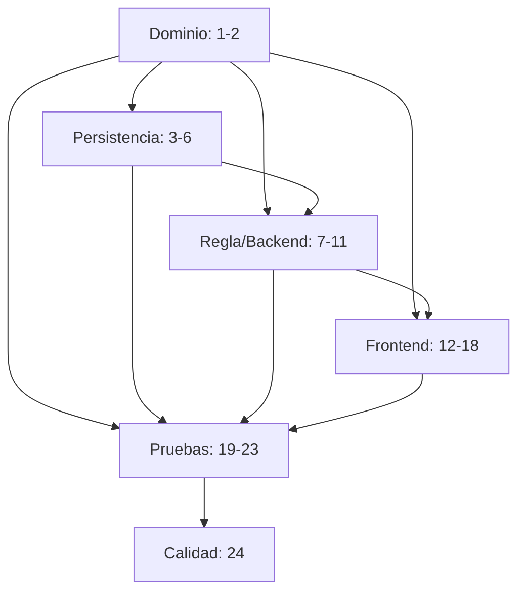

# Implementation Plan: Simulación de movimiento (003-movement-simulation)

**Fase MADA:** CONSTRUIR
**HU cubiertas:** HU-03
**Estado:** Implementado — pendiente de revisión independiente (revisor-qa-seguridad)

## Overview

Plan de implementación de la HU-03. Orden: dominio → persistencia → regla/servicio/backend →
frontend → pruebas → calidad. La decisión vive en el backend (regla pura `decideMovement`
que reutiliza `isCollision` de la spec 001); la UI solo muestra la respuesta de la API.

## Tasks

- [x] 1. Añadir al dominio `@home-guardian/domain` los tipos `RobotStateName`, `Decision`, `RobotSnapshot`, `MoveRequest`, `MoveResult`
  - _Requisitos: RF-02, RF-03, RNF-02_
- [x] 2. Añadir esquemas Zod `pointSchema` y `moveRequestSchema` y exportarlos desde `index.ts`
  - _Requisitos: RNF-01, RF-01.2_
- [x] 3. Crear migración `create_robot_state.sql` (tabla singleton `robot_state` con estado y posición)
  - _Requisitos: RF-02.1, DD-103_
- [x] 4. Crear migración `create_movement_log.sql` (tabla append-only `movement_log`)
  - _Requisitos: RF-05.1, DD-105_
- [x] 5. Implementar `robotRepository` (leer snapshot, actualizar estado/posición) con SQL parametrizado
  - _Requisitos: RF-02.1, RF-03.1, RF-03.2_
- [x] 6. Implementar `movementLogRepository` (solo inserción de decisiones)
  - _Requisitos: RF-05.1_
- [x] 7. (TDD, prueba roja primero) Implementar la regla pura `decideMovement` reutilizando `isCollision` (spec 001): ALLOW, PREVENTIVE_STOP (destino y trayectoria), DENIED_SAFE_STOP
  - _Requisitos: RF-02.2, RF-03.1, RF-03.2, RF-03.3, RNF-06_
- [x] 8. Implementar `movementService`: validar límites del plano (`DESTINATION_OUT_OF_BOUNDS`), leer zonas activas y robot, invocar `decideMovement`, persistir estado y log
  - _Requisitos: RF-01.4, RF-02.3, RF-05.1, DD-107_
- [x] 9. Implementar `simulationController` mapeando decisión → HTTP (200 ALLOW/PREVENTIVE_STOP, 409 DENIED_SAFE_STOP, 422 fuera de plano/payload)
  - _Requisitos: RF-04, DD-101, DD-102_
- [x] 10. Crear `routes/simulationRoutes.ts` (`GET /robot`, `POST /move`, `POST /reset`) y montar en `app.ts`
  - _Requisitos: Contrato de API_
- [x] 11. Implementar `reset` (SAFE_STOP → IDLE conservando posición) como única salida de SAFE_STOP
  - _Requisitos: DD-106_
- [x] 12. Crear `api/client.ts` + `simulationApi` (getRobot, move, reset)
  - _Requisitos: Convención frontend_
- [x] 13. Crear `hooks/useSimulation.ts` con estados de carga/error por operación
  - _Requisitos: RF-04.5_
- [x] 14. Reutilizar `FloorPlan` para capturar destino por clic (viewport→coords de plano) y pintar la posición del robot
  - _Requisitos: RF-01.1, RF-04.4_
- [x] 15. Crear `components/CoordInput.tsx` (destino por coordenadas) produciendo el mismo `Point` que el clic
  - _Requisitos: RF-01.2, RF-01.3, CA-03.7_
- [x] 16. Crear `components/DecisionPanel.tsx` que muestra decisión/estado/razón sin recalcular reglas (parada preventiva + `zoneName`; `SAFE_STOP_ACTIVE`)
  - _Requisitos: RF-04.1, RF-04.2, RF-04.3, CA-03.6_
- [x] 17. Integrar `pages/SimulationPage.tsx` (plano + entrada + panel) y actualizar posición/estado tras cada solicitud
  - _Requisitos: RF-04.4_
- [x] 18. Dejar placeholder reservado de inyección de fallos de sensor / alerta A-04 / prueba T-18 (sin implementar)
  - _Requisitos: Fuera de alcance (reservado)_
- [x] 19. Pruebas unit de `decideMovement`: ALLOW, PREVENTIVE_STOP (destino en zona), PREVENTIVE_STOP (trayectoria cruza), DENIED desde SAFE_STOP, determinismo
  - _Requisitos: CA-03.1, CA-03.2, CA-03.3, CA-03.4, RNF-06_
- [x] 20. Pruebas unit del servicio: 422 DESTINATION_OUT_OF_BOUNDS, persistencia de estado y de `movement_log`
  - _Requisitos: CA-03.5, RF-05.1_
- [x] 21. Pruebas de integración (Supertest): GET /robot, POST /move 200/409/422, POST /reset, registro en movement_log
  - _Requisitos: Contrato de API, CA-03.1..CA-03.5, CA-03.8_
- [x] 22. Pruebas de componentes (RTL): DecisionPanel no recalcula; destino por clic == por coordenadas
  - _Requisitos: CA-03.6, CA-03.7_
- [x] 23. Prueba E2E (Playwright): clic en zona → parada preventiva visible; reset → IDLE
  - _Requisitos: HU-03, CA-03.2, CA-03.4_
- [ ] 24. Calidad: ESLint + Prettier sin errores, cero `any`, sin secretos, pipeline CI verde
  - _Requisitos: RNF-02, Compuerta de oro_
  - Parcial (2026-11-22): ESLint sin errores, typecheck y build OK, cero `any`, sin secretos;
    archivos de la HU formateados con el estilo del repo (comillas simples, 100 columnas).
    **Pendiente:** el repo no tiene configuración de Prettier (`npm run format:check` falla
    en todo el repo con los valores por defecto) ni workflow de GitHub Actions, así que no
    hay "pipeline CI verde" que mostrar.

## Task Dependency Graph



```json
{
  "waves": [
    { "id": 0, "tasks": ["1", "2"] },
    { "id": 1, "tasks": ["3", "4", "5", "6"] },
    { "id": 2, "tasks": ["7", "8", "9", "10", "11"] },
    { "id": 3, "tasks": ["12", "13", "14", "15", "16", "17", "18"] },
    { "id": 4, "tasks": ["19", "20", "21", "22", "23"] },
    { "id": 5, "tasks": ["24"] }
  ]
}
```

## Notes

- TDD obligatorio en `decideMovement` (tarea 7): prueba roja antes de implementar.
- La UI nunca evalúa reglas: solo muestra la respuesta de la API (art. III).
- `movement_log` es append-only (sin UPDATE/DELETE); registro inmutable de decisiones.
- Reservado (no implementar en esta spec): inyección de fallos de sensor, alerta A-04,
  prueba T-18, y estados DEGRADED/RECOVERING.
- Compuerta Fase 3 (CONSTRUIR): todas las tareas completas, cada CA con al menos una prueba,
  revisión del humano antes de pasar a VERIFICAR.

### Trazabilidad CA → tarea
| CA | Tareas |
|----|--------|
| CA-03.1 | 7, 8, 19, 21 |
| CA-03.2 | 7, 16, 19, 21, 23 |
| CA-03.3 | 7, 19, 21 |
| CA-03.4 | 7, 11, 16, 19, 21, 23 |
| CA-03.5 | 8, 20, 21 |
| CA-03.6 | 16, 22 |
| CA-03.7 | 14, 15, 22 |
| CA-03.8 | 6, 8, 21 |
