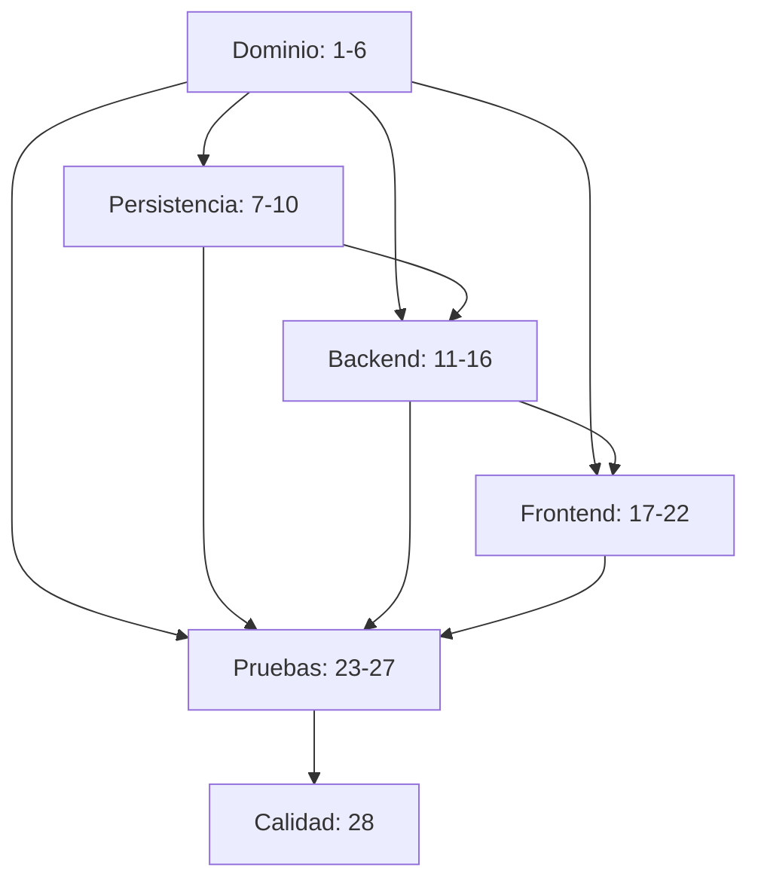

# Implementation Plan: Zonas restringidas (001-restricted-zones)

**Fase MADA:** CONSTRUIR
**HU cubiertas:** HU-01, HU-02
**Estado:** Pendiente de inicio (requiere `requirements.md` y `design.md` aprobados)

## Overview

Plan de implementación de las HU-01 y HU-02. Las tareas van de dominio → persistencia →
backend → frontend → pruebas, con TDD en la geometría. Cada tarea referencia su criterio de
aceptación o requisito del `requirements.md`.

## Tasks

- [ ] 1. Definir tipos del dominio `Zone`, `ZoneInput`, `Point`, `Segment`, `AABB` en `@home-guardian/domain`
  - _Requisitos: RF-02, DD-004_
- [ ] 2. Definir constantes `FLOOR_WIDTH=1000`, `FLOOR_HEIGHT=800` y leer `ROBOT_RADIUS` y `SAFETY_MARGIN` de variables de entorno con default `0`; derivar `COLLISION_PAD = r + m`
  - _Requisitos: Modelo geométrico, DD-008_
- [ ] 3. (TDD, prueba roja primero) Implementar `expandZone` y `pointInAABB` con borde inclusivo
  - _Requisitos: DD-001, DD-003_
- [ ] 4. (TDD) Implementar `segmentIntersectsAABB` (Liang-Barsky) con manejo de segmento degenerado (origen==destino)
  - _Requisitos: DD-002, B4, B9_
- [ ] 5. Implementar `isCollision(zone, segment, pad?)` que devuelve `{ collides, type }` con `type ∈ {ORIGIN_IN_RESTRICTED_ZONE, RESTRICTED_ZONE_VIOLATION, TRAJECTORY_CROSSES_ZONE} | null`; `pad` opcional (default `COLLISION_PAD`) para fijar `r+m` sin depender del entorno
  - _Requisitos: Modelo geométrico (4 reglas), DD-009_
- [ ] 6. Definir esquemas Zod `createZoneSchema`, `updateZoneSchema`, `listZoneQuerySchema` y exportar todo desde `index.ts`
  - _Requisitos: RNF-01, DD-007_
- [ ] 7. Crear `db/connection.ts` (instancia única `better-sqlite3`)
  - _Requisitos: RF-04.1, DD-005_
- [ ] 8. Crear `migrations/001_create_zones.sql` (tabla `zones` con `name UNIQUE`)
  - _Requisitos: RF-04.2, DD-006_
- [ ] 9. Crear `db/migrate.ts`: tabla `schema_migrations`, aplica pendientes en transacción, orden lexicográfico
  - _Requisitos: RF-04.2_
- [ ] 10. Implementar `zoneRepository` (`create`, `findById`, `findAll(filter)`, `update`, `delete`, `existsByName`) con mapeo `0|1`↔`boolean`
  - _Requisitos: RF-02.5, RF-04.1_
- [ ] 11. Crear `AppError` y fábricas (`ZONE_NOT_FOUND`, `ZONE_NAME_DUPLICATE`, `INVALID_ZONE_DIMENSIONS`, `ZONE_OUT_OF_BOUNDS`)
  - _Requisitos: Catálogo de errores_
- [ ] 12. Crear `middlewares/validate.ts` (Zod → 422) y `middlewares/errorHandler.ts` (AppError → `{code,message}`, 500 sin stack trace)
  - _Requisitos: RNF-04, RNF-05_
- [ ] 13. Implementar `zoneService` con inyección del repositorio: `assertDimensions`, `assertWithinFloor`, unicidad de nombre y CRUD
  - _Requisitos: RF-03, CA-02.2, CA-02.3, CA-02.4, DD-007_
- [ ] 14. Implementar `zoneController` (solo recibe/responde, delega al servicio)
  - _Requisitos: SOLID-S_
- [ ] 15. Crear `routes/zoneRoutes.ts` (`POST/GET/GET:id/PUT/DELETE /api/zones`) y montar en `app.ts`
  - _Requisitos: Contrato de API_
- [ ] 16. Cablear filtro `active` (por defecto activas, `all`, `false`)
  - _Requisitos: RF-02.5, CA-02.8_
- [ ] 17. Crear `api/client.ts` + `zonesApi` (list/get/create/update/remove)
  - _Requisitos: Convención frontend_
- [ ] 18. Crear `hooks/useZones.ts` con estados de carga/error por operación
  - _Requisitos: RNF frontend_
- [ ] 19. Crear `components/FloorPlan.tsx`: plano a escala `1000×800`, cuadrícula, origen arriba-izquierda, solo zonas activas destacadas
  - _Requisitos: CA-01.1, CA-01.2, RF-01_
- [ ] 20. Crear `components/ZoneForm.tsx` (alta/edición con validación visual)
  - _Requisitos: RF-02.1, RF-02.2_
- [ ] 21. Crear `components/ZoneList.tsx` (listar, activar/desactivar, eliminar)
  - _Requisitos: RF-02.3, RF-02.4, CA-02.6, CA-02.7_
- [ ] 22. Integrar `pages/RoomsPage.tsx` (plano + formulario + lista) y refrescar el plano tras cada mutación
  - _Requisitos: RF-01.4_
- [ ] 23. Pruebas unit de geometría: B1–B9 sobre Z1=(100,100,200,150) **fijando `pad=30` (r=20, m=10) explícitamente**, verificando `collides` y el `type` correcto; más `expandZone`/`pointInAABB`
  - _Requisitos: Escenarios de borde, DD-008, DD-009_
- [ ] 24. Pruebas unit del servicio: 422 dimensiones, 422 fuera de plano, 409 duplicado, filtro active
  - _Requisitos: CA-02.2, CA-02.3, CA-02.4, CA-02.8_
- [ ] 25. Pruebas de integración (Supertest): POST 201/409/422, GET lista+filtro, GET:id 200/404, PUT 200/404/409/422, DELETE 204/404
  - _Requisitos: Contrato de API_
- [ ] 26. Pruebas de componentes (RTL): ZoneForm validación, ZoneList activar/eliminar
  - _Requisitos: CA-02.5, CA-02.6, CA-02.7_
- [ ] 27. Prueba E2E (Playwright): plano con cuadrícula + crear zona + verla destacada
  - _Requisitos: HU-01, HU-02_
- [ ] 28. Calidad: ESLint + Prettier sin errores, cero `any`, sin secretos (`git grep -i password`), `.env` en `.gitignore`, pipeline CI verde
  - _Requisitos: RNF-02, Compuerta de oro_

## Task Dependency Graph



```json
{
  "waves": [
    { "id": 0, "tasks": ["1", "2", "3", "4", "5", "6"] },
    { "id": 1, "tasks": ["7", "8", "9", "10"] },
    { "id": 2, "tasks": ["11", "12", "13", "14", "15", "16"] },
    { "id": 3, "tasks": ["17", "18", "19", "20", "21", "22"] },
    { "id": 4, "tasks": ["23", "24", "25", "26", "27"] },
    { "id": 5, "tasks": ["28"] }
  ]
}
```

## Notes

- TDD obligatorio en la geometría (tareas 3 y 4): prueba roja antes de implementar.
- Consultas SQL siempre parametrizadas; base `:memory:` en pruebas.
- No implementar HU-06 a HU-10; esta spec es línea base.
- Compuerta Fase 3 (CONSTRUIR): todas las tareas completas, cada CA con al menos una prueba,
  y revisión del humano antes de pasar a VERIFICAR.

### Trazabilidad CA → tarea
| CA | Tareas |
|----|--------|
| CA-01.1 / CA-01.2 | 19, 27 |
| CA-02.1 | 10, 13, 15, 25 |
| CA-02.2 | 13, 24, 25 |
| CA-02.3 | 13, 24 |
| CA-02.4 | 13, 24 |
| CA-02.5 | 13, 20, 26 |
| CA-02.6 | 16, 21, 26 |
| CA-02.7 | 14, 21, 25, 26 |
| CA-02.8 | 16, 24 |
| B1-B9 | 3, 4, 5, 23 |
