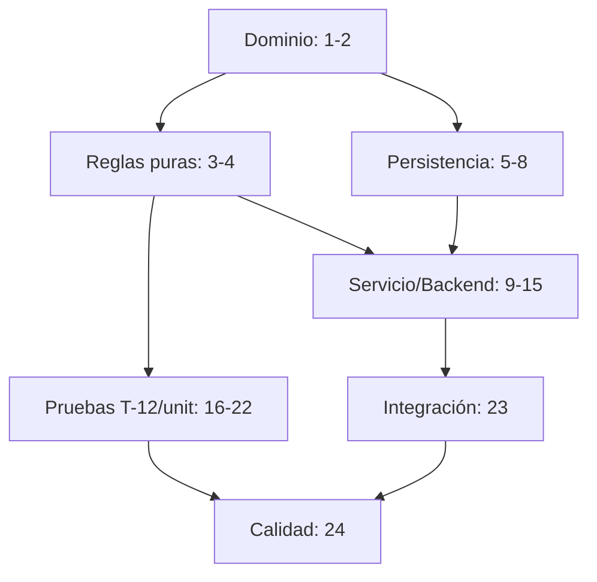

# Implementation Plan: Vigilante de seguridad (002-safety-guardian)

**Fase MADA:** CONSTRUIR
**HU cubiertas:** HU-04, HU-05
**Estado:** Pendiente de inicio (requiere `requirements.md` y `design.md` aprobados)

## Overview

Plan de implementación del vigilante (HU-04, HU-05). Orden: dominio → reglas puras (TDD) →
persistencia → servicio/backend → reinicio seguro → pruebas (T-12) → calidad. La geometría se
reutiliza de la spec 001; la UI la cubre la spec 003.

## Tasks

- [ ] 1. Añadir al dominio `RobotStateName`, `PositionQuality`, `DecisionCode`, `GuardianInput`, `GuardianDecision` en `@home-guardian/domain`
  - _Requisitos: 1, 2, 7.1_
- [ ] 2. Añadir esquema Zod `moveSchema` (destino) y exportarlo desde `index.ts`
  - _Requisitos: 7.1_
- [ ] 3. (TDD, prueba roja primero) Implementar `rules/stateMachine.ts` con la tabla de transiciones y las prohibiciones P-1 (SAFE_STOP y DEGRADED → MOVING) y P-2 (datos no confiables → MOVING)
  - _Requisitos: 3.4, 3.5_
- [ ] 4. (TDD) Implementar `rules/guardian.ts` `evaluateMovement` con el orden estricto estado → UNRELIABLE → MISSING → repo caído → origen → destino → trayectoria → AUTHORIZED, reutilizando `isCollision` (spec 001)
  - _Requisitos: 1.1, 1.2, 1.3, 1.4, 1.5, 1.6, 2.1, 2.2, 2.3, 2.4, 2.5, 7.3_
- [ ] 5. Crear migraciones `create_incidents.sql` (append-only con `zones_snapshot`) y `create_audit_log.sql` (append-only para rechazos por estado)
  - _Requisitos: 5.1, 5.3, 5.4_
- [ ] 6. Crear migración `add_position_quality.sql` (`ALTER TABLE robot_state ADD position_quality`)
  - _Requisitos: 6.1_
- [ ] 7. Implementar `incidentRepository` (solo inserción y listado)
  - _Requisitos: 5.2, 5.4_
- [ ] 8. Extender `robotRepository` para leer/actualizar estado, posición y `positionQuality`
  - _Requisitos: 2.1, 3.1, 4.1_
- [ ] 9. Implementar `guardianService`: leer snapshot, cargar zonas (fallo → null), invocar `evaluateMovement`, aplicar transición, persistir estado, registrar evaluación con snapshot de zonas
  - _Requisitos: 2.4, 3.1, 3.2, 5.1_
- [ ] 10. En `guardianService`, crear incidente solo en denegación que para; en rechazo por estado (`SAFE_STOP_ACTIVE`/`BUSY`) no crear incidente pero registrar el rechazo en el log de auditoría
  - _Requisitos: 5.2, 5.3_
- [ ] 11. Implementar recuperación (`recover`): exigir estado en parada, posición segura y datos confiables → RECOVERING → IDLE; si no, rechazar sin efectos
  - _Requisitos: 4.1, 4.2, 4.3_
- [ ] 12. Implementar `db/bootstrap.ts` (reinicio seguro ADR-10): `positionQuality=MISSING` y `MOVING` persistido → `SAFE_STOP`
  - _Requisitos: 6.1, 6.2_
- [ ] 13. Implementar `robotController` (state, move, recover) mapeando decisión → HTTP (200 AUTHORIZED/DENIED, 409 REJECTED, 422 payload)
  - _Requisitos: 1.5, 3.3, 7.2_
- [ ] 14. Implementar `incidentController` y `GET /api/incidents`
  - _Requisitos: 5.1_
- [ ] 15. Crear `routes/robotRoutes.ts` (`/api/robot/state|move|recover`) y `routes/incidentRoutes.ts` (`/api/incidents`); montar en `app.ts` y ejecutar bootstrap al arrancar
  - _Requisitos: Contrato de API, 6.1_
- [ ] 16. Pruebas T-12 grupo A (9): destino dentro/fuera/borde → RESTRICTED_ZONE_VIOLATION / AUTHORIZED
  - _Requisitos: 1.3, 7.4_
- [ ] 17. Pruebas T-12 grupo B (5): trayectoria cruza/tangente/no cruza → TRAJECTORY_CROSSES_ZONE / AUTHORIZED
  - _Requisitos: 1.4, 7.4_
- [ ] 18. Pruebas T-12 grupo C (3): sin zonas activas → siempre AUTHORIZED
  - _Requisitos: 1.5, 7.4_
- [ ] 19. Pruebas T-12 grupo D (5): radio `r=10`; y grupo E (3): margen `m=5`
  - _Requisitos: 1.1, 7.4_
- [ ] 20. Pruebas T-12 grupo F (2): `UNRELIABLE` → INSUFFICIENT_DATA, `MISSING` → MISSING_POSITION; y grupo G (1): repositorio caído → ZONE_DATA_UNAVAILABLE
  - _Requisitos: 2.2, 2.3, 2.4, 7.4_
- [ ] 21. Pruebas unit de transiciones prohibidas (P-1 SAFE_STOP→MOVING; P-2 datos no confiables→MOVING) y origen en zona → ORIGIN_IN_RESTRICTED_ZONE
  - _Requisitos: 1.2, 3.4, 3.5_
- [ ] 22. Pruebas unit del servicio: registro siempre, incidente solo en denegación, rechazo sin incidente, recover válido/ inválido, bootstrap ADR-10
  - _Requisitos: 4.1, 4.2, 5.2, 5.3, 6.1, 6.2_
- [ ] 23. Pruebas de integración (Supertest): `/api/robot/state|move|recover` (200/409/422) y `/api/incidents` (append-only)
  - _Requisitos: Contrato de API, 3.3, 5.1_
- [ ] 24. Calidad: ESLint + Prettier sin errores, cero `any`, sin secretos, T-12 verde sin frontend ni BD real, pipeline CI verde
  - _Requisitos: 7.2, 7.3, 7.4_

## Task Dependency Graph



```json
{
  "waves": [
    { "id": 0, "tasks": ["1", "2"] },
    { "id": 1, "tasks": ["3", "4"] },
    { "id": 2, "tasks": ["5", "6", "7", "8"] },
    { "id": 3, "tasks": ["9", "10", "11", "12", "13", "14", "15"] },
    { "id": 4, "tasks": ["16", "17", "18", "19", "20", "21", "22"] },
    { "id": 5, "tasks": ["23"] },
    { "id": 6, "tasks": ["24"] }
  ]
}
```

## Notes

- TDD obligatorio en las reglas puras (tareas 3 y 4): prueba roja antes de implementar.
- `evaluateMovement` reutiliza `isCollision` de la spec 001; no recalcular geometría.
- `incidents` es append-only (sin UPDATE/DELETE); incluye snapshot de zonas por decisión.
- T-12 (28 escenarios) debe correr con dobles de repositorio, sin frontend ni BD real.
- La UI del vigilante la cubre la spec `003-movement-simulation`.
- Compuerta Fase 3 (CONSTRUIR): todas las tareas completas, cada criterio con al menos una
  prueba, revisión del humano antes de pasar a VERIFICAR.

### Trazabilidad requisito → tarea (resumen)
| Requisito | Tareas |
|-----------|--------|
| R1 (geometría) | 4, 16, 17, 18, 19, 21 |
| R2 (orden/datos) | 4, 20 |
| R3 (parada/prohibidas) | 3, 9, 13, 21 |
| R4 (recuperación) | 11, 22 |
| R5 (incidentes) | 7, 9, 10, 14, 23 |
| R6 (reinicio seguro) | 6, 12, 22 |
| R7 (RNF/T-12) | 2, 4, 13, 16-20, 24 |
